# Nomad Analyst — Current Architecture Map

**Status:** Updated & Authoritative as of Phase 22 (Post-Phase 22A/B/C/D)  
**Date:** October 19, 2026  
**Primary Comprehensive Specification:** [`docs/architecture/SYSTEM_ARCHITECTURE.md`](file:///Users/shivamsingh/personal/nomad-analyst/docs/architecture/SYSTEM_ARCHITECTURE.md)  
**Technology Stack & OSS Registry:** [`docs/architecture/TECHNOLOGY_STACK.md`](file:///Users/shivamsingh/personal/nomad-analyst/docs/architecture/TECHNOLOGY_STACK.md)  
**REST API Architecture:** [`docs/backend/API_ARCHITECTURE.md`](file:///Users/shivamsingh/personal/nomad-analyst/docs/backend/API_ARCHITECTURE.md)  
**Frontend Architecture:** [`docs/frontend/FE_ARCHITECTURE.md`](file:///Users/shivamsingh/personal/nomad-analyst/docs/frontend/FE_ARCHITECTURE.md)  

---

## 1. Top-Level Architectural Diagram

The Nomad Analyst platform operates as a modular monolith applying Clean Architecture principles. It decouples high-throughput market data ingestion and quantitative strategy execution from user presentation and optional AI research synthesis.

```mermaid
graph TD
    %% Clients & Presentation
    Client["React 19 Frontend (Vite)"] <--> Daphne["Daphne ASGI Server"]
    Daphne <--> WS["chat/consumers.py (WebSockets)"]
    Daphne <--> API["Django REST APIs (/api/v1/...)"]

    %% Databases & Queues
    subgraph Storage & Queue Layer
        DB_Default[("PostgreSQL 16 default DB<br>(nomad_analyst)")]
        DB_Telemetry[("SQLite telemetry DB<br>(llm_telemetry.sqlite3)")]
        Redis_Queue[("Redis DB 0<br>(Celery Broker & Channels Layer)")]
        Redis_Cache[("Redis DB 1<br>(Distributed Locks & Cache)")]
    end

    %% Modules & Apps
    subgraph market ["Market App (Cash Equity & Quant Engine)"]
        M_TICKER["run_intraday_ticker.py"]
        M_KITE["KiteTickerService & KiteHistoricalService"]
        M_AGG["IntradayAggregator (1m/5m/15m OHLCV)"]
        M_OPP["IntradayOpportunityEngine (8-Factor)"]
        M_CTX["MarketContextService (Breadth & Regime)"]
    end

    subgraph fno ["F&O App (Derivatives Engine & Paper Trading)"]
        F_CONSUMER["FnoTickerConsumer (Multi-Token Options)"]
        F_AGG["OptionBarAggregator (1m OHLCV)"]
        F_QUOTE["OptionQuoteManager (Depth Snapshots)"]
        F_GREEKS["GreeksEngine (Black-76 IV & Greeks)"]
        F_UNIV["DesiredUniverseService (ATM ± Strikes)"]
        F_PAPER["PaperEngine & FeeCalculator"]
    end

    subgraph research ["Research App (Grounded AI Intelligence)"]
        R_BUILDER["ResearchEvidencePackageBuilder (SHA-256)"]
        R_RUNS[("ResearchRun & Evidence")]
        R_REPORTS[("ResearchReport Synthesis")]
    end

    subgraph llm ["LLM App (AI Gateway & Telemetry)"]
        ROUTER["llm/router.py (IntelligentRouter)"]
        EXEC["llm/tools/executor.py (ToolExecutor)"]
        REG["llm/tools/registry.py (Registry)"]
    end

    subgraph chat ["Chat App (State & Orchestration)"]
        GRAPH["chat/agents/v2_graph.py (LangGraph)"]
        SAVER["chat/agents/checkpoint_saver.py"]
    end

    %% Connections
    M_TICKER --> M_KITE
    M_TICKER --> F_CONSUMER
    M_KITE --> M_AGG
    F_CONSUMER --> F_AGG
    F_CONSUMER --> F_QUOTE
    F_CONSUMER --> F_UNIV

    M_AGG --> DB_Default
    F_AGG --> DB_Default
    F_QUOTE --> DB_Default
    F_GREEKS --> F_PAPER
    F_PAPER --> DB_Default

    API <--> DB_Default
    WS <--> Redis_Queue
    WS <--> GRAPH
    SAVER <--> DB_Default

    R_BUILDER --> DB_Default
    R_BUILDER --> ROUTER
    ROUTER <--> DB_Telemetry

    Redis_Cache -->|Distributed Locks| M_TICKER
```

---

## 2. Component Classifications & Current Status

### [EXISTING & OPERATIONAL]
* **Dual-Database Architecture:** PostgreSQL 16 (`nomad_analyst`) for 40 domain models and SQLite (`llm_telemetry.sqlite3`) for high-frequency LLM prompt telemetry via `LLMTelemetryRouter`.
* **Equity Market Data Ingestion:** Zerodha Kite WebSocket ticker daemon (`market/management/commands/run_intraday_ticker.py`), multi-timeframe candle aggregator (1m, 5m, 15m), and Yahoo Finance EOD historical data provider.
* **Deterministic 8-Factor Intraday Scoring Engine:** Evaluates Momentum, Relative Strength, Volume (RVOL), VWAP alignment, Market regime, Sector trend, ORB, and Data Quality without LLM involvement.
* **F&O Options Ingestion & Aggregation (`fno` app):**
  - Multi-token WebSocket subscription via `FnoTickerConsumer`.
  - Dynamic ATM strike universe resolution via `DesiredUniverseService`.
  - 1-minute option bar aggregation with compound unique idempotency (`OptionBarAggregator`).
  - High-frequency order book depth snapshots with exchange latency tracking (`OptionQuoteManager`).
* **Quantitative Derivatives Engine:**
  - Black-76 Implied Volatility and Greeks (`Delta`, `Gamma`, `Theta`, `Vega`, `Rho`) via `GreeksEngine`.
  - Option chain analytics: PCR (Volume/OI), Max Pain, ATM IV via `OptionChainFeatureEngine`.
  - Full Indian statutory transaction cost model (STT, Exchange Turnover, GST, SEBI, Stamp Duty) via `FeeCalculator`.
  - Paper trading execution engine and ledger (`PaperEngine`, `PaperTradeLedger`).
* **Zero-LLM Research Engine:** Deterministic evidence assembly with SHA-256 deduplication hashes, single-shot grounded LLM synthesis via `IntelligentRouter`.
* **Celery Background Schedule:** 10 registered background tasks protected by distributed Redis locks in Redis DB 1.
* **Frontend Terminal:** React 19 + TypeScript + Vite 6 + TradingView Lightweight Charts + Custom Vanilla CSS design tokens.

### [PENDING LIVE VALIDATION]
* **Monday Live-Session Acceptance Checks:** Live verification of `--enable-fno` tick throughput and order execution under real NSE market hours (refer to [`docs/audits/phase_22a_monday_runbook.md`](file:///Users/shivamsingh/personal/nomad-analyst/docs/audits/phase_22a_monday_runbook.md)).

---

## 3. Comprehensive Reference Documentation

For detailed schema definitions, mathematical formulas, and service workflows, refer to the authoritative architecture documents:
* **System Architecture:** [`docs/architecture/SYSTEM_ARCHITECTURE.md`](file:///Users/shivamsingh/personal/nomad-analyst/docs/architecture/SYSTEM_ARCHITECTURE.md)
* **REST API Specification:** [`docs/backend/API_ARCHITECTURE.md`](file:///Users/shivamsingh/personal/nomad-analyst/docs/backend/API_ARCHITECTURE.md)
* **Frontend Architecture:** [`docs/frontend/FE_ARCHITECTURE.md`](file:///Users/shivamsingh/personal/nomad-analyst/docs/frontend/FE_ARCHITECTURE.md)
* **Technology Stack Registry:** [`docs/architecture/TECHNOLOGY_STACK.md`](file:///Users/shivamsingh/personal/nomad-analyst/docs/architecture/TECHNOLOGY_STACK.md)
* **F&O Implementation Report:** [`docs/audits/phase_22b_to_22d_implementation_report.md`](file:///Users/shivamsingh/personal/nomad-analyst/docs/audits/phase_22b_to_22d_implementation_report.md)
