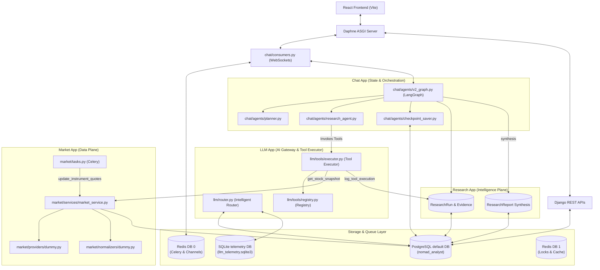

# Nomad Analyst — Current Architecture Map

This document establishes the authoritative architectural map of the **Nomad Analyst Platform** as of the completion of Module 0. It details the existing system components, boundaries, and data flows, distinguishing between what currently exists, what is planned, and what is missing.

---

## 1. Top-Level Architectural Diagram

The system operates as a modular monolith application built on top of Django, Daphne (ASGI), Celery, Redis, PostgreSQL, and SQLite.

---

## 2. Component Classifications

### [EXISTING]
*   **Django Application Boundaries**: `config` (settings), `llm` (AI router/gateway), `chat` (WS consumer, checkpoint saver, LangGraph state-machine), `market` (catalog, providers, and quote updates), `research` (evidence and report synthesis).
*   **Intelligent Router (`llm.router.IntelligentRouter`)**: Multi-provider LLM gateway supporting model lockups, complexity-tier routing (Groq, Gemini, Ollama, OpenRouter, Cerebras), and health check cooldown backoffs.
*   **Tool Execution Framework (`llm.tools.executor.ToolExecutor`)**: Enforces generic input schema validation (via Pydantic), permission checks, credentials redaction, latency tracking, and execution logging.
*   **Django Checkpoint Saver (`chat.agents.checkpoint_saver.DjangoCheckpointSaver`)**: Custom LangGraph checkpointer storing state bytes natively in PostgreSQL.
*   **Telemetry Router (`llm.routers.LLMTelemetryRouter`)**: Multi-DB router separating transient prompt execution logs (SQLite) from operational states (PostgreSQL).
*   **Stateful WebSocket Streaming (`chat.consumers.ChatConsumer`)**: Real-time communication of token stream logs and JSON state variables.
*   **Atomic Redis Lock Controls**: Redis DB 1 cache lock wrappers preventing Celery Beat from dispatching concurrent tasks.
*   **Dummy Ingestion Layer**: `DummyMarketProvider` and `DummyNormalizer` to populate stock quotes.

### [PLANNED]
*   **Real Market Data Adapters**: API integrations targeting actual Indian market data vendors (YFinance, AlphaVantage, or NSE scraper interfaces).
*   **Technical Indicator Engines**: Modules to calculate MACD, RSI, EMA, Bollinger Bands, and support/resistance levels.
*   **Corporate Document Parsing (OCR/Ingestion)**: Extraction of financial sheets from company PDF reports or BSE filings.
*   **Intraday Signal Generators**: Engines to trigger buy/sell signals based on real-time order-book or volume spikes.

### [MISSING]
*   **Decision Plane Models**: Database models for `Strategy`, `Signal`, `RiskProfile`, `Recommendation`, and `OutcomeTracker`.
*   **Quantitative Backtesting Engine**: Backtesting framework mapping historical market snapshots to trade signals.
*   **Risk Management Layer**: Position sizing, stop-loss calculations, and sector exposure limits.

---

## 3. Module & App Boundaries

*   **`config/`**: System entrypoint (settings, urls, ASGI, WSGI, celery setup).
*   **`llm/`**: Pure LLM utilities, vendor abstractions, prompt database, and tool execution boundaries. Does not know about market or chat contexts directly.
*   **`chat/`**: Conversational interface, agent graphs, memory stores, and user profile registries.
*   **`market/`**: Data plane catalog (`Company`, `Instrument`, `MarketSnapshot`) and quote updates.
*   **`research/`**: Intelligence plane logs (`ResearchRun`, `Evidence`, `ResearchReport`).

---

## 4. Multi-Database Layout

*   **PostgreSQL (`nomad_analyst`)**: Default database. Houses all model schemas except `PromptRun`.
*   **SQLite (`llm_telemetry.sqlite3`)**: Telemetry database. Managed via the custom `LLMTelemetryRouter`. Hosts only the `PromptRun` table.

---

## 5. Async & Queues Layout

*   **Redis DB 0 (`redis://127.0.0.1:6379/0`)**: Celery Broker, result backend, and Channels WebSockets layers.
*   **Redis DB 1 (`redis://127.0.0.1:6379/1`)**: Standard Django cache and distributed task locks (`lock:run_agent_task:*`).
*   **Celery Beat**: Database-backed periodic task scheduler (`django-celery-beat`).
