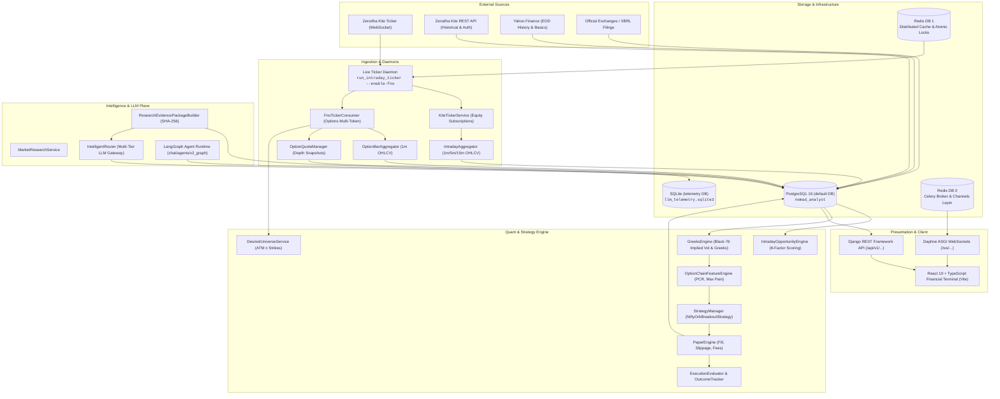

# Nomad Analyst — System Architecture & Technical Specification

**Platform:** Nomad Analyst (Indian Stock Market Intelligence & Quantitative Execution Engine)  
**Version:** Production Specification (Post-Phase 22A/B/C/D)  
**Date:** October 19, 2026  
**Status:** Authoritative Architecture Reference  
**Repository:** `nomad-analyst`  

---

## 1. Executive Summary & Core Principles

Nomad Analyst is an institutional-grade stock market intelligence, quant strategy, and real-time execution platform tailored for Indian equities (NSE/BSE) and equity derivatives (NFO Options & Futures).

The system is built as a **Clean-Architecture Modular Monolith** with decoupling between:
1. **Deterministic Data & Math Plane** (Market ingestion, multi-timeframe candle rollups, Greeks engine, 8-factor scoring, outcome evaluator).
2. **Derivatives & Strategy Plane** (F&O universe discovery, depth quote snapshots, paper trading engine, fee & slippage calculation).
3. **Intelligence & Evidence Plane** (Zero-LLM default principle: deterministic evidence packaging with SHA-256 hash deduplication, followed by optional single-shot grounded LLM synthesis).
4. **Presentation & Real-Time Plane** (REST API presentation boundaries and Django Channels WebSockets connected to a React 19 financial terminal).

### Non-Negotiable Engineering Guardrails
* **Zero-LLM Default Principle:** All scanners, indicator calculations, universe rankings, opportunity detections, risk parameters, and paper execution run with **0 LLM calls**. LLMs are only invoked when the human explicitly clicks "Examine" or requests a synthesis report.
* **Point-in-Time (PIT) Rigor:** Every historical metric, backtest step, and indicator calculation accepts an explicit `as_of` timestamp. Future data leaks are strictly prevented by database filtering constraints.
* **Market-Data Isolation:** Equity cash markets and F&O derivatives data pipelines remain logically separated at ingestion, persistence, and evaluation to prevent cross-instrument data contamination.
* **Strict Idempotency:** All ingestion aggregators (OHLCV candles and depth quotes) persist via compound unique constraints and atomic bulk upserts (`update_conflicts=True`).

---

## 2. High-Level System Architecture Diagram



---

## 3. Database Configuration & Multi-Database Routing

Nomad Analyst isolates analytical application data from high-volume AI telemetry through multi-database routing declared in [`config/settings.py`](file:///Users/shivamsingh/personal/nomad-analyst/config/settings.py) and enforced by [`llm/routers.py`](file:///Users/shivamsingh/personal/nomad-analyst/llm/routers.py).

### 3.1 Multi-Database Topology

| Database Key | Engine | Storage Target | Primary Purpose |
|---|---|---|---|
| `default` | `django.db.backends.postgresql` | `nomad_analyst` (Port 5432) | Core operational domain: Companies, instruments, OHLCV bars, F&O options, paper trades, user sessions, signals, recommendations. |
| `telemetry` | `django.db.backends.sqlite3` | `llm_telemetry.sqlite3` | High-frequency AI prompt runs, raw LLM token counts, cost logs, response latencies, and execution telemetry. |

### 3.2 Intelligent Database Router (`LLMTelemetryRouter`)

```python
# llm/routers.py
class LLMTelemetryRouter:
    """
    Directs LLM prompt telemetry models to 'telemetry' SQLite database
    and all core market, F&O, chat, and research models to 'default' PostgreSQL.
    """
    route_app_labels = {'llm'}

    def db_for_read(self, model, **hints):
        if model._meta.model_name == 'promptrun':
            return 'telemetry'
        return 'default'

    def db_for_write(self, model, **hints):
        if model._meta.model_name == 'promptrun':
            return 'telemetry'
        return 'default'

    def allow_relation(self, obj1, obj2, **hints):
        # Prevents foreign key joins across the PostgreSQL and SQLite boundaries
        db_set = {obj1._state.db, obj2._state.db}
        if 'default' in db_set and 'telemetry' in db_set:
            return False
        return True

    def allow_migrate(self, db, app_label, model_name=None, **hints):
        if model_name == 'promptrun':
            return db == 'telemetry'
        if db == 'telemetry':
            return False
        return db == 'default'
```

### 3.3 Redis Caching & Queuing Topology
* **Redis DB 0 (`redis://127.0.0.1:6379/0`)**:
  - Celery Message Broker & Result Backend (`CELERY_BROKER_URL`).
  - ASGI Channel Layer for WebSocket streaming (`channels_redis.core.RedisChannelLayer`).
* **Redis DB 1 (`redis://127.0.0.1:6379/1`)**:
  - Django Cache Backend (`django.core.cache.backends.redis.RedisCache`).
  - Distributed Process Locks (`SETNX` via `cache.add`) to ensure Celery Beat schedules and daemon commands never run concurrent duplicate loops.

---

## 4. Complete Application & Model Architecture (40 Domain Models)

The backend comprises 5 custom domain applications containing **40 models**:

```
nomad-analyst/
├── market/       (23 Models) - Equity data foundation, technical indicators, fundamental models, context & intraday scoring
├── fno/          (3 Models)  - F&O option bars, depth quote snapshots, paper trading ledger
├── research/     (3 Models)  - Research runs, SHA-256 evidence packages, synthesized reports
├── llm/          (3 Models)  - Prompt templates, telemetry runs, agent configurations
└── chat/         (8 Models)  - User profiles, conversations, messages, agent runs, LangGraph state checkpoints
```

### 4.1 `market` Application (23 Models)

1. **`Company`** (`market_company`): Master corporate entity (NSE symbol, ISIN, sector, industry, corporate website).
2. **`Instrument`** (`market_instrument`): Tradeable exchange contract (Equity, Index, lot size, exchange identifier).
3. **`MarketSnapshot`** (`market_marketsnapshot`): Point-in-time EOD/interval price snapshot (open, high, low, close, volume, previous close, change pct).
4. **`OHLCVBar`** (`market_ohlcvbar`): Multi-timeframe equity candle rollups (`1m`, `5m`, `15m`, `1d`) with compound uniqueness on `(instrument, timeframe, timestamp)`.
5. **`TechnicalFeature`** (`market_technicalfeature`): Point-in-time quant indicators (SMA, EMA, RSI, MACD, Bollinger Bands, ATR) indexed on `(instrument, timeframe, timestamp, param_key)`.
6. **`RawFundamentalData`** (`market_rawfundamentaldata`): Raw financial statement payloads retrieved from corporate filings or YFinance.
7. **`IncomeStatement`** (`market_incomestatement`): Normalized annual and quarterly P&L metrics (revenue, expenses, EBITDA, EBIT, net income, EPS).
8. **`BalanceSheetStatement`** (`market_balancesheetstatement`): Normalized assets, liabilities, equity capital, reserves, and borrowings.
9. **`CashFlowStatement`** (`market_cashflowstatement`): Operating, investing, financing, and free cash flow statement rollups.
10. **`DerivedFundamentalMetric`** (`market_derivedfundamentalmetric`): Computed financial ratios (P/E, P/B, ROE, ROCE, Debt/Equity, Current Ratio).
11. **`CorporateEvent`** (`market_corporateevent`): Corporate actions, dividend announcements, board meetings, ex-dates.
12. **`NewsItem`** (`market_newsitem`): Ingested market news stories with headline, summary, publisher source, and event type.
13. **`CorporateDisclosure`** (`market_corporatedisclosure`): Official regulatory filings submitted to NSE/BSE with SHA-256 content hashes.
14. **`MarketContextSnapshot`** (`market_marketcontextsnapshot`): Macro-level market regime (TRENDING_UP, TRENDING_DOWN, RANGING, VOLATILE), breadth advance/decline ratios, NIFTY & BANKNIFTY returns.
15. **`StockIntradayContext`** (`market_stockintradaycontext`): Real-time intraday metrics per equity (VWAP distance, RVOL, 5m/15m/30m momentum, relative strength vs sector).
16. **`Universe`** (`market_universe`): Named constituent portfolios (e.g., `NIFTY_50`, `NIFTY_BANK`, `FNO_STOCKS`).
17. **`UniverseMembership`** (`market_universemembership`): Active time-bound mappings linking instruments to named universes.
18. **`StockOpportunitySnapshot`** (`market_stockopportunitysnapshot`): Point-in-time swing/delivery opportunities evaluated across 6 dimensions.
19. **`StockRecommendation`** (`market_stockrecommendation`): Actionable entry/stop-loss/target setups with deterministic setup types.
20. **`RecommendationOutcome`** (`market_recommendationoutcome`): Walk-forward outcome tracking capturing actual fill price, exit reason, and net P&L.
21. **`BacktestRun`** (`market_backtestrun`): Configuration and summary results for walk-forward historical simulation runs.
22. **`KiteCredential`** (`market_kitecredential`): Encrypted OAuth access token, user session, request token, and expiry tracker for Zerodha Kite.
23. **`IntradayOpportunitySnapshot`** (`market_intradayopportunitysnapshot`): Live 8-factor ranked intraday score per stock (momentum, RS, volume, VWAP, market, sector, ORB, data quality).

---

### 4.2 `fno` Application (3 Models)

1. **`OptionOHLCVBar`** (`fno_option_ohlcvbar`):
   - Stores 1-minute historical and live candle rollups for NFO derivative contracts.
   - **Fields:** `instrument_token`, `tradingsymbol`, `underlying_symbol` (`NIFTY`/`BANKNIFTY`), `option_type` (`CE`/`PE`), `strike_price`, `expiry_date`, `timeframe`, `timestamp`, `open`, `high`, `low`, `close`, `volume`, `open_interest`, `oi_status`, `is_partial_bar`.
   - **Idempotency Constraint:** Unique constraint on `['instrument_token', 'timeframe', 'timestamp']`.
2. **`OptionQuoteSnapshot`** (`fno_option_quote_snapshot`):
   - High-fidelity order-book depth snapshots captured at 1-minute intervals during live sessions.
   - **Fields:** `instrument_token`, `tradingsymbol`, `exchange_timestamp_utc`, `received_wall_clock_utc`, `exchange_time_status`, `best_bid`, `best_ask`, `bid_quantity_l1`, `ask_quantity_l1`, `depth` (JSON Level 2 order book), `quote_status`.
   - **Audit Capability:** Tracks wall-clock latency against exchange timestamps, detects stale or locked quotes.
3. **`PaperTradeLedger`** (`fno_paper_trade_ledger`):
   - Execution ledger for paper-traded derivative strategies with transaction-cost modeling.
   - **Fields:** `trade_id`, `strategy_id`, `strategy_version`, `signal_id`, `instrument_token`, `tradingsymbol`, `option_type`, `strike_price`, `expiry_date`, `entry_timestamp`, `entry_fill_price`, `entry_slippage`, `exit_timestamp`, `exit_fill_price`, `exit_slippage`, `quantity`, `brokerage`, `stt`, `exchange_turnover_charges`, `gst`, `sebi_charges`, `stamp_duty`, `total_fees`, `gross_pnl`, `net_pnl`, `exit_reason`.

---

### 4.3 `research` Application (3 Models)

1. **`ResearchRun`** (`research_researchrun`): Master audit record for an AI research execution tracking query, target symbol, status, and LLM model.
2. **`Evidence`** (`research_evidence`): Atomic piece of ground-truth evidence gathered from market APIs, news, or filings. Enforces unique SHA-256 `content_hash` to guarantee zero redundant evidence.
3. **`ResearchReport`** (`research_researchreport`): Synthesized markdown investment analysis report grounded in verified evidence.

---

### 4.4 `llm` Application (3 Models)

1. **`LLMPrompt`** (`llm_llmprompt`): Versioned Jinja2 prompt templates. Immutable once executed.
2. **`PromptRun`** (`llm_promptrun` - Routed to `telemetry` DB): Operational trace of an LLM call: prompt text, response, tokens (input/output), cost in USD, and latency in ms.
3. **`AgentConfig`** (`llm_agentconfig`): Dynamic agent persona definitions, temperature bounds, and assigned complexity tiers (`simple`, `medium`, `critical`).

---

### 4.5 `chat` Application (8 Models)

1. **`UserProfile`** (`chat_userprofile`): User identity, settings, preferences.
2. **`Conversation`** (`chat_conversation`): Chat session wrapper with locked model parameters.
3. **`Message`** (`chat_message`): Chat message history (`user`, `assistant`, `system`, `tool`) with token usage.
4. **`AgentRun`** (`chat_agentrun`): LangGraph execution run auditing total token expenditures.
5. **`ToolExecution`** (`chat_toolexecution`): Trace of tool invocations within an agent run.
6. **`AgentCheckpoint`** (`chat_agentcheckpoint`): Serialized binary state checkpoints from LangGraph runtime.
7. **`AgentCheckpointWrite`** (`chat_agentcheckpointwrite`): Channel writes from LangGraph steps.
8. **`AgentMemory`** (`chat_agentmemory`): Extracted user preferences and market facts.

---

## 5. Core Services & Execution Engines

### 5.1 Real-Time Ingestion & Live Ticker Daemon

Live market streaming runs via `market/management/commands/run_intraday_ticker.py` with multi-consumer support:
* **Equity Stream:** Handled by `KiteTickerService`, subscribing to NIFTY 50 constituents and indices. Ticks buffer in Redis and aggregate into `OHLCVBar` candles at 1m, 5m, and 15m.
* **F&O Stream (`--enable-fno`):** Handled by `FnoTickerConsumer`. Dynamically reconciles subscriptions with `DesiredUniverseService` (ATM ± strikes for current weekly expiry).
* **Tick Rollup:** `OptionBarAggregator` buffers ticks in memory, detects candle boundary crossings, and performs bulk upserts into `OptionOHLCVBar`.
* **Depth Snapshots:** `OptionQuoteManager` writes periodic top-of-book and Level 2 depth quotes to `OptionQuoteSnapshot` with exchange timestamp freshness checks.

### 5.2 Derivatives Quantitative Engine (`fno/`)

* **`DesiredUniverseService`:**
  - Evaluates underlying index spot/future prices (e.g., NIFTY 50 at 24,500).
  - Determines nearest weekly expiry date.
  - Dynamically calculates ATM strike and subscribes to `ATM ± N` Call and Put strikes (default 22 tokens per index).
* **`GreeksEngine`:**
  - Implements the Black-76 option pricing model for European index options.
  - Computes Implied Volatility (IV) via Brent-Dekker root finding.
  - Calculates first and second order Greeks: **Delta**, **Gamma**, **Theta**, **Vega**, and **Rho**.
* **`OptionChainFeatureEngine`:**
  - Aggregates chain-wide analytics: Put-Call Ratio (PCR by Volume and OI), Max Pain strike, ATM implied volatility, and strike-level OI additions/unwinding.
* **`PaperEngine` & `FeeCalculator`:**
  - Simulates paper execution with realistic slippage models based on bid/ask spread and order size.
  - Implements full Indian statutory fee schedule: STT (Securities Transaction Tax on options exercise/sell), Exchange Turnover charges, GST (18%), SEBI turnover fees, Stamp Duty, and brokerage charges.

### 5.3 Equity Intraday Opportunity Engine (`market/services/`)

The 8-Factor Intraday Opportunity Engine evaluates stocks deterministically every minute:

$$\text{Final Score} = \sum_{i=1}^{8} w_i \times S_i$$

| Factor | Weight | Evaluation Logic |
|---|---|---|
| **Momentum** | 20% | Price velocity across 5m, 15m, and 30m windows. |
| **Relative Strength** | 20% | Outperformance relative to NIFTY 50 and respective sector index. |
| **Volume (RVOL)** | 15% | Current volume compared to historical time-of-day baseline. |
| **VWAP Alignment** | 10% | Price position relative to intraday Volume Weighted Average Price. |
| **Market Context** | 10% | Alignment with broader market regime (Bullish/Bearish breadth). |
| **Sector Context** | 10% | Strength and leadership of the stock's sector. |
| **Opening Range Breakout** | 5% | Breakout confirmation above/below the 15-minute opening range. |
| **Data Quality Gate** | 10% | Penalty for stale ticks, bar gaps, or anomalous spread variance. |

---

## 6. Background Scheduling & Celery Tasks

Periodic background processing is driven by Celery Beat and worker pools. All tasks implement distributed Redis locks to guarantee single-instance execution:

| Task Name | Module | Schedule | Lock Duration | Description |
|---|---|---|---|---|
| `update_instrument_quotes` | `market.tasks` | Every 5 min (Market hours) | 120s | Updates EOD/intraday snapshot quotes for active universe. |
| `refresh_market_context` | `market.tasks` | Every 1 min (Market hours) | 45s | Recalculates market breadth, advance/decline, and regime. |
| `run_intraday_incremental_update` | `market.tasks` | Every 1 min (Market hours) | 45s | Rolls 1m/5m/15m bars, computes VWAP, momentum, and RVOL. |
| `run_intraday_strategy_scan` | `market.tasks` | Every 1 min (Market hours) | 45s | Evaluates 8-factor scores and emits `IntradayOpportunitySnapshot`. |
| `run_daily_opportunity_scan` | `market.tasks` | EOD (16:00 IST) | 600s | Generates multi-factor swing and delivery opportunities. |
| `run_daily_recommendation_scan` | `market.tasks` | EOD (16:30 IST) | 600s | Produces actionable entry/stop/target recommendations. |
| `evaluate_recommendation_outcomes` | `market.tasks` | EOD (17:00 IST) | 300s | Walk-forward evaluation of open recommendations against daily price bars. |
| `expire_intraday_session_recommendations` | `market.tasks` | EOD (15:35 IST) | 180s | Expires untriggered intraday signals and force-closes intraday positions. |
| `run_intraday_backfill_task` | `market.tasks` | On-demand / Pre-market | 1200s | Backfills missing historical intraday candles from Kite API. |
| `purge_expired_option_quotes` | `fno.tasks` | Daily (01:00 IST) | 300s | Purges expired high-frequency depth quote snapshots to control database bloat. |

---

## 7. REST API & WebSocket Protocol Map

All REST endpoints reside under the `/api/v1/` namespace:

### 7.1 Market Context & Overview
* `GET /api/v1/market/overview/`: Macro indices, breadth ratio, top sectors, global cues.
* `GET /api/v1/market/indices/`: Benchmark index performance (NIFTY 50, NIFTY BANK, INDIA VIX).
* `GET /api/v1/market/regime/`: Current market regime classification and confidence.
* `GET /api/v1/market/breadth/`: Advance/decline count, advance-decline ratio, new highs/lows.
* `GET /api/v1/market/sectors/`: Sector performance rankings and relative strength.

### 7.2 Stock Intelligence & Fundamentals
* `GET /api/v1/stocks/`: Master list of active instruments.
* `GET /api/v1/stocks/search/?q={query}`: Symbol and company name autocomplete.
* `GET /api/v1/stocks/{symbol}/detail/`: Master equity profile, sector, exchange.
* `GET /api/v1/stocks/{symbol}/chart/?timeframe={1m|5m|15m|1d}`: Historical OHLCV candlestick data.
* `GET /api/v1/stocks/{symbol}/technical/`: Quant indicators (RSI, MACD, Bollinger Bands, ATR).
* `GET /api/v1/stocks/{symbol}/fundamental/`: Income statements, balance sheets, cash flows, ratios.
* `GET /api/v1/stocks/{symbol}/context/`: Live intraday context (VWAP, RVOL, momentum).

### 7.3 Opportunities, Setups & Backtesting
* `GET /api/v1/intraday/opportunities/?mode={RAW|SECTOR_DIVERSIFIED}`: Live ranked intraday setups.
* `GET /api/v1/opportunities/delivery/`: Ranked 6-dimension delivery and swing setups.
* `GET /api/v1/recommendations/active/`: Active recommendations with entry/stop/target levels.
* `GET /api/v1/recommendations/history/`: Historical recommendations and completed trade logs.
* `POST /api/v1/backtests/run/`: Walk-forward strategy backtest simulation.
* `GET /api/v1/backtests/{run_id}/`: Backtest performance statistics (Sharpe, max drawdown, win rate).

### 7.4 F&O Derivatives & Real-Time Streams
* `GET /api/v1/fno/chains/{symbol}/`: Live option chain with Greeks, IV, PCR, and Max Pain.
* `GET /api/v1/fno/paper-trades/`: Paper trading ledger with real-time P&L and fee breakdowns.
* `WS /ws/intraday/`: Live WebSocket feed streaming tick updates, signal changes, and research logs.

---

## 8. Frontend Architecture Integration

The frontend client is implemented in [`frontend/`](file:///Users/shivamsingh/personal/nomad-analyst/frontend/) using:
* **React 19 + TypeScript 5.7+**: High-density institutional financial terminal layout.
* **Vite 6**: Sub-second HMR and tree-shaken production bundles.
* **Vanilla CSS Design System (`frontend/src/index.css`)**: Dark-mode terminal design tokens without Tailwind runtime or utility bloat.
* **TradingView Lightweight Charts (v4.2+)**: High-performance canvas-based candlestick rendering with volume and indicator panes.
* **Resilient SWR Caching Layer**: In-house query cache with background revalidation and automatic WebSocket reconciliation.

---

## 9. Architectural Integrity & Reliability Safeguards

1. **Pre-Open Bar Contamination Guard:** The ticker daemon rejects ticks and bars timestamped before `09:15:00 IST`, preventing distorted VWAP and indicator baselines.
2. **Locked & Crossed Quote Rejection:** `OptionQuoteManager` strictly rejects order books where `bid >= ask` or `bid == 0`, flagging them as `CORRUPT_OR_LOCKED`.
3. **Session Reconnection Safety:** Disconnections trigger automatic backoff reconnects without dropping active minute bar accumulators; incomplete bars on hard disconnect are marked `is_partial_bar=True`.
4. **Subscribed Token Telemetry:** Active subscriptions are logged from daemon runtime events and verifiable via live ticker logs rather than inferred from database writes alone.
