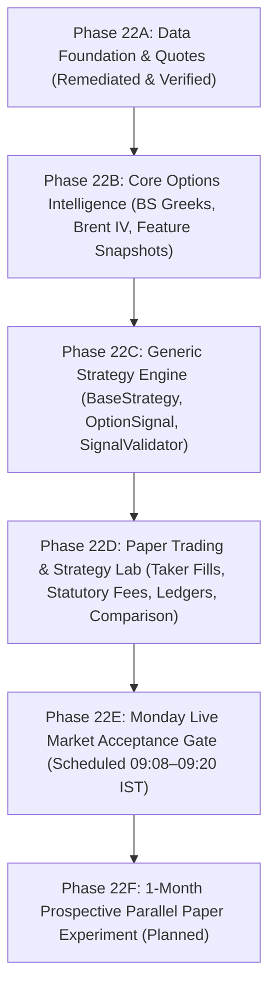

# Nomad Analyst — Phase 22 Technical Audit & ChatGPT Review Handoff

**Handoff Reference:** `docs/audits/phase_22_chatgpt_handoff.md`  
**Date:** 2026-10-17  
**Time:** 23:22 IST  
**Author:** Quantitative Researcher & Systems Architect  
**Review Target:** Independent ChatGPT Architecture & Code Audit  
**Status:** READY FOR INDEPENDENT AUDIT  

---

## 1. Context & Purpose of Handoff

This document provides a complete, self-contained summary of the implementation across **Phases 22A, 22B, 22C, and 22D** of the Nomad Analyst F&O Options Intelligence Pillar.

### Operational Context:
- **Offline Development Rule:** Live-market acceptance is treated as a **production-validation gate, not a blocker for offline development**.
- Phases 22B, 22C, and 22D have been fully implemented against deterministic test fixtures and verified interfaces.
- Live-market validation is explicitly scheduled for Monday market open (09:08–09:20 IST) under **Phase 22E**.

---

## 2. Architectural Blueprint & Phase Mapping



### Phase Identifiers and Aliases:
- **Phase 22A** (legacy alias *Phase 1*): Data foundation, 184-byte normalizer, 1-minute OHLCV+OI bars, quote snapshots. (Remediated; 37 tests passing).
- **Phase 22B** (legacy alias *Phase 2*): Core Options Intelligence — Black-Scholes analytical Greeks, Brent IV inversion, session-aware time-to-expiry, standardized `OptionFeatureSnapshot`. (14 tests passing).
- **Phase 22C** (legacy alias *Phase 3*): Generic Strategy Engine — `BaseStrategy`, dynamic config, standardized `OptionSignal`, `SignalValidator`, `StrategyManager`, and `NiftyOrbBreakoutStrategy`. (6 tests passing).
- **Phase 22D** (legacy alias *Phase 4*): Paper Trading & Strategy Lab — Conservative taker fills with slippage, statutory fee engine, zero-bid/settlement separation, PostgreSQL `PaperTradeLedger`, `StrategyPerformanceEvaluator`. (6 tests passing).
- **Phase 22E** (legacy alias *Phase 5 Stage 1*): Monday Live Market Acceptance Gate — 09:08–09:20 IST pre-market and market-hours tick verification, dynamic ATM rebalancing validation, and reconnect tuning.
- **Phase 22F** (legacy alias *Phase 6*): Prospective Parallel Paper Experiment & Review.

---

## 3. Key Components Implemented

### 1. `fno/services/greeks_engine.py` (Phase 22B)
- **Analytical Black-Scholes-Merton:** Calculates Delta, Gamma, Vega (1% vol change), and Daily Theta (divided by 252.0 convention) with continuous dividend yield ($r = 0.065$, $q = 0.012$).
- **Brent-Dekker Hybrid IV Solver:** Numerically inverts Black-Scholes price within bounds $[\sigma_{\min}=0.001, \sigma_{\max}=5.000]$ with maximum 50 iterations and tolerance $10^{-6}$.
- **Expiry Session Math:** Computes remaining fractional session today (09:15 to 15:30 IST) + intermediate trading business days.
- **Explicit Failure Modes:** Returns explicit `failure_reason`: `BELOW_INTRINSIC`, `ZERO_BID`, `EXPIRED`, `NON_CONVERGENT`, `INVALID_INPUTS`. Never fabricates Greeks or substitutes zero.

### 2. `fno/services/feature_engine.py` (Phase 22B)
- **Pydantic Model `OptionFeatureSnapshot`:** Implements immutable frozen feature contract (schema v1.3.0) with git commit provenance, calculation timestamps, triple timestamps, quote freshness ($\le 3.0$s), underlying spot and futures volume context, market regime and breadth, moneyness classification (`ATM`, `ITM`, `DEEP_ITM`, `OTM`, `DEEP_OTM`), open interest interpretation (`LONG_BUILDUP`, `SHORT_BUILDUP`, `LONG_UNWINDING`, `SHORT_COVERING`), order book imbalance, and `is_valid_for_signal`.

### 3. `fno/strategies/base.py` & `validator.py` (Phase 22C)
- **Isolated Strategy Interface:** `BaseStrategy` with `on_feature_snapshot()` and `on_trade_event()`.
- **Standardized Signal Schema:** `OptionSignal` containing target instrument, action (`BUY_TO_OPEN`, `EXIT_TARGET`, `EXIT_STOP`, `EXIT_TIME`, `EXIT_EOD`), lot count, limit price hint, max acceptable slippage, stop loss, profit target, and audit rationale.
- **SignalValidator Gate:** Rejects stale quotes (`REJECTED_STALE_QUOTE`), locked quotes (`REJECTED_LOCKED_QUOTE`), crossed books (`REJECTED_CROSSED_BOOK`), empty books (`REJECTED_EMPTY_BOOK`), partial bars (`REJECTED_PARTIAL_BAR`), unverified timestamps (`REJECTED_UNVERIFIED_TIMESTAMP`), and spreads $> 2.5\%$ (`REJECTED_EXCESSIVE_SPREAD`). Restricts initial scope strictly to Long NIFTY index CE/PE buying.

### 4. `fno/strategies/manager.py` & `nifty_orb_breakout.py` (Phase 22C)
- **StrategyManager:** Coordinates multiple independent strategies, enforces pre-evaluation snapshot eligibility, validates signals, maintains audit trail (`SignalAuditEntry`), and dispatches trade feedback.
- **NiftyOrbBreakoutStrategy:** Pure, decoupled 15-minute Opening Range Breakout strategy buying ATM/near-ITM CE/PE options on index breakout.

### 5. `fno/models.py` & `fno/execution/` (Phase 22D)
- **Database Model `PaperTradeLedger`:** Standalone PostgreSQL table (`fno_paper_trade_ledger`) recording strategy ID, version, signal UUID, instrument token, option type, strike, expiry, fill prices, slippage, quantities, exit triggers, fill types (`MARKET_TAKER`, `SETTLEMENT`), gross P&L, statutory frictions breakdown (JSONB), net P&L, market regime, VIX level, and trade statuses.
- **`StatutoryFeeCalculator`:** Round-trip fee calculation implementing flat ₹20 brokerage/leg, 0.03553% exchange charges, 0.0001% SEBI charges, 0.003% buy stamp duty, 0.15% sell STT (or intrinsic settlement STT), and 18% GST.
- **`PaperExecutionEngine`:** Conservative taker fills: Buys at `Ask + max(0.05, 0.005 * Ask)`; Sells at `Bid - max(0.05, 0.005 * Bid)`. Zero-bid exits mark `PENDING_LIQUIDITY` without fabricating fills. Official cash settlement resolves via `SETTLEMENT` fill type with zero market slippage.
- **`StrategyPerformanceEvaluator` & `StrategyComparisonMatrix`:** Generates Net P&L, Expectancy, Win Rate, Profit Factor, Max Drawdown, Friction Drag Ratio, and market regime breakdown.

---

## 4. Test Verification Summary

```bash
venv/bin/python manage.py test fno.tests market.tests
```

```text
Ran 361 tests in 7.614s

OK
Destroying test database for alias 'default'...
Destroying test database for alias 'telemetry'...
```

- **F&O Test Suite:** 63 tests, 0 failures, 0 errors.
- **Equity Test Suite:** 298 tests, 0 failures, 0 errors.
- **Total Combined:** 361 tests, 0 failures, 0 errors.

---

## 5. Monday Live Market Acceptance Checklist (Phase 22E)

| Verification Item | Target Window | Target Metric / Acceptance Criteria | Status |
| :--- | :--- | :--- | :---: |
| Pre-open token subscription | 09:08–09:15 IST | 22 NFO option contracts subscribed in `MODE_FULL` | PENDING MONDAY OPEN |
| Real tick routing & parsing | 09:15–09:20 IST | 184-byte packets unpacked; 0 equity state mutations | PENDING MONDAY OPEN |
| Dynamic ATM rebalance | Continuous | Rebalances strikes when spot crosses $\pm 25$ pts | PENDING MONDAY OPEN |
| Quote snapshot latency & freshness | Continuous | Persisted quotes reflect $\le 3.0$s age; valid depth | PENDING MONDAY OPEN |
| Bar aggregator flush | 1-minute close | Idempotent persistence under compound unique key | PENDING MONDAY OPEN |
| Reconnect recovery | Network drop | Re-subscribes all 22 active tokens within 5.0s | PENDING MONDAY OPEN |
