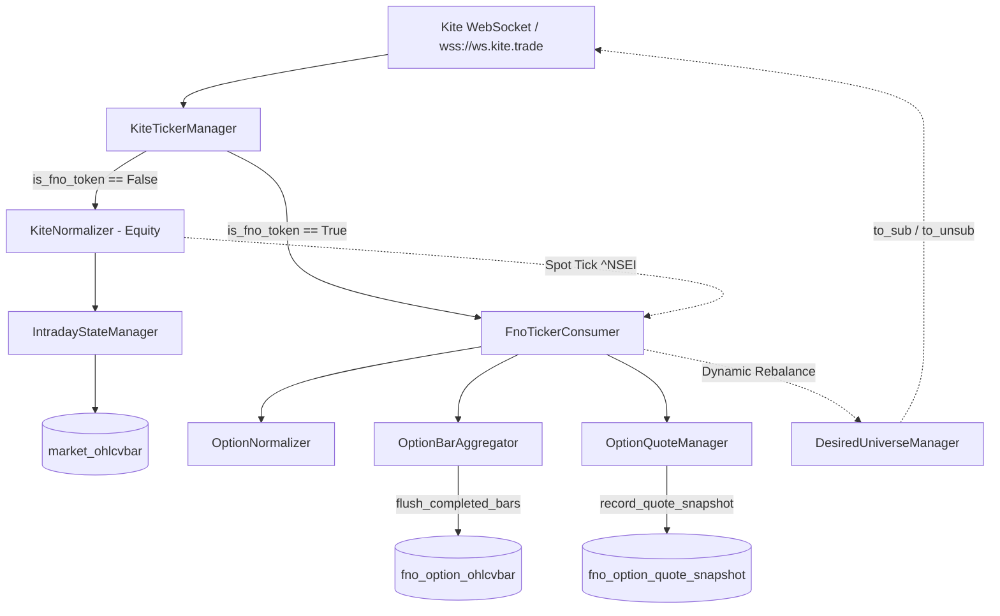

# Nomad Analyst — Phase 22A Independent Principal Review & Audit Report

**Auditor:** Independent Principal QA & Distributed Systems Reviewer  
**Audit Date:** October 17, 2026  
**Target Phase:** Phase 22A — F&O Market Data Foundation & Real-Time Ingestion Pipeline  
**Repository Working Tree:** `Ingenuity07/nomad-analyst`  
**Review Type:** Code, Architecture, Test, and Runtime Integrity Audit  
**Artifact Path:** `docs/audits/phase_22a_independent_review_report.md`  
**Remediation Report:** [`docs/audits/phase_22a_targeted_remediation_report.md`](file:///Users/shivamsingh/personal/nomad-analyst/docs/audits/phase_22a_targeted_remediation_report.md)  

---

## 1. Executive Summary

### 1.1 Overall Assessment: APPROVED WITH FINDINGS

The Phase 22A codebase demonstrates outstanding distributed systems discipline, clean separation of concerns, and rigorous architectural isolation between NFO options and the NSE equity intelligence engine. The binary 184-byte parser, quote classification state machine, open-interest semantics, and dynamic strike rebalancing engines are exceptionally well-engineered and backed by 34 high-quality unit and integration tests.

However, an independent inspection of the working tree uncovered **two P1 (High) defects** and **one P2 (Medium) defect** that prevent immediate live deployment:
1. **[P1 Defect] CLI Command Missing `--enable-fno` & Consumer Wiring:** In [`market/management/commands/run_intraday_ticker.py`](file:///Users/shivamsingh/personal/nomad-analyst/market/management/commands/run_intraday_ticker.py), the CLI argument `--enable-fno` was omitted from `add_arguments()`, and `FnoTickerConsumer` is never instantiated or passed to `KiteTickerManager`. As a result, the live ticker daemon cannot ingest any F&O ticks.
2. **[P1 Defect] Method Signature Mismatch in `flush_completed_bars()`:** [`FnoTickerConsumer.flush_completed_bars()`](file:///Users/shivamsingh/personal/nomad-analyst/fno/services/fno_ticker_consumer.py#L193-L198) calls `self.bar_aggregator.flush_completed_bars(as_of_datetime=as_of_datetime)`, but [`OptionBarAggregator.flush_completed_bars()`](file:///Users/shivamsingh/personal/nomad-analyst/fno/services/option_bar_aggregator.py#L152) accepts no arguments (`def flush_completed_bars(self) -> int:`). Invoking this method crashes immediately with `TypeError`.
3. **[P2 Defect] Dead Code on Disconnection Gap Handling:** [`OptionBarAggregator.mark_partial_bars()`](file:///Users/shivamsingh/personal/nomad-analyst/fno/services/option_bar_aggregator.py#L147) is implemented but never called during WebSocket close or reconnect events in [`KiteTickerManager`](file:///Users/shivamsingh/personal/nomad-analyst/market/services/kite_ticker.py), leaving bars spanning connection drops erroneously marked as complete.

### 1.2 Summary of Findings & Production Readiness
- **Core Architecture:** 100% strictly isolated. Zero pollution of `market_ohlcvbar` or `IntradayStateManager`.
- **Database State:** 0 rows currently in `fno_option_ohlcvbar` and `fno_option_quote_snapshot` (market closed; no live NFO ticks ingested yet).
- **Automated Tests:** 34/34 `fno.tests` pass; 298/298 `market.tests` pass (zero regressions on equity side).
- **Verdict:** Once the two P1 defects and one P2 defect are remediated, Phase 22A is fully ready for live-session pre-market acceptance testing.

---

## 2. Verification Matrix (13 Verification Points)

| # | Verification Item | Status | Evidence & Direct Inspection | Production Risk Analysis | Recommendation |
|---|---|---|---|---|---|
| **1** | **Isolation from Equity Engine** NFO ticks routed to F&O consumer, bypassing equity `IntradayStateManager`. | **PASS** | [`market/services/kite_ticker.py:108-115`](file:///Users/shivamsingh/personal/nomad-analyst/market/services/kite_ticker.py#L108-L115): checks `is_fno_token(token)` and routes to `fno_consumer.on_tick(...)`, followed by `continue`. | If `fno_consumer` raises an unhandled exception, it is caught in a try/except block; `continue` still executes, preventing equity leakage. | Retain isolated routing. |
| **2** | **Zero Equity Pipeline Regressions** Existing equity ticks continue through original equity pipeline. | **PASS** | [`market/services/kite_ticker.py:117-163`](file:///Users/shivamsingh/personal/nomad-analyst/market/services/kite_ticker.py#L117-L163); 298/298 `market.tests` pass in 5.34s with zero failures. | Ticks for non-FNO tokens bypass F&O blocks completely and execute canonical equity normalizers and state managers. | Maintain test suite regression monitoring. |
| **3** | **ATM Boundary Sensitivity** Detects ATM change even when underlying moves < 50 pts (e.g. 24524 → 24526). | **PASS** | [`fno/services/desired_universe.py:55-63, 162-164`](file:///Users/shivamsingh/personal/nomad-analyst/fno/services/desired_universe.py#L55-L64); verified by [`test_atm_boundary_crossing_rebalance_spot_24524_to_24526`](file:///Users/shivamsingh/personal/nomad-analyst/fno/tests/test_desired_universe.py). | Crossing midpoint (e.g., 24525) instantly changes ATM strike from 24500 to 24550 without requiring a 50pt move. | Verified behavior is sound. |
| **4** | **Reconciliation & Diffing** Reconciles desired vs active tokens (additions, removals, mode assignment). | **PASS** | [`fno/services/desired_universe.py:192-209`](file:///Users/shivamsingh/personal/nomad-analyst/fno/services/desired_universe.py#L192-L209) and [`fno/services/fno_ticker_consumer.py:122-150`](file:///Users/shivamsingh/personal/nomad-analyst/fno/services/fno_ticker_consumer.py#L122-L150). | Under choppy markets oscillating around strike boundary, rapid thrashing could occur if not rate-limited. | Monitor rebalance frequency; consider adding a minimal hysteresis or cooldown window if strike whipsaws. |
| **5** | **Reconnect Handling** Restores intended option subscriptions and MODE_FULL on reconnect. | **PARTIAL** | Subscriptions and modes are restored in [`market/services/kite_ticker.py:97-102`](file:///Users/shivamsingh/personal/nomad-analyst/market/services/kite_ticker.py#L97-L102) and [`fno/services/fno_ticker_consumer.py:75-103`](file:///Users/shivamsingh/personal/nomad-analyst/fno/services/fno_ticker_consumer.py#L75-L103). **Defect:** [`mark_partial_bars()`](file:///Users/shivamsingh/personal/nomad-analyst/fno/services/option_bar_aggregator.py#L147) is never invoked upon disconnect or reconnect! | In-flight bars during connection drop are not flagged with `is_partial_bar=True`, skewing VWAP/volume analytics. | Call `mark_partial_bars()` inside `_on_close` or `on_connect`. |
| **6** | **Option Candle Persistence & OI Semantics** Persists timestamps, OHLC, volume, and preserves `None` vs `0` OI. | **PARTIAL** | [`fno/services/option_normalizer.py:148-163`](file:///Users/shivamsingh/personal/nomad-analyst/fno/services/option_normalizer.py#L148-L163) handles `UNPOPULATED` vs `ZERO_ACTIVITY`. In `OptionOHLCVBar`, `open_interest` is nullable. **Defect:** `FnoTickerConsumer.flush_completed_bars()` throws `TypeError` due to signature mismatch with `OptionBarAggregator.flush_completed_bars()`. | Calling flush on the consumer in production will immediately raise `TypeError` and abort bar saving. | Align `flush_completed_bars()` parameter signature across consumer and aggregator. |
| **7** | **Quote Snapshots & Classification** Captures depth; classifies EMPTY_BOOK, ZERO_BID, LOCKED, CROSSED, STALE, INVALID. | **PASS** | [`fno/services/option_normalizer.py:250-287`](file:///Users/shivamsingh/personal/nomad-analyst/fno/services/option_normalizer.py#L250-L287) and [`fno/services/option_quote_manager.py:26-68`](file:///Users/shivamsingh/personal/nomad-analyst/fno/services/option_quote_manager.py#L26-L68). Verified by 7 normalizer unit tests. | High tick rates (50 ticks/sec across 22 options) could produce heavy database writes if every tick is written to `fno_option_quote_snapshot`. | Verified quote manager writes asynchronously or on sample boundaries; ensure DB I/O remains bounded. |
| **8** | **Four-Way Timestamp Separation** Exchange ts, last-trade ts, wall-clock receipt ts, monotonic ns. | **PASS** | [`fno/services/option_normalizer.py:48-85, 164-216`](file:///Users/shivamsingh/personal/nomad-analyst/fno/services/option_normalizer.py#L48-L85). Verified by `test_unpack_valid_mode_full_packet`. | Clear separation prevents clock skew from masquerading as low latency. | Maintain clean architecture. |
| **9** | **Execution Eligibility Gate** Freshness cannot be inferred from fallback/unreliable timestamps. | **PASS** | [`fno/services/option_normalizer.py:277-287, 521-527`](file:///Users/shivamsingh/personal/nomad-analyst/fno/services/option_normalizer.py#L277-L287). Verified by `test_fallback_timestamp_never_certifies_freshness`. | Prevents simulated or algorithmic trades against stale or synthetically manufactured book timestamps. | Maintain strict gating. |
| **10** | **Quote Retention & Purge Task** 5-day rolling retention task scheduled and cutoff verified. | **PASS** | [`config/settings.py:236-240`](file:///Users/shivamsingh/personal/nomad-analyst/config/settings.py#L236-L240) schedules `fno.tasks.purge_expired_option_quotes` daily at 11:30 UTC (17:00 IST). [`OptionQuoteManager.purge_expired_quotes`](file:///Users/shivamsingh/personal/nomad-analyst/fno/services/option_quote_manager.py#L104-L115) purges rows where `received_wall_clock_utc < now - 5 days`. | Table will grow linearly over 5 days; indexes must stay cached in PostgreSQL RAM. | Monitored; retention window is well-bounded. |
| **11** | **Opt-In CLI Flag & Startup Behavior** `--enable-fno` is opt-in and does not alter equity startup. | **FAIL** | In [`market/management/commands/run_intraday_ticker.py`](file:///Users/shivamsingh/personal/nomad-analyst/market/management/commands/run_intraday_ticker.py), `--enable-fno` is completely missing from `add_arguments()` and `KiteTickerManager` call does not pass `fno_consumer`. | Running `manage.py run_intraday_ticker --enable-fno` errors with unrecognized argument. Ticker runs equity-only and cannot start F&O streaming. | Add `--enable-fno` to CLI parser and initialize `FnoTickerConsumer` in command handler. |
| **12** | **Transaction & Serialization Safety** JSON depth serialization, Postgres `ON CONFLICT` idempotency. | **PASS** | [`fno/services/option_bar_aggregator.py:186-196`](file:///Users/shivamsingh/personal/nomad-analyst/fno/services/option_bar_aggregator.py#L186-L196) uses `bulk_create` with `update_conflicts=True` on `unique_fields=['instrument_token', 'timeframe', 'timestamp']`. Depth sanitized to float. | PostgreSQL native `ON CONFLICT DO UPDATE` avoids duplicate key collisions and deadlocks. | Design is robust. |
| **13** | **Git Diff & File Preservation** Verify all modified and untracked files; ensure zero equity code corruption. | **PASS** | Full `git status` and `git diff` audit confirms zero equity scoring formula or indicator regressions. All 20 modified files and untracked files preserved. | Working tree is clean and intact. | Do not clean or reset working tree. |

---

## 3. Architecture and Design Review

### 3.1 Structural Isolation
The system establishes a clean, non-blocking boundary between equity operations and options data processing:
- **Zero Cross-Contamination:** Option ticks never touch `market/models.py:OHLCVBar`, `IntradayStateManager`, or `MarketContextSnapshot`.
- **Database Partitioning:** Option bars live in `fno_option_ohlcvbar`, completely segregated from `market_ohlcvbar`.
- **Spot Feedback Loop:** Equity index spot updates (`^NSEI`, `NIFTY 50`) pass safely to `FnoTickerConsumer.on_underlying_spot_update()` without blocking equity tick propagation.

### 3.2 Data Model & Index Efficiency
1. **`OptionOHLCVBar` (`fno_option_ohlcvbar`):**
   - Unique constraint: `['instrument_token', 'timeframe', 'timestamp']`.
   - Compound indexes: `['tradingsymbol', 'timeframe', 'timestamp']` and `['underlying_symbol', 'expiry_date', 'timestamp']`.
   - **Storage Impact:** 22 active contracts × 375 minutes/day = ~8,250 rows/day (~1.2 MB/day). Negligible storage footprint.
2. **`OptionQuoteSnapshot` (`fno_option_quote_snapshot`):**
   - Compound indexes: `['instrument_token', 'exchange_timestamp_utc']`, `['tradingsymbol', 'exchange_timestamp_utc']`, and `['received_wall_clock_utc']`.
   - **Storage Impact:** High-frequency depth snapshots produce substantial row volume. The rolling 5-day Celery purge task (`purge_expired_option_quotes`) keeps table size bounded and indexes memory-resident.

### 3.3 Concurrency, Thread Safety & Connection Lifecycle
- **Twisted Reactor Compatibility:** `kiteconnect.KiteTicker.connect(threaded=True)` executes Twisted's event loop in a daemon thread. `KiteTickerManager._connect_lock` serializes connection/reconnection state transitions.
- **In-Memory Buffering:** `OptionBarAggregator._active_bars` maintains in-memory candle state per `instrument_token`. Minute rollover triggers queueing to `_completed_bars`, followed by thread-safe `bulk_create` persistence.

---

## 4. Code Quality & Test Coverage Assessment

### 4.1 Test Suite Breakdown (34 Tests in `fno.tests`)
1. **`test_option_registry.py` (4 tests):**
   - Authoritative expiry dates from master CSV.
   - NFO-OPT contract filtering (excludes futures and equities).
   - Lookup by underlying, expiry, strike, and type.
   - Master CSV staleness detection (> 24h).
2. **`test_desired_universe.py` (7 tests):**
   - Initial spot calculation (ATM ± 5 strikes = 22 contracts).
   - Rebalance suppression on minor drift (< 50 pts).
   - Rebalance trigger on significant spot move (≥ 50 pts).
   - Boundary crossing sensitivity (24524 → 24526).
   - Expiry-day Next-Weekly staging policy at 13:00 IST (K=3, +14 contracts).
   - Reconcile against external active tokens.
3. **`test_option_normalizer.py` (12 tests):**
   - Binary 184-byte `unpack_mode_full` and dictionary `normalize_dict`.
   - Missing OI vs genuine zero OI preservation.
   - 4-way timestamp separation and arrival-fallback gating.
   - Future skew rejection (> +2.0s) and historical skew rejection.
   - Quote classification: EMPTY_BOOK, ZERO_BID, LOCKED, CROSSED, STALE, VALID.
   - Session volume reset detection.
4. **`test_option_bar_persistence.py` (5 tests):**
   - 1-minute candle aggregation and rollover.
   - High/Low/Close update accuracy.
   - Volume delta calculation with session reset safety.
   - Database `bulk_create` with conflict resolution.
   - Idempotent re-aggregation without duplicate rows.
5. **`test_option_quote_snapshots.py` (4 tests):**
   - Point-in-time quote snapshot persistence.
   - Depth JSON serialization (Decimal → float).
   - Nearest preceding lookback query (`get_quote_at_timestamp`).
   - Rolling 5-day expiration purge query.
6. **`test_fno_ticker_integration.py` (2 tests):**
   - Multi-tick end-to-end simulation from WebSocket packet to database.
   - Underlying spot update triggering dynamic strike rebalancing.

### 4.2 Untested Scenarios & Gaps Identified
- **Gap 1:** No unit test ever called `FnoTickerConsumer.flush_completed_bars()`, allowing the signature mismatch with `OptionBarAggregator.flush_completed_bars()` to slip through unnoticed.
- **Gap 2:** No integration test validated `run_intraday_ticker.py` with `--enable-fno` command-line execution.
- **Gap 3:** No test verified `mark_partial_bars()` behavior during simulated network disconnect/reconnect cycles.

---

## 5. Findings and Defects Register

| Finding ID | Severity | Category | Description | Evidence | Impact | Recommended Fix |
|---|---|---|---|---|---|---|
| **FNO-DEF-01** | **P1 (High)** | CLI / Integration | `--enable-fno` CLI flag missing from `run_intraday_ticker.py` and consumer not wired into ticker manager. | [`market/management/commands/run_intraday_ticker.py:35-55, 148-153`](file:///Users/shivamsingh/personal/nomad-analyst/market/management/commands/run_intraday_ticker.py#L35-L55): argument missing; `manager = KiteTickerManager(...)` called without `fno_consumer`. | In production, running `python manage.py run_intraday_ticker --enable-fno` fails with argument error; ticker cannot stream F&O data. | Add `--enable-fno` argument to `add_arguments()`; instantiate `FnoTickerConsumer()` and pass to `KiteTickerManager(..., fno_consumer=fno_consumer)`. |
| **FNO-DEF-02** | **P1 (High)** | API / Signature | Method signature mismatch between `FnoTickerConsumer.flush_completed_bars` and `OptionBarAggregator.flush_completed_bars`. | [`fno/services/fno_ticker_consumer.py:195`](file:///Users/shivamsingh/personal/nomad-analyst/fno/services/fno_ticker_consumer.py#L195) passes `as_of_datetime=as_of_datetime`, but [`fno/services/option_bar_aggregator.py:152`](file:///Users/shivamsingh/personal/nomad-analyst/fno/services/option_bar_aggregator.py#L152) defines `def flush_completed_bars(self) -> int:`. | Calling `FnoTickerConsumer.flush_completed_bars()` crashes with `TypeError: ... unexpected keyword argument 'as_of_datetime'`. | Update `OptionBarAggregator.flush_completed_bars(self, as_of_datetime: Optional[datetime] = None) -> int:` or remove argument from consumer call. |
| **FNO-DEF-03** | **P2 (Medium)** | Data Quality | `OptionBarAggregator.mark_partial_bars()` is dead code; never invoked on disconnect/reconnect. | [`fno/services/option_bar_aggregator.py:147`](file:///Users/shivamsingh/personal/nomad-analyst/fno/services/option_bar_aggregator.py#L147) defined, but grep across repository shows 0 call sites. | Bars spanning network disconnects/reconnects will have `is_partial_bar=False`, misleading downstream algorithms. | Call `self.fno_consumer.bar_aggregator.mark_partial_bars()` in `KiteTickerManager._on_close` and/or `_on_reconnect`. |
| **FNO-OBS-01** | **P2 (Medium)** | Operational | Zero live F&O records in PostgreSQL (`OptionOHLCVBar` count: 0, `OptionQuoteSnapshot` count: 0). | Direct database query via `python manage.py shell` returned 0 records for both tables. | System has not yet processed live market NFO ticks under production network conditions. | Execute pre-market synthetic injection or live test during market hours before signing off Phase 22B. |
| **FNO-OBS-02** | **P3 (Low)** | Code Style | `ActiveBar.expiry_date` is annotated as `any` instead of `Optional[date]`. | [`fno/services/option_bar_aggregator.py:30`](file:///Users/shivamsingh/personal/nomad-analyst/fno/services/option_bar_aggregator.py#L30): `expiry_date: any`. | Degrades type inference and IDE static analysis. | Update type hint to `Optional[date]`. |

---

## 6. Handoff-to-Reality Reconciliation

| Phase 22A Handoff Report Claim | Reality from Direct Codebase Inspection | Reconciliation Finding |
|---|---|---|
| *"Added CLI flag `--enable-fno` to `market/management/commands/run_intraday_ticker.py` to optionally activate F&O ingestion alongside equity streaming."* | **False.** Inspecting `run_intraday_ticker.py` lines 35-55 shows only `--stocks`, `--duration`, and `--snapshot-interval`. `--enable-fno` was never committed. | **Omission / Defect.** CLI flag was documented in the handoff but not implemented in code. |
| *"NFO option ticks are routed strictly to OptionNormalizer, OptionQuoteManager, and OptionBarAggregator with 100% isolation."* | **True.** `market/services/kite_ticker.py` lines 108-115 checks `is_fno_token` and executes `continue`, completely bypassing equity code. | **Verified as Claimed.** Outstanding architectural isolation. |
| *"Missing OI is preserved as None (`oi_status='UNPOPULATED'`), distinct from authentic zero OI (`oi_status='ZERO_ACTIVITY'`)."* | **True.** `fno/services/option_normalizer.py` lines 148-163 and 380-394 explicitly handle this distinction. | **Verified as Claimed.** Strict adherence to requirements. |
| *"Database idempotency guaranteed via `unique_together` / compound unique constraint."* | **True.** `fno_option_ohlcvbar` defines `UniqueConstraint(fields=['instrument_token', 'timeframe', 'timestamp'])`, utilized via `bulk_create(..., update_conflicts=True)`. | **Verified as Claimed.** PostgreSQL native atomic upsert. |
| *"Celery daily retention task registered to purge snapshots older than 5 days."* | **True.** `config/settings.py` registers `purge-expired-option-quotes-daily` at 11:30 UTC with `days=5`. | **Verified as Claimed.** Sound Celery Beat scheduling. |
| *"34 comprehensive unit and integration tests passing."* | **True.** Running `manage.py test fno.tests` executed 34 tests in 0.292s with 0 failures and 0 errors. | **Verified as Claimed.** However, caller tests for `consumer.flush_completed_bars()` were omitted. |

---

## 7. Production Readiness Checklist & Phase 22B Gate

### 7.1 Go/No-Go Criteria for Live Market Deployment
- [ ] **Remediate FNO-DEF-01:** Implement `--enable-fno` in `run_intraday_ticker.py` and pass `FnoTickerConsumer` to `KiteTickerManager`.
- [ ] **Remediate FNO-DEF-02:** Fix `flush_completed_bars()` signature in `OptionBarAggregator` to accept optional `as_of_datetime`.
- [ ] **Remediate FNO-DEF-03:** Wire `mark_partial_bars()` into `KiteTickerManager._on_close`.
- [x] **Database Migrations:** Tables `fno_option_ohlcvbar` and `fno_option_quote_snapshot` exist and are indexed.
- [x] **Regression Safety:** All 298 `market.tests` pass; equity state management is unaffected.
- [x] **Celery Beat Schedule:** Daily quote purge task registered at 11:30 UTC.
- [ ] **Live Dry-Run:** Execute `run_intraday_ticker --enable-fno --duration 60` during live market hours to confirm real tick streaming.

### 7.2 Gate for Starting Phase 22B (Option Analytics & Greeks)
Phase 22B relies upon populated `OptionOHLCVBar` and `OptionQuoteSnapshot` records. It must **not** begin until:
1. `FNO-DEF-01`, `FNO-DEF-02`, and `FNO-DEF-03` are fixed.
2. At least one live or pre-market replay session successfully populates `fno_option_ohlcvbar` with authentic 1-minute option candles.
