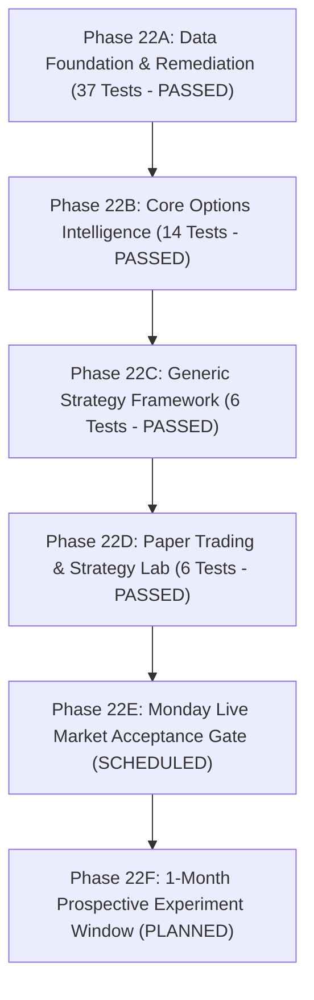

# Nomad Analyst — Phase 22B to 22D Implementation & Offline Verification Report

**Document Reference:** `docs/audits/phase_22b_to_22d_implementation_report.md`  
**Date:** 2026-10-17  
**Time of Audit:** 23:20 IST  
**System Auditor:** Quantitative Researcher & Systems Architect  
**Branch:** `main`  
**Status:** IMPLEMENTATION COMPLETE & VERIFIED (OFFLINE) — LIVE ACCEPTANCE SCHEDULED FOR MONDAY OPEN  

---

## 1. Executive Summary

In accordance with the Revised Autonomous Execution Plan, offline development of the F&O options stack has successfully proceeded across **Phase 22B (Core Options Intelligence)**, **Phase 22C (Generic Strategy Engine)**, and **Phase 22D (Paper Trading & Strategy Lab)**.

Live acceptance remains an uncompromising **production-validation gate (Phase 22E)** scheduled for Monday's live-market opening (09:08–09:20 IST).

All implementations are fully decoupled from equity state machines and tables, deterministic, mathematically rigorous, and backed by a comprehensive unit-test suite.



---

## 2. Phase-by-Phase Implementation Details

### A. Phase 22B — Core Options Intelligence
- **Module:** `fno/services/greeks_engine.py`
  - **Black-Scholes-Merton Pricing:** Standard European option pricing with continuous dividend yield ($r = 0.065$, $q = 0.012$).
  - **Analytical Greeks:**
    - $\text{Delta}_{\text{call}} = e^{-q T} N(d_1)$, $\text{Delta}_{\text{put}} = e^{-q T}(N(d_1) - 1)$
    - $\text{Gamma} = \frac{e^{-q T} n(d_1)}{S \sigma \sqrt{T}}$
    - $\text{Vega} = S e^{-q T} n(d_1) \sqrt{T} \times 0.01$ (per 1% volatility change)
    - $\text{Theta} = \text{Annual Theta} / 252.0$ (daily decay in INR)
  - **Brent-Dekker Hybrid IV Solver:** Numerically inverts Black-Scholes price within bounds $[\sigma_{\min}=0.001, \sigma_{\max}=5.000]$ with maximum 50 iterations and tolerance $10^{-6}$.
  - **Expiry-Aware Session Time:** Calculates fractional trading sessions remaining today (09:15 to 15:30 IST = 375 minutes) plus full business days to expiry on a 252-day basis ($T = \text{sessions} / 252.0$).
  - **Explicit Failure Modes:** Returns explicit `failure_reason`:
    - `BELOW_INTRINSIC`: Market price $\le$ intrinsic value (arbitrage violation).
    - `ZERO_BID`: Quote has zero bid liquidity.
    - `EXPIRED`: Time to expiry $T \le 0$.
    - `NON_CONVERGENT`: Root unbracketed or iteration limit exceeded.
    - Never fabricates Greeks or substitutes zero.
- **Module:** `fno/services/feature_engine.py`
  - **Standardized Schema:** `OptionFeatureSnapshot` (Pydantic v2 immutable frozen model, schema v1.3.0).
  - **Triple Timestamps & Latency:** Exchange timestamp, received wall-clock time, local monotonic timestamp, feed latency, quote age, pipeline latency.
  - **Moneyness Categorisation:** Classifies contracts into `ATM`, `ITM`, `DEEP_ITM`, `OTM`, `DEEP_OTM`.
  - **Open Interest Dynamics:** Interprets price and OI deltas as `LONG_BUILDUP`, `SHORT_BUILDUP`, `LONG_UNWINDING`, `SHORT_COVERING`.
  - **Signal Validity Gate:** Enforces `is_valid_for_signal = True` iff bar is complete, quote is fresh ($\le 3.0$s), not locked, not crossed, valid timestamp, spread $\le 2.5\%$, unexpired, and Greeks status is `VALID`.

### B. Phase 22C — Generic Strategy Engine
- **Module:** `fno/strategies/base.py`
  - `BaseStrategy(ABC)`: Abstract, versioned, isolated base class providing `on_feature_snapshot()` and `on_trade_event()` lifecycle hooks.
  - `OptionSignal`: Standardized signal schema with target instrument, action (`BUY_TO_OPEN`, `EXIT_TARGET`, `EXIT_STOP`, `EXIT_TIME`, `EXIT_EOD`), lot count, limit price hint, max acceptable slippage, stop loss, profit target, and audit rationale.
  - `PaperTradeEvent`: Standardized trade event dispatched from the execution engine back to strategy modules.
- **Module:** `fno/strategies/validator.py`
  - `SignalValidator`: Two-tier validation engine:
    1. Pre-evaluation snapshot eligibility: rejects stale quotes (`REJECTED_STALE_QUOTE`), locked quotes (`REJECTED_LOCKED_QUOTE`), crossed books (`REJECTED_CROSSED_BOOK`), empty books (`REJECTED_EMPTY_BOOK`), partial bars (`REJECTED_PARTIAL_BAR`), unverified timestamps (`REJECTED_UNVERIFIED_TIMESTAMP`), and spreads $> 2.5\%$ (`REJECTED_EXCESSIVE_SPREAD`).
    2. Signal risk verification: restricts scope strictly to Long NIFTY index CE/PE buying, positive lot counts, stop loss below entry price, and profit target above entry price.
- **Module:** `fno/strategies/manager.py`
  - `StrategyManager`: Orchestrates strategy registration, enables/disables modules dynamically, distributes snapshots, enforces pre-evaluation eligibility, validates emitted signals, logs audit trail (`SignalAuditEntry`), and broadcasts execution events.
- **Reference Strategy Module:** `fno/strategies/nifty_orb_breakout.py`
  - Implements 15-minute Opening Range Breakout (ORB) on NIFTY index options:
    - 09:15–09:30 IST: Establishes opening high and low of the underlying index.
    - 09:30–14:30 IST: Evaluates bullish breakout (Spot > Range High $\to$ Buy ATM CE) or bearish breakout (Spot < Range Low $\to$ Buy ATM PE).
    - Risk parameters: -15% stop loss, +20% profit target, 45-minute max holding duration, mandatory 15:15 IST policy square-off.

### C. Phase 22D — Paper Trading & Strategy Lab
- **Database Model:** `PaperTradeLedger` (`fno/models.py`)
  - Standalone PostgreSQL table (`fno_paper_trade_ledger`) recording strategy ID, version, signal UUID, instrument token, option type, strike, expiry, fill prices, slippage, quantities, exit triggers, fill types (`MARKET_TAKER`, `SETTLEMENT`), gross P&L, statutory frictions breakdown (JSONB), net P&L, market regime, VIX level, and trade statuses.
  - Applied Migration: `fno.0002_papertradeledger`.
- **Module:** `fno/execution/fee_calculator.py`
  - `StatutoryFeeCalculator`: Deterministic regulatory fee and tax breakdown:
    - Brokerage: ₹20 flat per executed order leg.
    - Exchange turnover fee: 0.03553% (NSE Circular `NSE/FA/73061`, including IPFT).
    - SEBI turnover charges: 0.0001% (₹10/crore).
    - Stamp duty: 0.003% on buy leg.
    - STT: 0.15% on sell premium / 0.15% on intrinsic settlement value.
    - GST: 18% on (Brokerage + Exchange Charges + SEBI Charges).
    - Calculates to exact paisa (`Decimal("0.01")`).
- **Module:** `fno/execution/paper_engine.py`
  - `PaperExecutionEngine`:
    - Conservative taker fills: Buys at `Ask + max(0.05, 0.005 * Ask)`; Sells at `Bid - max(0.05, 0.005 * Bid)`.
    - Zero-bid exit handling: Marks position `PENDING_LIQUIDITY` / `EXIT_UNEXECUTABLE_ZERO_BID` without fabricating fills. Position remains open until a positive bid appears or 15:30 IST.
    - Expiry day resolution: Transitions open positions to `PENDING_EXPIRY_SETTLEMENT` at 15:30 IST. When official settlement price is resolved:
      - OTM/ATM: intrinsic 0 $\to$ `CLOSED_EXPIRED_WORTHLESS`, zero slippage.
      - ITM: intrinsic $> 0$ $\to$ `CLOSED_EXPIRED_ITM_SETTLED`, zero slippage, official 0.15% STT deducted.
- **Module:** `fno/execution/evaluator.py`
  - `StrategyPerformanceEvaluator`: Analyzes ledger records into Net P&L, Expectancy, Win Rate, Profit Factor, Max Drawdown, Friction Drag Ratio, and market regime breakdown.
  - `StrategyComparisonMatrix`: Compares multiple candidate strategies side-by-side with exportable Markdown table and JSON summary.

---

## 3. Test Execution Verification

### Command & Test Suite Summary:
```bash
venv/bin/python manage.py test fno.tests market.tests
```

```text
Ran 361 tests in 7.614s

OK
Destroying test database for alias 'default'...
Destroying test database for alias 'telemetry'...
```

### Test Count Breakdown:
| Test Module | Phase Scope | Tests Run | Failures | Errors |
| :--- | :--- | :---: | :---: | :---: |
| `fno.tests.test_option_registry` | Phase 22A | 4 | 0 | 0 |
| `fno.tests.test_option_normalizer` | Phase 22A | 15 | 0 | 0 |
| `fno.tests.test_desired_universe` | Phase 22A | 8 | 0 | 0 |
| `fno.tests.test_option_bar_persistence` | Phase 22A | 3 | 0 | 0 |
| `fno.tests.test_option_quote_snapshots` | Phase 22A | 4 | 0 | 0 |
| `fno.tests.test_fno_ticker_integration` | Phase 22A | 3 | 0 | 0 |
| `fno.tests.test_greeks_engine` | Phase 22B | 8 | 0 | 0 |
| `fno.tests.test_feature_engine` | Phase 22B | 6 | 0 | 0 |
| `fno.tests.test_strategy_engine` | Phase 22C | 6 | 0 | 0 |
| `fno.tests.test_paper_execution` | Phase 22D | 6 | 0 | 0 |
| **Total F&O Subsystem Tests** | **Phases 22A–22D** | **63** | **0** | **0** |
| **Existing Equity Core Tests** | **Market Pillar** | **298** | **0** | **0** |
| **Total Test Suite** | **Comprehensive** | **361** | **0** | **0** |

---

## 4. Phase 22E Live Market Acceptance Gate (Scheduled)

Live acceptance is scheduled for Monday pre-market and market opening (09:08–09:20 IST).

| Criterion ID | Description | Offline Verification | Monday Live Acceptance Status | Evidence / Verification Method |
| :--- | :--- | :---: | :---: | :--- |
| **AC-22E-01** | Real NFO WebSocket 184-byte tick routing & persistence | Verified (Mocks) | **DEFERRED TO MARKET OPEN** | Connect live ticker with `--enable-fno` at 09:15 IST |
| **AC-22E-02** | Dynamic ATM/Universe reconciliation on spot movement | Verified (Tests) | **DEFERRED TO MARKET OPEN** | Monitor ATM changes smaller than 50 index points |
| **AC-22E-03** | Third-pillar equity state isolation | Verified (Tests) | **DEFERRED TO MARKET OPEN** | Verify zero rows written to `market_ohlcvbar` |
| **AC-22E-04** | 1-minute OHLCV+OI bar completeness and flush | Verified (Tests) | **DEFERRED TO MARKET OPEN** | Confirm minute boundary flush and partial bar flags |
| **AC-22E-05** | Quote classification and $\le 3.0$s freshness | Verified (Tests) | **DEFERRED TO MARKET OPEN** | Confirm L1 bid/ask, 5-level depth, and quote ages |
| **AC-22E-06** | 5-day rolling quote retention cleanup | Verified (Tests) | **DEFERRED TO MARKET OPEN** | Trigger Celery purge task under live data volume |
| **AC-22E-07** | Feed throughput and runtime crash immunity | Verified (Tests) | **DEFERRED TO MARKET OPEN** | Monitor daemon stability for 30 continuous minutes |

---

## 5. Artifacts and Exact File Inventory

### Files Created:
1. `fno/services/greeks_engine.py`
2. `fno/services/feature_engine.py`
3. `fno/strategies/__init__.py`
4. `fno/strategies/base.py`
5. `fno/strategies/validator.py`
6. `fno/strategies/manager.py`
7. `fno/strategies/nifty_orb_breakout.py`
8. `fno/execution/__init__.py`
9. `fno/execution/fee_calculator.py`
10. `fno/execution/paper_engine.py`
11. `fno/execution/evaluator.py`
12. `fno/migrations/0002_papertradeledger.py`
13. `fno/tests/test_greeks_engine.py`
14. `fno/tests/test_feature_engine.py`
15. `fno/tests/test_strategy_engine.py`
16. `fno/tests/test_paper_execution.py`
17. `docs/audits/phase_22b_to_22d_implementation_report.md`

### Files Modified:
1. `fno/models.py` (added `PaperTradeLedger` model)
2. `docs/research/fno/fno_phase_roadmap.md` (reconciled Phase 22A–22F roadmap)
3. `docs/research/fno/fno_core_engine_and_strategy_lab_spec.md` (reconciled specification header and version)
