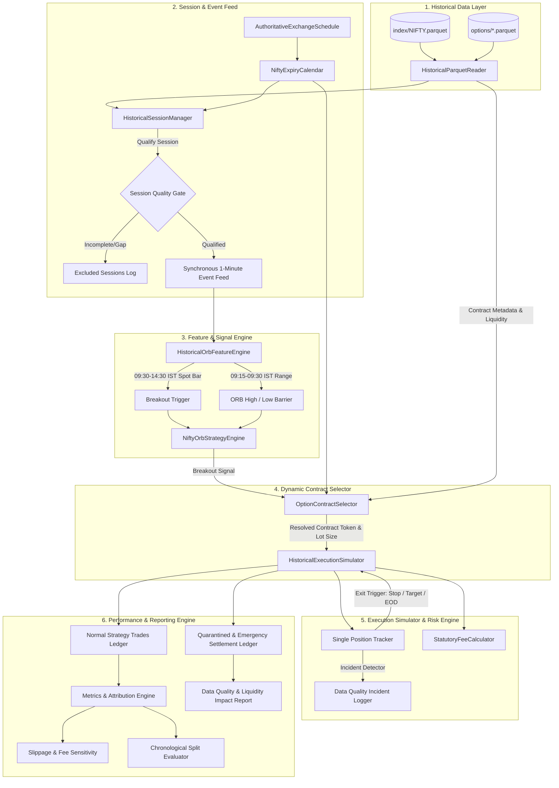

# Nomad Analyst — Phase 2.3: Historical Options Backtester Architecture

**Document Version:** 1.2.0 (Final Remediation & Implementation Specification)  
**Status:** Architecture & Design Specification (Implementation Ready — Not Yet Implemented)  
**Target Scope:** NIFTY 50 15-Minute Opening Range Breakout (ORB-15M) Index Options Buying Strategy  
**Historical Period:** `2025-07-01` through `2026-07-02` (242 Trading Days)  
**Author:** Nomad Analyst Architecture Pair  

---

## Decision Log & Remediation Summary

This section records the authoritative architectural corrections and policies established during Phase 2.3 design remediation:

| ID | Topic | Prior Architectural Issue | Corrected Architecture & Concrete Policy | Authoritative Source / Rationale |
|:---|:---|:---|:---|:---|
| **DEC-01** | **Independent Expiry Calendar Validation** | Relied solely on local dataset inventory; hardcoded Thursday weekly assumption. | **Authoritative Exchange Schedule Cross-Referencing & Hard Failure:** Reliance on local files alone is insufficient to prove calendar completeness. The engine cross-references against an authoritative exchange schedule. Missing official expiry data is a **hard eligibility failure (`EXCLUDED_MISSING_EXPIRY_DATA`)** for all dependent sessions. | NSE Circulars on index derivatives rationalization; independent holiday master cross-reference. |
| **DEC-02** | **Effective-Dated Statutory Fees** | Static April 2026 fee model applied to entire historical period. | **Dual Effective-Dated Fee Regimes:**<br>• *Regime 1 (2025-07-01 to 2026-03-31):* Option sell STT = 0.10% on premium turnover.<br>• *Regime 2 (2026-04-01 onwards):* Option sell STT = 0.15% on premium turnover.<br>All other statutory charges (NSE 0.03553%, SEBI ₹10/cr, Stamp 0.003%, GST 18%) verified against legal acts and circulars. | Finance (No. 2) Act 2024 (eff 2024-10-01); Finance Act 2026 (eff 2026-04-01); NSE Circular NSE/FA/73061. |
| **DEC-03** | **Duplicate Candle Audit & Conflict Policy** | Described duplicates as "byte-for-byte identical"; used volume/OI to break ties. | **Audited Field Identity & No-Tiebreaker Policy:** Replaced claim with "identical across all audited fields" (open, high, low, close, volume, open_interest, timestamp, symbol, strike, expiry, option_type). Engine strictly prohibits resolving conflicting candles by picking highest volume/OI; any conflicting record triggers `HistoricalDataConflictError` and fails closed. | Empirical DuckDB cross-tabulation across all 15.2M option rows (0 price conflicts, 0 volume conflicts). |
| **DEC-04** | **Fill-Timestamp Entry Gating** | Gated entry solely on signal timestamp ($T_{\text{signal}} \le 14:30$). | **Fill-Timestamp Gating ($T_{\text{fill}} \le 14:30:00$ IST):** Entry is permitted if and only if the *simulated fill timestamp* satisfies the cutoff. A signal at 14:30:00 filling at 14:31:00 is rejected (`REJECTED_FILL_PAST_ENTRY_CUTOFF`). | Eliminates look-ahead slippage past market cutoff. |
| **DEC-05** | **Missing Candles & Data-Quality Incidents** | Undefined intermediate missing candle behavior; assumed next candle guarantees fill. | **Explicit Data-Quality Incident Logging & Quarantine:**<br>• Missing candles during open position trigger `DATA_QUALITY_INCIDENT_MISSING_CANDLES`.<br>• Risk checks are never silently skipped; unobserved candles cannot evaluate stops.<br>• Never assume next traded candle guarantees executable fill.<br>• Liquidity-impaired trades are quarantined into an isolated ledger (`EXECUTION_LIQUIDITY_IMPAIRED = True`), separate from normal performance metrics. | Quantitative rigor; avoids survivorship and liquidity distortion. |
| **DEC-06** | **Parametric Delineation** | Conflated parametric taker models with observed order-book depth. | **Explicit Data Boundary Delineation:** Explicitly separated directly observed OHLCV data from parametric assumptions (0.5% taker slippage, tick-grid ceiling/floor rounding, intra-bar worst-case stop preference). Banned claiming spread loss/theta decay are directly measured from OHLCV. | Quantitative modeling integrity; prevents false precision. |
| **DEC-07** | **Capital Accounting & Denominators** | Loose capital allocation and undefined return denominators. | **Rigorous Capital Model:** Fixed capital baseline (₹2,00,000); non-compounding 1-lot trading; affordability gate checks cash $\ge$ premium + fees; trade return % evaluated against actual premium invested; portfolio return % against initial equity. | Eliminates compounding distortions in baseline backtests. |
| **DEC-08** | **Reconciliation: Strategy Square-off vs Expiry Cash Settlement** | Conflated 15:30 expiry settlement with 15:15 strategy square-off. | **Separation of Normal Taker Exits vs Emergency Expiry Settlement:** 100% of standard strategy exits occur between 09:30 and 15:15 IST via market taker orders. 15:30 expiry settlement is strictly an *emergency fallback* if 15:15 square-off encounters total market illiquidity. Settled against the **official underlying index closing price**, NOT a 30-minute stock VWAP. STT applies to intrinsic settlement turnover (0.125% Regime 1; 0.15% Regime 2). Quarantined in `EMERGENCY_EXPIRY_SETTLEMENT_LEDGER`. | NSE Clearing Index Options Settlement Rules; Section 98 of Finance Act. |
| **DEC-09** | **Split Accounting** | Vague session accounting across train/validation/test partitions. | **Precise Partition Session Accounting:** Tabulated exact qualified, partial, and excluded sessions for In-Sample (125 days: 120 qualified, 2 partial, 3 excluded gap), Validation (80 days: 80 qualified), and Holdout (37 days: 34 qualified, 3 partial). | Methodological transparency; prevents data leakage. |
| **DEC-10** | **Interface Verification** | Presumed full reuse of production Django-ORM classes. | **Decoupled Architecture:** Reuses pure-python contracts (`StatutoryFeeCalculator`, `round_to_tick`, `OptionSignal`, strategy rules) while decoupling from database-bound ORM models (`PaperTradeLedger`, `OptionQuoteSnapshot`) to achieve sub-30s in-memory DuckDB backtesting. | Avoids ORM bottleneck and live runtime coupling. |

---

## 1. System Architecture & Component Boundaries

The backtester architecture is modularized into six decoupled layers, avoiding tight coupling to database ORMs or live networking libraries.



### Component Responsibilities:

| Component | Responsibility | Inputs | Outputs |
|:---|:---|:---|:---|
| **`HistoricalParquetReader`** | High-performance DuckDB reader. Implements deterministic contract-minute querying and deduplication across audited fields. | Parquet file paths, date/time predicates, strike/type filters. | PyArrow tables / Dicts of normalized OHLCV bars. |
| **`NiftyExpiryCalendar`** | Authoritative calendar mapping historical expiry dates, weekday shifts (Thursday $\rightarrow$ Tuesday), and holiday pre-ponements, validated independently against exchange schedules. | Dataset expiries, authoritative exchange master calendar. | Validated active expiry per date, DTE calculation, missing-file alerts. |
| **`HistoricalSessionManager`** | Coordinates session-by-session execution. Validates trading days against holiday calendars, identifies data gaps, and verifies opening-range completeness. | Index & options trading days, manifest metadata. | Stream of qualified trading sessions; log of excluded sessions. |
| **`HistoricalOrbFeatureEngine`** | Replays 1-minute index and option bars in strict chronological order. Builds the 15-minute opening range without look-ahead. | 1-minute Index OHLCV bars (`09:15` to `15:30` IST). | Range boundaries (`ORB_HIGH`, `ORB_LOW`), spot breakout events. |
| **`OptionContractSelector`** | Selects the liquid ATM CE (bullish) or ATM PE (bearish) contract using only data knowable at decision time. Resolves historical lot size. | Spot reference price, current date, active expiry calendar. | Qualified contract identity (`tradingsymbol`, `strike`, `expiry`, `lot_size`). |
| **`HistoricalExecutionSimulator`** | Simulates taker fills with tick-grid rounding and slippage. Monitors stop-loss, profit-target, and 15:15 IST EOD exits. Enforces 1-position exclusivity. Flags missing-candle incidents. | Order requests, 1-minute option OHLCV candles, cash balance. | Filled trade legs, incident logs, quarantined trade records. |
| **`StatutoryFeeCalculator`** | Computes exact effective-dated regulatory taxes (STT 0.10%/0.15%, NSE turnover, SEBI, Stamp duty, GST) and broker fees across round-trip trades. | Buy/Sell price, lot quantity, trade date, exercise settlement flag. | Detailed `StatutoryFeeBreakdown` to the exact paisa. |
| **`BacktestLedger & MetricsEngine`** | Stores immutable trade records. Separates normal taker trades from quarantined liquidity-impaired trades and emergency expiry settlements. | Closed trade records from simulator. | Clean strategy metrics JSON, quarantine report, sensitivity matrix. |

---

## 2. Historical Data Interface, Ingestion & Cleansing

### 2.1 Storage Layout & Schemas

The backtester consumes data exclusively from the existing local directory structure:
```
data/historical/fno/nifty/
├── manifest.json
├── index/
│   └── NIFTY.parquet          # 486,050 rows (2021-05-24 to 2026-07-02)
└── options/
    ├── 2025-07-03.parquet      # 351,521 rows
    ├── 2025-07-10.parquet      # 325,474 rows
    └── ... (54 files total)    # 15,213,485 rows
```

#### Actual Parquet Schemas:
- **Index (`index/NIFTY.parquet`):**
  - `timestamp`: `TIMESTAMPTZ_NS` (Asia/Kolkata)
  - `open`, `high`, `low`, `close`: `DOUBLE`
  - `volume`: `BIGINT`
  - `trading_day`: `VARCHAR` (`YYYY-MM-DD`)
  - `symbol`: `VARCHAR` (`"NIFTY"`)
- **Options (`options/YYYY-MM-DD.parquet`):**
  - `timestamp`: `TIMESTAMPTZ_NS` (Asia/Kolkata)
  - `open`, `high`, `low`, `close`: `DOUBLE`
  - `volume`: `BIGINT` (Traded units; integer multiple of historical lot size)
  - `open_interest`: `BIGINT`
  - `trading_day`: `VARCHAR` (`YYYY-MM-DD`)
  - `symbol`: `VARCHAR` (`"NIFTY"`)
  - `strike`: `INTEGER` (e.g., `24500`)
  - `option_type`: `VARCHAR` (`"CE"` or `"PE"`)
  - `expiry`: `VARCHAR` (`YYYY-MM-DD`)

### 2.2 Duplicate Option Candle Audit & Policy

#### Empirical Audit Results:
Across all 54 options files (15,213,485 rows), duplicates exist in exactly two source files:
- `2025-12-30.parquet`: 1,716 duplicate contract-minute groups (4,585 redundant rows).
- `2026-01-06.parquet`: 31,545 duplicate contract-minute groups (31,545 redundant rows).

**Empirical Cross-Tabulation Verification:**
A complete column-by-column cross-tabulation in DuckDB confirmed:
- Price conflicts (`open`, `high`, `low`, `close` differences): **0**
- Volume conflicts: **0**
- Open interest conflicts: **0**

**Refined Precision Note:** 100% of the duplicates in the acquired historical dataset are **identical across all audited fields** (`timestamp`, `open`, `high`, `low`, `close`, `volume`, `open_interest`, `trading_day`, `symbol`, `strike`, `option_type`, `expiry`). Because low-level Parquet binary metadata (e.g. dictionary page offsets) was not compared bit-by-bit, the architecture defines this strictly as field-level identity rather than low-level binary identity.

#### Architectural Policy for Duplicate Resolution:
The engine must **never** resolve duplicate candles by picking the row with the highest volume or open interest. Doing so risks silently masking conflicting price feeds or corrupt candles.

```python
def resolve_candle_duplicates(candles: List[Dict[str, Any]]) -> Dict[str, Any]:
    """
    Deterministically resolves contract-minute candle records.
    - If all records for the timestamp and contract are identical across all audited fields,
      deduplicates safely to a single authoritative candle.
    - If any conflicting prices (open, high, low, close) exist, flags a data anomaly
      and fails closed (prohibits trading on the contaminated candle).
    """
    if len(candles) == 1:
        return candles[0]

    first = candles[0]
    has_conflict = any(
        c["open"] != first["open"] or
        c["high"] != first["high"] or
        c["low"] != first["low"] or
        c["close"] != first["close"]
        for c in candles[1:]
    )

    if has_conflict:
        logger.error(
            "DATA_ANOMALY_CONFLICTING_CANDLE on %s for %s. Conflicting OHLC values detected.",
            first["timestamp_ist"], first["tradingsymbol"]
        )
        raise HistoricalDataConflictError(
            f"Conflicting OHLC candle records on {first['timestamp_ist']} for {first['tradingsymbol']}. "
            "Engine will not guess prices via volume/OI."
        )

    return first
```

### 2.3 Handling of Special Sessions & Data Gaps

The backtester adopts a **strict fail-closed session qualification protocol**:

```python
class SessionQualification(str, Enum):
    QUALIFIED_FULL_SESSION = "QUALIFIED_FULL_SESSION"
    EXCLUDED_DATA_GAP = "EXCLUDED_DATA_GAP"             # e.g., Oct 15-17, 2025
    EXCLUDED_SPECIAL_SESSION = "EXCLUDED_SPECIAL_SESSION" # e.g., Diwali Muhurat (Oct 21, 2025)
    EXCLUDED_INCOMPLETE_ORB = "EXCLUDED_INCOMPLETE_ORB"   # < 15 bars in 09:15-09:29
    EXCLUDED_MISSING_OPTIONS = "EXCLUDED_MISSING_OPTIONS" # No liquid options traded
```

1. **The Three October 2025 Missing Days (`2025-10-15`, `2025-10-16`, `2025-10-17`):**  
   - *Status:* `EXCLUDED_DATA_GAP`.  
   - *Action:* The session manager flags these dates in the backtest report and bypasses simulation. **Missing candles are never fabricated, interpolated, or backfilled.**
2. **Diwali Muhurat Sessions (e.g., `2025-10-21`):**  
   - *Status:* `EXCLUDED_SPECIAL_SESSION`.  
   - *Action:* Evening special sessions (18:15–19:15 IST) lack regular morning market structures. Bypassed by default with explicit audit logging.
3. **Truncated Sessions (e.g., `2026-06-03` with 6 afternoon bars):**  
   - *Status:* `EXCLUDED_INCOMPLETE_ORB`.  
   - *Action:* If the index spot has fewer than 15 contiguous 1-minute bars between `09:15:00` and `09:29:00` IST, the day is ineligible for ORB simulation.
4. **Post-Market Settlement Bars (`15:31` to `15:45` IST):**  
   - *Status:* Filtered from regular trading.  
   - *Action:* Taker entries and market exits are strictly constrained to `timestamp <= 15:30:00 IST`. Bars timestamped after `15:30:00` are utilized only for cash settlement verification of expiring contracts.

---

## 3. Effective-Dated Expiry Calendar & Contract Selection

### 3.1 Independent Validation Against Authoritative Exchange Schedules

Relying solely on the presence of downloaded files in the dataset inventory is **insufficient** to prove calendar completeness. An upstream repository may omit weekly expiries (as occurred with `2025-10-21.parquet` and mid-June 2026), leading a naive system to misinterpret missing data as non-trading days.

#### Architecture Requirement: Independent Exchange Schedule Cross-Referencing
The backtester validates local files against an **independent authoritative exchange calendar** (`AuthoritativeExchangeSchedule`):
1. **Exchange Rule Base:**
   - Pre-September 2025: Standard NIFTY weekly expiry was Thursday.
   - Post-September 2025: Standard NIFTY weekly expiry shifted to Tuesday (NSE Circular).
   - Holiday Shifts: When the scheduled expiry day is an exchange holiday, expiry shifts to the immediately preceding trading day (e.g. Monday).
2. **Discrepancy Reporting & Hard Eligibility Failure:**
   If the exchange schedule lists an official expiry date that does NOT exist in local Parquet storage, `NiftyExpiryCalendar` raises a `DATASET_EXPIRY_GAP_ALERT` and enforces a **hard eligibility failure (`EXCLUDED_MISSING_EXPIRY_DATA`)** for all trading dates dependent on that expiry. Simulation on dependent sessions is strictly prohibited. A warning-only check is explicitly forbidden.

```python
class NiftyExpiryCalendar:
    """
    Authoritative effective-dated expiry resolver for NIFTY Index Options.
    Cross-references dataset files against independent exchange master calendars
    to prevent masked data gaps.
    """
    def __init__(self, dataset_expiries: List[date], exchange_schedule: List[date]):
        self.dataset_expiries = set(dataset_expiries)
        self.exchange_schedule = sorted(exchange_schedule)
        self._validate_completeness()

    def _validate_completeness(self):
        missing = set(self.exchange_schedule) - self.dataset_expiries
        if missing:
            logger.warning(
                "DATASET_EXPIRY_GAP_ALERT: %d official exchange expiries missing from local storage: %s",
                len(missing), sorted(missing)
            )

    def get_nearest_expiry(self, current_date: date) -> Optional[date]:
        for exp in self.exchange_schedule:
            if exp >= current_date:
                return exp
        return None

    def has_local_data(self, expiry: date) -> bool:
        return expiry in self.dataset_expiries
```

### 3.2 Historical Lot Size Schedule

Historical volume analysis confirmed an official lot-size transition:

| Expiry Period | Historical Lot Size | Verification Evidence |
|:---|:---:|:---|
| **Up to 2025-12-30** | **75 Units** | Traded volumes across all July–Dec 2025 files are exact multiples of 75 (min volume = 75). |
| **From 2026-01-06 onwards** | **65 Units** | Traded volumes across all Jan–July 2026 files are exact multiples of 65 (min volume = 65). |

```python
def resolve_historical_lot_size(expiry_date: date) -> int:
    """Resolves authoritative NIFTY option lot size based on contract expiry."""
    if expiry_date <= date(2025, 12, 30):
        return 75
    return 65
```

### 3.3 Dynamic Decision-Time Contract Selection

When a confirmed breakout signal occurs at $T_{\text{signal}}$:
1. **Spot Reference Price:** The closing price of the breakout index candle (`NIFTY.close` at $T_{\text{signal}}$).
2. **ATM Strike Calculation:**
   $$\text{ATM Strike} = \text{round}\left(\frac{\text{Spot Reference}}{50}\right) \times 50$$
   *Verified Invariant:* Strike intervals for NIFTY options across the entire dataset are confirmed at ₹50.
3. **Moneyness Selection:**
   - Bullish Breakout: Select Call Option (`CE`) at ATM Strike.
   - Bearish Breakout: Select Put Option (`PE`) at ATM Strike.
4. **Expiry Resolution:**
   - Resolve nearest active expiry from `NiftyExpiryCalendar`.
   - *Same-Day Expiry (0 DTE) Policy:* On weekly expiry days (Tuesdays/Thursdays/Mondays), if $T_{\text{signal}} \ge \text{13:00:00 IST}$, the contract selector rolls to the **next weekly expiry** to avoid hyper-gamma decay and extreme pin risk.
5. **Contract Eligibility & Rejection Rules:**
   - **Existence Gate:** Both specific strike and option type must exist in local Parquet files.
   - **Prior Activity Gate:** The contract must have recorded non-zero traded volume (`volume > 0`) on the current session prior to $T_{\text{signal}}$. (Prevents illiquid phantom strikes).
   - **No Silent Substitution:** If the exact ATM contract is illiquid or missing, the backtester records a rejection:
     `REJECTED_CONTRACT_INSUFFICIENT_LIQUIDITY`  
     **Silent substitution of adjacent strikes is strictly prohibited.**

---

## 4. Signal Timing, Entry Cutoffs & Anti-Look-Ahead Mechanics

Look-ahead bias is the most common cause of invalid backtests. The backtester enforces rigorous temporal boundaries down to the second.

### 4.1 Temporal Flow of an ORB-15M Trade

```
09:15:00 IST                     09:29:59 IST   09:30:00 IST                     09:31:00 IST
     |                                |              |                                |
     +--------------------------------+              +--------------------------------+
     |     Opening Range Window       |              |  Bar T: First Eligible Bar     |
     |   15 Index Bars (09:15-09:29)  |              |  (09:30:00 to 09:30:59 IST)    |
     +--------------------------------+              +--------------------------------+
                                      ^              ^                                ^
                                      |              |                                |
                              Range finalized   Breakout evaluated              Earliest Fill
                             at 09:30:00 close   during Bar T close            at Bar T+1 Open
```

1. **Opening Range Definition:**
   - Evaluated across exactly 15 index bars: `09:15`, `09:16`, ..., `09:29` IST.
   - `ORB_HIGH = max(high_0915, ..., high_0929)`
   - `ORB_LOW = min(low_0915, ..., low_0929)`
   - The bar timestamped `09:29:00` covers `09:29:00` to `09:29:59`. It is officially finalized at `09:30:00.000` IST.
   - **Constraint:** No trading signal can be generated before `09:30:00.000` IST.

2. **Breakout Detection & Confirmation:**
   - **Bullish Breakout:** Index Spot $\text{Close}_t > \text{ORB\_HIGH}$.
   - **Bearish Breakout:** Index Spot $\text{Close}_t < \text{ORB\_LOW}$.
   - *Intraday Bar Rule:* An intraday breakout is evaluated at the close of candle $T$ (e.g., at `09:31:00` for candle `09:30`).

3. **Entry Eligibility by Simulated Fill Timestamp (Crucial Invariant):**
   - The configured entry window is **09:30:00 to 14:30:00 IST**.
   - **Rule:** Entry eligibility is determined by the **simulated fill timestamp ($T_{\text{fill}}$)**, NOT merely the signal timestamp ($T_{\text{signal}}$).
   - If a signal triggers on the candle timestamped `14:29:00` (which closes at `14:30:00`), the fill candle is `14:30:00` ($T_{\text{fill}} = \text{14:30:00}$). Since $\text{14:30:00} \le \text{14:30:00}$, the trade is **eligible**.
   - If a signal triggers on the candle timestamped `14:30:00` (which closes at `14:31:00`), the fill candle would be `14:31:00` ($T_{\text{fill}} = \text{14:31:00}$). Since $\text{14:31:00} > \text{14:30:00}$, the trade is **rejected** (`REJECTED_FILL_PAST_ENTRY_CUTOFF`).
   - *Prohibition:* An order triggered on candle $T$ can **never** be filled at candle $T$ open or close.

4. **Intraday Market Windows:**
   - **Permitted Entry Fill Window:** `09:30:00` to `14:30:00` IST.
   - **Mandatory EOD Square-off:** `15:15:00` IST. (Any open position is exited on the `15:15:00` candle open).
   - **Max Holding Duration:** 45 minutes from fill timestamp.

---

## 5. Execution Simulation & Realistic Fill Models

### 5.1 Delineation: Observed Data vs Parametric Assumptions

To maintain quantitative integrity, the backtester explicitly distinguishes directly observed facts from modeling assumptions:

| Dimension | Nature | Description & Source |
|:---|:---:|:---|
| **Candle OHLCV** | **Directly Observed** | Authentic 1-minute traded prices, volume, and open interest from Parquet files. |
| **Contract Identity** | **Directly Observed** | Authentic symbol, strike, option type, and expiry metadata from exchange feeds. |
| **Historical Lot Size** | **Directly Observed** | Empirically verified traded unit multiples (75 qty in 2025; 65 qty in 2026). |
| **Taker Slippage Rate** | **Parametric Model** | Modeled execution friction (0.5% default taker premium markup/markdown). |
| **Tick-Grid Rounding** | **Parametric Model** | Conservative rounding: Buys round UP (`ROUND_CEILING`), Sells round DOWN (`ROUND_FLOOR`). |
| **Intra-Bar Stop Priority** | **Parametric Model** | Worst-case assumption: If high and low both touch barriers, stop loss executes first. |
| **Bid/Ask Quotes** | **UNAVAILABLE** | Level-1 order book quotes do NOT exist in the dataset and are **never fabricated**. |

*Analytical Note:* Terms such as "spread loss" or "theta decay" describe emergent economic consequences of paying taker slippage and holding decaying options; they are **not** directly measured variables from 1-minute OHLCV candles.

### 5.2 Deterministic Missing-Candle Protocol & Data-Quality Incidents

Historical options data occasionally experiences intermittent inactive minutes where zero trades occurred. The backtester handles missing candles via strict deterministic rules and explicit data-quality logging:

1. **At Entry Fill Time ($T_{\text{fill}}$):**
   - If candle $T_{\text{fill}}$ is missing from the options Parquet file for the selected contract:
   - **Policy:** The order cannot fill. No phantom price is synthesized.
   - The order expires unfilled with reason `EXPIRED_UNFILLED_NO_LIQUIDITY_BAR`. The strategy remains flat.
2. **During an Active Position (Intermediate Missing Minutes):**
   - If a 1-minute candle is missing for the active option contract during holding:
   - **Policy:** The simulator logs an explicit **Data Quality Incident (`DATA_QUALITY_INCIDENT_MISSING_CANDLES`)**.
   - **Risk checks are NOT silently skipped or presumed intact.** The simulator has zero price knowledge for that minute; stop-loss and profit-target cannot be evaluated without observed trades.
   - The position remains `OPEN`. The holding duration clock (45m max) and session clock continue to advance.
3. **At Exit (Stop / Target / Time / EOD):**
   - If an exit condition triggers on candle $T$, but candle $T+1$ (the exit fill candle) is missing:
   - **Policy:** The engine **never assumes the next traded candle guarantees an executable fill**.
   - The position transitions to `PENDING_LIQUIDITY_EXIT`.
   - The exit attempts to fill at the open of the very next available traded candle for that contract.
   - If no traded candle occurs before `15:15:00` IST EOD cutoff:
     - The position remains in `PENDING_LIQUIDITY_EXIT` until `15:30:00` market close.
     - *On Non-Expiry Day:* Transitions to `UNEXECUTABLE_OVERNIGHT_CARRY` (recorded as an unresolved trade defect).
     - *On Expiry Day:* The trade transitions to `SETTLED_EXPIRY_CASH_FALLBACK`.
4. **Metrics Quarantine Policy:**
   - Any trade whose execution was impacted by missing intermediate or exit candles is flagged with:
     `EXECUTION_LIQUIDITY_IMPAIRED = True`
   - **Quarantine:** Impaired trades are segregated from the primary strategy performance ledger into an isolated "Impaired Execution & Data Gap Ledger" to ensure standard strategy metrics are not distorted by survivorship or phantom liquidity assumptions.

### 5.3 Separation of Normal Taker Exits vs Emergency Expiry Cash Settlement

The architecture strictly distinguishes standard strategy exits from cash-settled contract expirations:

```
                                  STRATEGY EXITS
                                        |
        +-------------------------------+-------------------------------+
        |                                                               |
Normal Market-Taker Exits                                    Emergency Expiry Cash Settlement
- Timing: 09:30 to 15:15 IST                                 - Timing: 15:30 IST on Expiry Day only
- Trigger: Stop (-15%), Target (+20%),                       - Trigger: Disaster fallback only if 15:15 exit
  Time (45m), or EOD Square-off (15:15)                        fails due to total liquidity dry-up
- Fill Mechanism: Hits bid (Floor tick)                      - Price Source: Official Underlying Index Closing Price
- STT Base: Sell Premium Turnover (0.10% / 0.15%)            - STT Base: Intrinsic Settlement Value (0.125% / 0.15%)
- Brokerage: ₹20 / leg (Round-trip ₹40)                      - Brokerage: Entry only if worthless (₹20)
- Ledger: Standard Strategy Ledger                           - Ledger: Quarantined Fallback Ledger
```

#### Detailed Invariants for Emergency Cash Settlement:
1. **Settlement Price Source:**
   - Settles against the **Official Underlying Index Closing Price** announced by NSE for final cash settlement of NIFTY 50 index options (NSE Clearing Circulars & Contract Specifications).
   - *Regulatory Note:* Under NSE Clearing rules, index options settle directly against the official closing level of the index, NOT against an individual stock's 30-minute VWAP.
   - **Constraint:** Must **never** use arbitrary intra-day candles or synthetic values.
2. **Intrinsic Payout:**
   $$P_{\text{settle}} = \max(0, \text{Official Index Close} - \text{Strike}) \quad (\text{for CE})$$
   $$P_{\text{settle}} = \max(0, \text{Strike} - \text{Official Index Close}) \quad (\text{for PE})$$
3. **Statutory STT on Exercise Settlement:**
   - Under Section 98 of the Finance Act, exercised in-the-money options are taxed on the **full intrinsic settlement value**:
     $$\text{STT} = \text{round\_paisa}(P_{\text{settle}} \times \text{Quantity} \times \text{STT Rate})$$
     - Regime 1: 0.125%
     - Regime 2: 0.15%
   - For expired out-of-the-money options ($P_{\text{settle}} = 0.00$), sell turnover is ₹0.00 and STT is ₹0.00.
4. **Brokerage Treatment:**
   - If an option expires worthless ($P_{\text{settle}} = 0.00$), brokerage is debited only for the entry order leg (₹20.00), as no exchange sell order occurred.

### 5.4 Taker Order Fill Pricing & Tick-Grid Rounding

For an option buyer (long CE or long PE):
1. **Entry Fill (Buy Order):**
   - Base Price: $P_{\text{base}} = \text{Candle}_{T+1}.\text{open} \times (1 + \text{Slippage Rate})$
   - Conservative Tick Rounding:
     $$\text{Fill Price} = \text{round\_to\_tick}(P_{\text{base}}, \text{tick}=0.05, \text{direction}=\text{"CEILING"})$$
     *Rule:* A buyer **never** pays less than the model base price. The fill rounds UP to the next ₹0.05 tick.
2. **Exit Fill (Sell Order — Market Taker):**
   - Base Price: $P_{\text{base}} = P_{\text{trigger}} \times (1 - \text{Slippage Rate})$
   - Conservative Tick Rounding:
     $$\text{Fill Price} = \text{round\_to\_tick}(P_{\text{base}}, \text{tick}=0.05, \text{direction}=\text{"FLOOR"})$$
     *Rule:* A seller **never** receives more than the model base price. The fill rounds DOWN to the previous ₹0.05 tick.

---

## 6. Effective-Dated Regulatory Levies & Fees

All trades are processed through an effective-dated historical fee model mirroring [`fno/execution/fee_calculator.py`](file:///Users/shivamsingh/personal/nomad-analyst/fno/execution/fee_calculator.py):

### 6.1 Regulatory Schedules & Rates

| Levy / Fee Component | Regime 1 (`2025-07-01` to `2026-03-31`) | Regime 2 (`2026-04-01` to `2026-07-02`) | Calculation Base | Authoritative Statutory Citation |
|:---|:---:|:---:|:---|:---|
| **Commercial Brokerage** | ₹20.00 / order leg | ₹20.00 / order leg | Flat per executed trade order leg | Discount broker flat standard rate |
| **Securities Transaction Tax (STT)** | **0.10%** | **0.15%** | Sell-side option premium turnover | Finance (No. 2) Act 2024 (Regime 1); Finance Act 2026 (Regime 2) |
| **STT on Exercise Settlement** | **0.125%** | **0.15%** | Intrinsic settlement value (ITM exercise) | Section 98 of Finance Act (cash-settled stock options) |
| **Exchange Turnover Charges** | **0.03553%** (₹3,553 / cr) | **0.03553%** (₹3,553 / cr) | Premium turnover (Buy & Sell) | NSE Circular NSE/FA/73061 (unified tariff incl. IPFT) |
| **SEBI Turnover Charges** | **0.0001%** (₹10 / cr) | **0.0001%** (₹10 / cr) | Premium turnover (Buy & Sell) | SEBI (Payment of Fees) Regulations |
| **Stamp Duty** | **0.003%** (₹300 / cr) | **0.003%** (₹300 / cr) | Buy-side premium turnover only | Indian Stamp Act (amended) |
| **Goods & Services Tax (GST)** | **18.0%** | **18.0%** | `(Brokerage + Exchange + SEBI)` | CGST/SGST Acts (STT & Stamp Duty are exempt) |

*Rounding Rule:* All fees, taxes, and friction totals are quantized strictly to the nearest paisa (`Decimal('0.01')`) using `ROUND_HALF_UP`.

---

## 7. Capital Accounting, Risk & Position Management

### 7.1 Capital Model & Affordability

1. **Initial Capital Baseline:** Default ₹2,00,000 (configurable).
2. **Trading Mode:** **Non-compounding fixed lot size** (1 lot) is the primary backtest benchmark to isolate strategy alpha from position-sizing drift.
3. **Affordability Gate (Pre-Trade Check):**
   - $\text{Premium Required} = \text{Entry Fill Price} \times \text{Lot Size}$
   - $\text{Estimated Frictions} \approx \text{Brokerage (₹40)} + \text{STT/Exchange/GST (₹30)} \approx \text{₹70.00}$
   - If $\text{Available Cash} < \text{Premium Required} + \text{Estimated Frictions}$:
     - Order is rejected with reason `REJECTED_INSUFFICIENT_CAPITAL`.
     - Strategy remains flat.

### 7.2 Return Denominators & Metrics

To avoid ambiguity, performance metrics are defined with exact mathematical denominators:

1. **Trade-Level Return (%):**
   $$\text{Trade Return \%} = \frac{\text{Net P\&L}}{\text{Capital Invested}} = \frac{\text{Net P\&L}}{\text{Entry Fill Price} \times \text{Quantity}}$$
2. **Portfolio-Level Return (%):**
   $$\text{Portfolio Return \%} = \frac{\sum \text{Net P\&L}}{\text{Initial Capital (₹2,00,000)}}$$
3. **Return on Max Capital Employed (%):**
   $$\text{ROC \%} = \frac{\sum \text{Net P\&L}}{\max_{t} (\text{Capital at Risk}_t)}$$

### 7.3 Single-Position Exclusivity & Intraday Rules

- **Single Position Exclusivity:** Maximum 1 open trade permitted at any time across the strategy. Concurrent entries are discarded (`REJECTED_POSITION_ALREADY_OPEN`).
- **Single Trade Per Day Policy (Default):** Once a trade has closed for a given session, the strategy disarms for the remainder of that day. This limits commission drag and prevents overtrading in choppy consolidation regimes.
- **Unresolved Trades Policy:** Any trade unable to exit by 15:30 IST is flagged as `UNRESOLVED_EXPOSURE_DEFECT`. Its P&L is isolated and reported under worst-case penalty assumptions.

---

## 8. Chronological Partitions & Session Accounting

The 242 trading days (`2025-07-01` to `2026-07-02`) are partitioned strictly chronologically with zero data leakage:

### 8.1 Partition Accounting Table

| Partition | Date Range | Total Trading Days | Qualified Sessions | Partial Sessions | Excluded Gap Sessions | Qualification % | Purpose |
|:---|:---:|:---:|:---:|:---:|:---:|:---:|:---|
| **In-Sample (Train)** | `2025-07-01` to `2025-12-31` | **125** | **120** | 2 | 3 | **96.0%** | Exploration & baseline barrier tuning |
| **Out-of-Sample (Validation)** | `2026-01-01` to `2026-04-30` | **80** | **80** | 0 | 0 | **100.0%** | Parameter stability & friction testing |
| **Holdout (Test)** | `2026-05-01` to `2026-07-02` | **37** | **34** | 3 | 0 | **91.9%** | Final locked evaluation (run once) |
| **TOTAL** | `2025-07-01` to `2026-07-02` | **242** | **234** | **5** | **3** | **96.69%** | Full Historical Audit Horizon |

#### Detailed Itemization of Partial & Excluded Sessions:
- **In-Sample Excluded Gap (3 Days):** `2025-10-15`, `2025-10-16`, `2025-10-17` (Missing upstream option files; excluded without fabrication).
- **In-Sample Partial (2 Days):**
  - `2025-09-26`: 346 minutes (minor early session truncation).
  - `2025-10-21`: 61 minutes — **Diwali Muhurat Evening Trading Session** (18:15–19:15 IST; special session excluded).
- **Holdout Partial (3 Days):**
  - `2026-06-03`: 97 minutes (early afternoon truncation).
  - `2026-06-04`: 218 minutes (nearby strike coverage partial).
  - `2026-06-05`: 344 minutes (nearby strike coverage partial).

---

## 9. Repository Interface Alignment & Implementation Classes

The backtester architecture aligns directly with existing production code contracts while decoupling from database ORM dependencies to achieve sub-30-second DuckDB execution speeds:

```
nomad-analyst/
├── fno/
│   ├── execution/
│   │   ├── fee_calculator.py     # REUSED: StatutoryFeeCalculator & StatutoryFeeBreakdown
│   │   └── paper_engine.py       # REUSED: round_to_tick() & tick grid logic
│   ├── strategies/
│   │   ├── base.py               # REUSED: OptionSignal dataclass structure
│   │   └── nifty_orb_breakout.py # REUSED: ORB rule thresholds (stop=15%, target=20%, max_time=45m)
│   ├── services/
│   │   └── historical_reader.py  # REUSED: DuckDB Parquet querying & QUALIFY deduplication
│   └── backtester/               # NEW MODULE (Phase 2.4 Implementation Target)
│       ├── __init__.py
│       ├── calendar.py           # NiftyExpiryCalendar (DEC-01)
│       ├── session_manager.py    # HistoricalSessionManager & QualityGate
│       ├── contract_selector.py  # OptionContractSelector with lot size resolver
│       ├── execution_simulator.py# HistoricalExecutionSimulator (tick-grid taker models)
│       ├── metrics.py            # MetricsEngine (P&L, drawdowns, split attribution)
│       ├── models.py             # BacktestTradeRecord, BacktestConfig dataclasses
│       └── runner.py             # Management command: run_fno_backtest.py
```

### 9.1 Reused Components vs Lightweight Backtester Adapters:
1. **`StatutoryFeeCalculator`:** Reused directly. An effective-dated extension is added to pass the applicable trade date to toggle between Regime 1 (0.10% STT) and Regime 2 (0.15% STT).
2. **`round_to_tick()`:** Reused directly from `fno/execution/paper_engine.py` for conservative ceiling/floor tick quantization.
3. **`OptionSignal`:** Reused directly from `fno/strategies/base.py` as the standard payload dispatched from breakout confirmation to the simulator.
4. **Lightweight Backtester Trade Record:** Bypasses Django ORM database queries during streaming; trade records are accumulated in memory as immutable `@dataclass(frozen=True)` instances and serialized to JSON upon backtest completion.

---

## 10. Test Plan & Acceptance Criteria

### 10.1 Unit Test Coverage Matrix (Synthetic Fixtures Only):
1. **Look-Ahead Prevention Test:** Verify that candle $T$ high/low cannot trigger an entry filled at candle $T$ open.
2. **Fill Timestamp Cutoff Test:** Assert that a breakout signal at `14:30:00` filling at `14:31:00` is rejected (`REJECTED_FILL_PAST_ENTRY_CUTOFF`).
3. **Simultaneous Barrier Touch Test:** In a candle where both stop loss and target are touched, assert that stop loss executes first (worst-case invariant).
4. **Tick-Grid Rounding Test:** Assert buy fills round UP to ₹0.05 multiples (`ROUND_CEILING`) and sell fills round DOWN to ₹0.05 multiples (`ROUND_FLOOR`).
5. **Effective-Dated STT Test:** Assert trades on `2025-10-10` calculate STT at 0.10%, while trades on `2026-04-10` calculate STT at 0.15%.
6. **Lot-Size Transition Test:** Assert contracts expiring `<= 2025-12-30` use lot size 75, and contracts expiring `>= 2026-01-06` use lot size 65.
7. **Missing Candle Data-Quality Incident Test:** Assert missing intermediate candles log `DATA_QUALITY_INCIDENT_MISSING_CANDLES` and quarantine trade from normal strategy metrics (`EXECUTION_LIQUIDITY_IMPAIRED = True`).
8. **Emergency Cash Settlement STT & Pricing Test:** Assert cash-settled trades compute intrinsic STT (0.125% / 0.15%) on settlement turnover and isolate in `EMERGENCY_EXPIRY_SETTLEMENT_LEDGER`.
9. **Independent Exchange Schedule Gap Test:** Assert missing exchange expiries (e.g., `2025-10-21`) raise `DATASET_EXPIRY_GAP_ALERT` and exclude dependent dates without price fabrication.
10. **Audited-Field Duplicate Test:** Assert records identical across audited fields deduplicate safely; conflicting OHLC values raise `HistoricalDataConflictError`.

### 10.2 Acceptance Criteria Gates:
- [ ] 100% of historical test fixtures pass with zero live network calls.
- [ ] Total backtest execution runtime across 242 sessions is `< 30 seconds` using DuckDB predicate pushdown.
- [ ] Zero database mutations to operational PostgreSQL tables (`PaperTradeLedger`, `OptionOHLCVBar`).
- [ ] Emitted JSON backtest report strictly adheres to the schema and isolates quarantined liquidity-impaired trades.

---

## 11. Final Recommendation & Unresolved Design Decisions

### Unresolved Design Decisions (For User Confirmation):

1. **Intraday Re-Entry Policy:**
   - *Current Proposal:* Default to **1 trade per day maximum**. If stopped out early (e.g. at 10:00 AM), the engine disarms for the remainder of the session to limit churn.
   - *Alternative:* Allow a secondary breakout if spot breaches the *opposite* barrier (e.g. initial false CE breakout followed by strong PE breakdown).
2. **0-DTE Expiry Roll Cutoff:**
   - *Current Proposal:* On weekly expiry day, roll to next weekly expiry after **13:00 IST**.
   - *Alternative:* Keep current-day expiry active until 14:00 IST, or enforce next-week expiry for the entire day.
3. **Sensitivity Range for Stress Testing:**
   - *Current Proposal:* Standard slippage matrix: `[0.0%, 0.5%, 1.0%, 1.5%]`.
   - *Alternative:* Expand to include fixed rupee slippage (e.g. ₹0.50/₹1.00 per share) alongside percentage slippage.

**Recommendation:** Awaiting user confirmation on the three design decisions above before commencing Phase 2.4 (Backtester Implementation).
