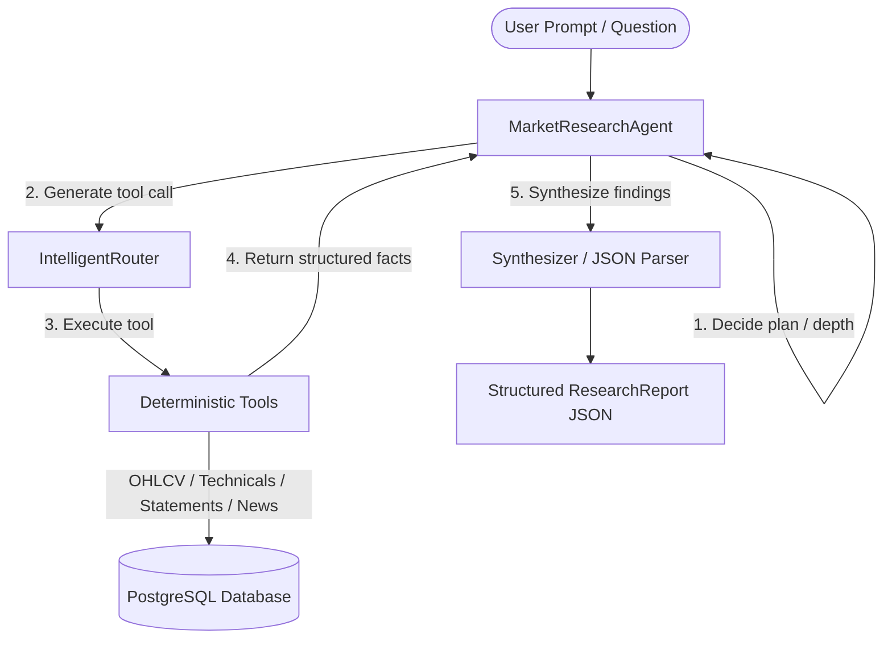

# Module 5 — LLM & Agent-Driven Market Intelligence

This document defines the architecture, design choices, prompt structure, and point-in-time constraints of the stock research layer (Module 5).

---

## 1. Core Architecture
The research system decouples **reasoning** (LLM agent) from **fact retrieval** (deterministic tools):

---

## 2. Agent vs Tool Boundaries
*   **Tools**: Retrieve raw facts, filter datasets, perform calculations (like RSI, MA, or margins), and return structured data. Tools have NO reasoning capabilities.
*   **Agent**: Decides what data is needed, combines cross-domain evidence, identifies conflicts (e.g. rising revenues but declining margins), explains macroeconomic implications, and drafts the research narrative. The agent MUST NOT calculate financial ratios or scrape data manually.

---

## 3. Prompt Architecture
The system uses the `MarketResearchAgent` system prompt to enforce rules:
*   **Grounding**: Every statement must refer to tool output.
*   **PIT Safety**: No information after the target `as_of` date.
*   **No Recommendations**: No BUY, SELL, or HOLD ratings, target prices, or financial advice.
*   **Structured Output Contract**: Must return a single valid JSON object matching the `ResearchReport` schema.

---

## 4. Research Depth & Iteration Controls
The maximum number of execution loop turns is bounded by the selected depth to control API costs and prevent infinite loops:
*   **QUICK**: Max 6 iterations. Focused on stock snapshot, basic technicals, and latest news.
*   **STANDARD**: Max 9 iterations. Incorporates full technicals, annual/quarterly financials, and corporate events.
*   **DEEP**: Max 12 iterations. Broader historical technical trends, multiple statement periods, financial ratios, risk factor identification, and conflict handling.

---

## 5. Point-in-Time (PIT) Safety Enforcement
PIT safety is enforced at two levels:
1.  **Agent Execution Level**: The agent's loop *automatically* injects the `as_of` parameter into every generated tool call.
2.  **Service/DB Level**: Stored database queries filter `timestamp__lte=as_of` or `period_end__lte=as_of_date`, preventing look-ahead leakage.

---

## 6. Conflict & Failure Handling
*   **Conflicting Signals**: Rather than forcing a unified view, the agent calls out discrepancies (e.g. "News indicates strong forward growth, but margins dropped 4% YoY").
*   **Graceful Degradation**: If a tool (e.g. Screener or Yahoo RSS) fails, the agent lists that data source as "Unavailable" in the report's unknowns and continues analysis using other tools.
*   **Malformed Output**: The service catches JSON decoding errors, wrapping the raw text response in a fallback report structure to maintain user interface stability.

---

## 7. Structured Intelligence Report Schema
The final output is a JSON dictionary containing:
*   `company`: Company Name
*   `instrument`: Stock Ticker Symbol
*   `as_of`: Target Date ISO String
*   `summary`: Executive Summary paragraph
*   `market_snapshot`: Price and trade metrics
*   `technical_analysis`: Trend and indicators narrative
*   `fundamental_analysis`: Balance sheet, margin, and cash flow narrative
*   `news_analysis`: Material news items synthesis
*   `positive_factors`: List of positive facts
*   `risks`: List of clear risk factors
*   `contradictions`: Discrepancy details
*   `unknowns`: Missing/unconfirmed items
*   `evidence`: Trace citations linking back to tools/periods
*   `generated_at`: Current UTC generation timestamp
