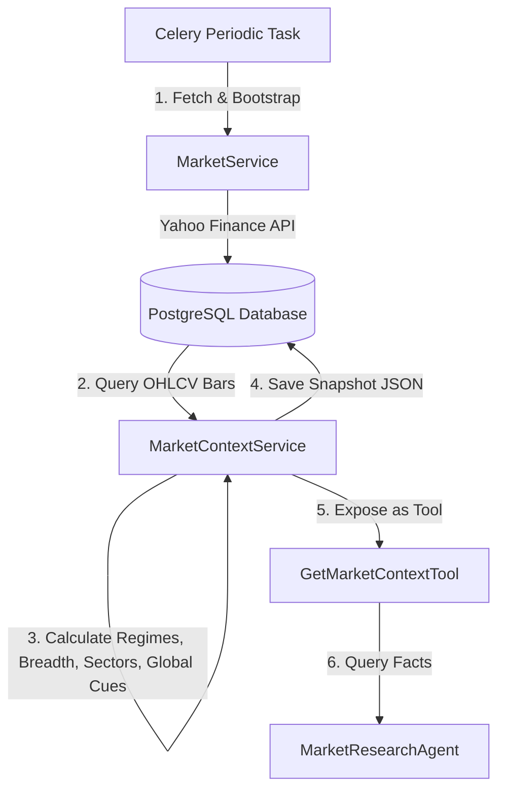

# Module 6 — Market Regime & Cross-Market Intelligence

This document defines the design, calculations, scheduling, and tools of the deterministic market-context layer (Module 6).

---

## 1. Core Architecture
The market context layer calculates and persists the broader market environment (Indian index trends, breadth, sector leaderboards, global cues, and cross-market relationships) at any point-in-time (PIT):

---

## 2. Calculated Components

### A. Index Trend, Volatility, and Momentum Regimes
*   **Trend Classification**:
    *   `bullish`: Close > SMA200 and SMA50 > SMA200
    *   `bearish`: Close < SMA200 and SMA50 < SMA200
    *   `sideways`: Otherwise
*   **Volatility Classification**:
    *   Calculates 20-day realized daily return volatility.
    *   Compares the current value with historical percentiles (25th, 75th, 95th) computed over a rolling 200-bar history.
    *   Falls back to absolute daily standard deviation thresholds (Low: <0.8%, Normal: 0.8%-1.8%, High: 1.8%-3.0%, Extreme: >3.0%) if historical bars are short.
*   **Momentum Classification**:
    *   `positive`: RSI14 > 55 and MACD line > MACD signal
    *   `negative`: RSI14 < 45 and MACD line < MACD signal
    *   `neutral`: Otherwise

### B. Market Breadth Metrics
Evaluates overall participation across active equities in the target universe (all active equities stored in the system):
*   **A/D Ratio**: Advancing / max(1, Declining) daily returns.
*   **SMA Participation**: Percentage of stocks trading above their SMA20, SMA50, and SMA200.
*   **New Highs/Lows**: Count of stocks trading within 0.5% of their rolling 252-day high/low.
*   **Breadth Regime**: `strong` (above-SMA50 participation > 70%), `weak` (above-SMA50 participation < 30%), or `neutral`.

### C. Sector Performance Leaderboard
Groups active equities by sector, calculating:
*   **Average return**: Mean daily return of all stocks in the sector.
*   **Relative strength**: Average sector return minus Nifty 50 return.
*   **Momentum state**: Compares sector rank vs 5 trading days ago. If rank improves by $\ge 2$, it is marked `improving`. If it drops by $\ge 2$, it is marked `deteriorating`. Otherwise, it is `stable`.

### D. Global Cues & Timezone Alignment
Tracks major global indices, currencies, commodities, and treasury yields (`^GSPC`, `^IXIC`, `^DJI`, `^VIX`, `USDINR=X`, `CL=F`, `GC=F`, `^TNX`).
*   **Staleness**: Checks the difference between the target `as_of` and the last recorded bar's timestamp. If $> 48$ hours, marks `stale: True`.

### E. Cross-Market Features
*   **Pearson Correlation**: Computes 20-day rolling correlation of Nifty 50 daily returns vs S&P 500, USD/INR rate, and Crude Oil.
*   **Disclaimer**: Explicitly labels correlations as statistical associations that do not imply causation.

---

## 3. Database Schema
Persists aggregated snapshots in the `default` database using the `MarketContextSnapshot` model:

*   `as_of` (DateTime): The PIT target timestamp.
*   `universe` (String): The target universe code (e.g. `NIFTY50`).
*   `calculations_version` (Integer): Model calculation format version.
*   `index_regimes` (JSON): Trend, volatility, and momentum results for indices.
*   `breadth` (JSON): Advances, declines, participation, and highs/lows counts.
*   `sector_rankings` (JSON): Leaderboard rankings and relative performance.
*   `global_cues` (JSON): Values, percent change, and staleness of global cues.
*   `cross_market_features` (JSON): Rolling correlations and disclaimers.
*   `macro_events` (JSON): Relevant economic news/disclosures matching keywords (RBI, Federal Reserve, inflation).
*   `data_quality` (JSON): Coverage ratio, count of missing benchmark symbols, and completeness score.

---

## 4. Scheduling & Celery Task
*   A periodic Celery task `refresh_market_context` runs hourly.
*   It automatically fetches latest quotes and 90-day history for the benchmarks, calculates their technical features, runs the context calculations, and saves the snapshot.
