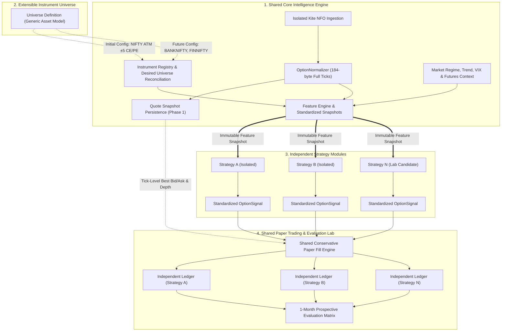
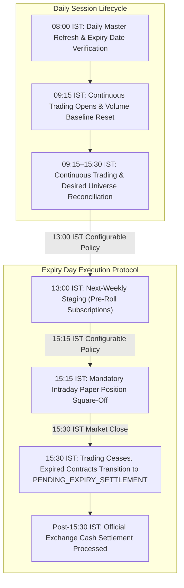

# Nomad Analyst — F&O Core Intelligence Engine & Strategy Lab Specification
 
 **Document Reference:** `docs/research/fno/fno_core_engine_and_strategy_lab_spec.md`  
 **Revision Date:** 2026-10-17  
 **Revision Version:** 2.0.0 (Phase 22A–22F Execution Plan Architecture)  
 **Author:** Quantitative Researcher & Systems Architect  
 **Status:** CANONICAL ARCHITECTURAL SPECIFICATION — RATIFIED FOR OFFLINE DEVELOPMENT (PHASES 22B, 22C, 22D)  


---

## 1. Executive Overview & Architecture Principles

This document establishes the canonical software architecture and data contracts for Nomad Analyst's **F&O Options Pillar**. It reconciles all prior research documents into a single authoritative technical specification.

### A. Four Core Architectural Pillars
The F&O system is decomposed into four strictly decoupled subsystems:



### B. Core Non-Negotiable Tenets
1. **Third Pillar Isolation:** F&O derivative market data must **never** mutate the existing equity `IntradayStateManager` or equity `market_ohlcvbar` table.
2. **Single Source of Validated Truth:** All trading strategies consume the exact same validated, timestamped feature snapshots. No strategy is permitted to maintain its own WebSocket connection, private ticker, or unvalidated data feed.
3. **Realistic Fills via Persisted Quotes:** Simulated fills cannot be evaluated from OHLCV candles alone. High-frequency bid/ask and depth snapshots are captured and persisted starting in Phase 1 (`fno_option_quote_snapshot`) to ensure that Phase 4 taker fills execute against real market depth.
4. **Independent Quote Freshness & Strict Timestamp Rules:** Quote age is measured from the quote packet's exchange timestamp, **independently of last-trade age**. Never treat a receipt-time fallback as proof that an exchange quote is fresh; fallback quotes are ineligible for execution. Never subtract an epoch timestamp from a monotonic timestamp.
5. **Zero State Leakage:** Strategies are completely isolated modules. Positions, simulated orders, and performance state are tracked in separate, independent ledgers per strategy.
6. **Separation of Market Exits from Expiry Settlement:** Continuous market exits occur strictly against the order book bid. Official expiry settlement is an administrative cash settlement that does not cross a bid-ask spread and is never recorded as a bid-side fill.
7. **No Fabricated Prices, Fills, or Settlement Values:** If an exit cannot find an executable bid, or if official settlement values/fees are uningested, the system transitions to `PENDING_EXPIRY_SETTLEMENT` without fabricating fills or settlement prices. Expired contracts are strictly prevented from entering next-session exit retries.
8. **Prospective Walk-Forward Lab:** No synthetic backtesting on unrecorded expired options. Strategy validation proceeds strictly through prospective live-market paper evaluation over a designated one-month parallel evaluation window.

---

## 2. Ingestion, Normalization & Data Quality Engine

### A. Isolated Kite NFO WebSocket Ingestion
The Kite Connect WebSocket receives market data over a shared TLS socket, but token dispatch is segregated immediately at the framing layer:

- Tokens matching `segment == "INDICES"` or `(exchange == "NSE" and instrument_type == "EQ")` route to the existing equity `KiteNormalizer`.
- Tokens matching `exchange == "NFO"` route strictly to the isolated `OptionNormalizer` in the `fno/` application.

### B. Kite Connect `MODE_FULL` Binary Packet Mapping (184 Bytes)
The binary packet transmitted by KiteTicker in `MODE_FULL` for derivative contracts is unpacked according to the official Kite Connect specification ([https://kite.trade/docs/connect/v3/websocket/](https://kite.trade/docs/connect/v3/websocket/)):

| Byte Offset | Field Name | Data Type | Units / Scale | Semantic Description |
| :--- | :--- | :--- | :--- | :--- |
| **0 – 3** | `instrument_token` | `uint32` (Big Endian) | Integer | Unique broker instrument identifier |
| **4 – 7** | `last_price` | `int32` (Big Endian) | `/ 100.0` (INR) | Last traded premium price |
| **8 – 11** | `last_quantity` | `int32` (Big Endian) | Contracts | Traded quantity in the most recent transaction |
| **12 – 15** | `average_price` | `int32` (Big Endian) | `/ 100.0` (INR) | **Exchange Session Average Traded Price (ATP)** from 09:15 IST across all market participants. *(Distinct from Nomad's internally calculated bar/rolling VWAP)* |
| **16 – 19** | `volume_traded` | `int32` (Big Endian) | Contracts | Cumulative session contract volume |
| **20 – 23** | `buy_quantity` | `int32` (Big Endian) | Contracts | Total cumulative quantity available across the entire buy order book |
| **24 – 27** | `sell_quantity` | `int32` (Big Endian) | Contracts | Total cumulative quantity available across the entire sell order book |
| **28 – 31** | `open` | `int32` (Big Endian) | `/ 100.0` (INR) | Session open premium price |
| **32 – 35** | `high` | `int32` (Big Endian) | `/ 100.0` (INR) | Session high premium price |
| **36 – 39** | `low` | `int32` (Big Endian) | `/ 100.0` (INR) | Session low premium price |
| **40 – 43** | `close` | `int32` (Big Endian) | `/ 100.0` (INR) | Previous trading session close premium |
| **44 – 47** | `last_trade_time` | `int32` (Big Endian) | Unix Seconds | Timestamp of the last executed trade |
| **48 – 51** | `oi` | `int32` (Big Endian) | Contracts | **Open Interest (number of outstanding contracts)** |
| **52 – 55** | `oi_day_high` | `int32` (Big Endian) | Contracts | Session high Open Interest |
| **56 – 59** | `oi_day_low` | `int32` (Big Endian) | Contracts | Session low Open Interest |
| **60 – 63** | `exchange_timestamp`| `int32` (Big Endian) | Unix Seconds | Timestamp assigned by the exchange feed |
| **64 – 183** | `depth` | `120 bytes` (10 entries)| Structured | 10 market depth levels: 5 Buy levels followed by 5 Sell levels (see below) |

#### Market Depth Entry Structure (Bytes 64–184)
Each of the 10 depth levels occupies exactly **12 bytes** ($10 \times 12 = 120\text{ bytes}$):
- `quantity` (`int32`, 4 bytes, Big Endian): Aggregate contract quantity at this depth level.
- `price` (`int32`, 4 bytes, Big Endian, `/ 100.0` for INR): Limit price at this level.
- `orders` (`int16`, 2 bytes, Big Endian): Count of open orders at this level.
- `padding` (2 bytes): Protocol word alignment bytes.

### C. Timestamp Architecture & Quantitative Correctness
Every tick and quote snapshot records distinct temporal values with unambiguous semantic boundaries:

1. `exchange_timestamp_utc` (`Optional[datetime]`, timezone-aware UTC):  
   Parsed from packet bytes 60–63 (Unix epoch seconds converted to UTC datetime). Represents the exchange matching engine's clock at packet broadcast.
2. `last_trade_timestamp_utc` (`Optional[datetime]`, timezone-aware UTC):  
   Parsed from packet bytes 44–47. Represents the execution time of the most recent trade. Remains stationary across quote updates when no trade occurs.
3. `received_wall_clock_utc` (`datetime`, timezone-aware UTC):  
   Recorded at the exact moment the WebSocket frame is received by the Nomad ingestion daemon via `datetime.now(timezone.utc)`.
4. `received_monotonic_ns` (`int`):  
   Captured via `time.monotonic_ns()` at frame receipt. Used **exclusively** for internal pipeline duration calculations and local debounce timers.

#### Separate Temporal Metrics:
The system strictly separates feed latency, quote age, last-trade age, and pipeline latency:
- **Feed Latency:** Measures transport/network delay from exchange to local socket:
  $$\Delta_{\text{feed\_ms}} = \text{int}\left((\text{received\_wall\_clock\_utc} - \text{exchange\_timestamp\_utc}).\text{total\_seconds}() \times 1000\right)$$
- **Quote Age (Price/Depth Freshness):** Measured strictly from the quote packet's exchange timestamp, **independently of last-trade age**:
  $$\Delta_{\text{quote\_age\_s}} = \max\left(0.0, (\text{evaluation\_wall\_clock\_utc} - \text{exchange\_timestamp\_utc}).\text{total\_seconds}()\right)$$
- **Last-Trade Age (Transaction Activity):** Measures time elapsed since the last executed trade on that instrument:
  $$\Delta_{\text{trade\_age\_s}} = \max\left(0.0, (\text{evaluation\_wall\_clock\_utc} - \text{last\_trade\_timestamp\_utc}).\text{total\_seconds}()\right) \quad (\text{if } \text{last\_trade\_timestamp\_utc} \text{ exists, else } \text{None})$$
- **Internal Pipeline Latency:** Measures elapsed time inside Nomad's daemon:
  $$\Delta_{\text{pipeline\_ms}} = \frac{\text{time.monotonic\_ns}() - \text{received\_monotonic\_ns}}{1{,}000{,}000}$$

> [!CRITICAL]
> **Mathematical Rule on Monotonic vs. Epoch Timestamps:**  
> A monotonic timestamp has an arbitrary system-defined reference point (e.g., host uptime). **Never subtract an epoch timestamp from a monotonic timestamp.**  

#### Timestamp Validation, Fallback Semantics & Execution Eligibility:
> [!CRITICAL]
> **Receipt Fallback Rule: Never Treat Fallback as Freshness.**  
> A receipt-time fallback allows internal queue sequencing, but **can NEVER be treated as proof that an exchange quote is fresh**.

| `exchange_time_status` | Condition | Normalization & Persistence Behavior | Strategy Signal & Execution Eligibility |
| :--- | :--- | :--- | :--- |
| **`VALID`** | $0 < \text{packet\_ts}$, and $-300\text{s} \le \text{exchange\_ts} - \text{received\_utc} \le +2.0\text{s}$ | Persisted with original `exchange_timestamp_utc`. | **Eligible for signal and execution** IF $\Delta_{\text{quote\_age\_s}} \le 3.0\text{s}$ and book is `VALID`. |
| **`FALLBACK_TO_RECEIVED`** | $\text{packet\_ts} == 0$ or null (pre-open / handshake). | `exchange_timestamp_utc = received_wall_clock_utc`. Logged with warning. | **INELIGIBLE FOR EXECUTION** (`EXECUTION_INELIGIBLE_UNVERIFIED_TIMESTAMP`). `is_quote_fresh` cannot be certified. |
| **`INVALID`** | $\text{packet\_ts} < 0$ or non-numeric. | Discarded or flagged `INVALID`. | **INELIGIBLE FOR EXECUTION** (`EXECUTION_INELIGIBLE_INVALID_TIMESTAMP`). |
| **`FUTURE_SKEW_REJECTED`** | $\text{exchange\_ts} > \text{received\_utc} + 2.0\text{s}$ (unacceptable clock drift). | Discarded from candle rollups and quote snapshots. Logged to anomaly metrics. | **INELIGIBLE FOR EXECUTION** (`EXECUTION_INELIGIBLE_FUTURE_SKEW`). |
| **`HISTORICAL_SKEW_REJECTED`** | $\text{exchange\_ts} < \text{session\_open} - 300\text{s}$. | Discarded as stale delayed replay. | **INELIGIBLE FOR EXECUTION** (`EXECUTION_INELIGIBLE_HISTORICAL_SKEW`). |

### D. Session Volume Resets, Late Ticks & Reconnection Gaps
1. **Session-Aware Volume Reset:**
   - At 09:15:00 IST (start of continuous trading), exchange volume counters reset.
   - If an incoming tick reports $\text{volume\_traded} < \text{previous\_cumulative\_volume}$, the normalizer flags a `SESSION_RESET` event, establishes the new volume baseline, and resets the 1-minute delta accumulator. It must **never** record negative volume deltas.
2. **Late-Tick Handling:**
   - 1-minute candles close at $T_{\text{close}} = \text{HH:MM:59.999}$.
   - A grace window of 1,000ms is allowed for network jitter. Any tick arriving after the grace window with `exchange_timestamp_utc < current_bar_start_utc` is **discarded from the finalized bar** to guarantee PostgreSQL immutability, and logged to a `late_ticks_variance_count` metric.
3. **Reconnection Gaps & Partial Bars:**
   - On WebSocket disconnect, the daemon records `connection_gap_start = now()`. Upon reconnection, it records `connection_gap_end = now()`.
   - Any 1-minute candle interval $[T_{\text{bar\_start}}, T_{\text{bar\_end}}]$ overlapping $[connection\_gap\_start, connection\_gap\_end]$ is explicitly flagged `is_partial_bar = True` with `gap_duration_seconds`.
   - **Strategy Gate:** Strategy modules are strictly prohibited from generating trading signals from partial bars.

### E. Quote Quality & Bid-Ask Classification
Quote state is strictly categorized into mutually exclusive classifications:
- **Valid Active Quote (`VALID`):** $\text{Best Bid} > 0$, $\text{Best Ask} > 0$, $\text{Best Bid} < \text{Best Ask}$, $\text{exchange\_time\_status} == \text{"VALID"}$, and $\text{quote\_age} \le 3.0\text{s}$. Eligible for taker execution.
- **Locked Quote (`LOCKED`):** $\text{Best Bid} == \text{Best Ask}$. Occurs during circuit limits or exchange crossings. Spread is 0. Taker execution is **blocked** (`is_locked = True`).
- **Crossed Quote (`CROSSED`):** $\text{Best Bid} > \text{Best Ask}$. Indicates feed corruption or exchange desynchronization. Taker execution is **blocked** (`is_crossed = True`).
- **Empty Order Book (`EMPTY_BOOK`):** $\text{Best Bid is None}$ or $\text{Best Ask is None}$ (common on illiquid deep OTM strikes). Execution is **blocked**.
- **Zero Bid (`ZERO_BID`):** $\text{Best Bid} == 0.0$. Valid market state for worthless options, but relative spread calculation $(\frac{\text{Ask} - \text{Bid}}{\text{Bid}})$ must guard against division by zero. Selling at market is **blocked**.
- **Stale Quote (`STALE`):** $\text{quote\_age} > 3.0\text{s}$ during continuous trading hours. Taker execution is **blocked** (`is_stale = True`).
- **Invalid / Corrupt Quote (`INVALID`):** $\text{Price} < 0$, non-numeric, or NaN values. Taker execution is **blocked**.

### F. Open Interest Semantics: Missing vs. Zero
- `open_interest is None`: Unpopulated / not reported by exchange feed (e.g., during pre-open 09:00–09:15 IST or initial connection handshake). Assigned `oi_status = "UNPOPULATED"`. Strategies must not evaluate OI deltas.
- `open_interest == 0`: Explicit numeric zero reported by exchange. Valid economic state for newly listed or unparticipated strikes. Assigned `oi_status = "ZERO_ACTIVITY"`.

---

## 3. Extensible Instrument Universe & Policy Lifecycles

### A. Generic Universe Configuration Model
The core engine is asset-agnostic and parameterized via `UnderlyingAssetConfig`:

```python
class UnderlyingAssetConfig(BaseModel):
    """Generic configuration for an underlying asset's derivative universe."""
    underlying_symbol: str               # e.g., "^NSEI", "^NSEBANK"
    underlying_name: str                 # e.g., "NIFTY 50", "NIFTY BANK"
    futures_symbol: Optional[str]        # e.g., "NIFTY-FUT" for active near-month
    exchange: str = "NFO"
    strike_step: Decimal                 # e.g., Decimal("50.0") for NIFTY, Decimal("100.0") for BANKNIFTY
    lot_size: int                        # e.g., 25 or 15
    tick_size: Decimal = Decimal("0.05")
    strike_window_k: int = 5             # ATM ±K strikes (default 5 -> 11 CE + 11 PE = 22 strikes)
    rebalance_threshold_pts: Decimal    # Threshold to evaluate center drift (default 50.0 for NIFTY)
    
    # Configurable Operational & Risk Policies (Not universal exchange mandates)
    next_weekly_staging_policy_time: time = time(13, 0) # Configurable policy for next-weekly pre-subscription
    intraday_square_off_policy_time: time = time(15, 15) # Configurable policy for intraday paper exits
    session_close_time: time = time(15, 30)              # Official market trading close
    is_active: bool = True
```

### B. Initial Supported Scope (Phase 1–5 Configuration)
- **Configured Underlying:** NIFTY 50 (`underlying_symbol = "^NSEI"`).
- **Contract Type:** European Call (CE) and Put (PE).
- **Direction:** Long options (buying only). Option writing/selling is prohibited.
- **Expiry Scope:** Active nearest weekly contract resolved authoritatively from `kite_instruments_master.csv`. Standard weekly contracts expire on Tuesday (shifting to **the previous trading day if Tuesday is a holiday**).
- **Strike Scope:** ATM $\pm 5$ strikes on both sides (11 CE + 11 PE = 22 contracts).
- **Partial Chain Boundary Disclaimer:** The ATM $\pm 5$ window is an **initial capture window**, not a complete option chain. The system does not claim or compute full-chain surface metrics (such as full skew or complete market PCR) from this partial window.

### C. Configurable Staging & Expiry Day Lifecycles
Operational triggers and market close procedures follow clearly labeled policy definitions:



#### Detailed Policy Stages:
1. **Configurable Next-Weekly Staging Policy (`staging_policy_time = 13:00 IST`):**  
   *Policy Purpose:* In the Indian derivatives market, liquidity migration from expiring contracts to the next weekly series accelerates in the afternoon. By default policy at 13:00 IST on expiry day, the engine pre-subscribes to Next-Weekly ATM strikes ($K=3$, 14 contracts) in `MODE_FULL`. This warms up WebSocket buffers, seeds 1-minute OHLCV candles, and initializes Greeks for the next cycle without disrupting active tracking of the expiring series. This is a Nomad operational policy, not an exchange rule.
2. **Configurable Intraday Square-Off Policy (`intraday_square_off_policy_time = 15:15 IST`):**  
   *Policy Purpose:* To prevent overnight gap risk and reflect prudent risk practices prior to broker RMS actions, Nomad triggers market exit signals for all open intraday paper positions at 15:15 IST. This is a configurable internal risk rule.
3. **Session Close & Series Retirement (`session_close_time = 15:30 IST`):**  
   *Exchange Rule:* Official trading in the expiring weekly contract ceases at 15:30:00 IST. Expired contracts are unsubscribed from live ticks and marked `EXPIRED`. The Next-Weekly series is promoted to Primary Active.

---

## 4. Shared Core Intelligence Engine & Feature Contracts

### A. Underlying Volume, VWAP & Context Sourcing
> [!CRITICAL]
> **Mathematical and Structural Index Fact:**  
> A statistical cash index such as NIFTY 50 (`^NSEI`) has **no traded volume** and **no native order book**.  
> **Summing the volume of the 50 constituent equities does NOT produce an index VWAP.** An index is an equity market-capitalization divisor formula of prices; constituent share volume is mathematically distinct from index turnover.

To maintain strict quantitative integrity, underlying context is split into price context and traded-instrument volume context:

1. **Index Price Context (Sourced from `^NSEI`):**  
   Provides spot price, index bar open/high/low/close, index trend, and moving averages.
2. **Underlying Traded Volume Context (Sourced from Active NIFTY Futures):**  
   When volume-weighted context is required for underlying momentum, it is **strictly sourced from the active near-month NIFTY Futures contract (`NIFTY-FUT`)**, which is a real traded instrument with native volume, open interest, and market VWAP.
   - $\text{underlying\_vwap\_source} = \text{"NIFTY_FUTURES_ACTIVE_MONTH"}$.
3. **Constituent Breadth Context (Separate Metric):**  
   The aggregate volume of NIFTY 50 constituents is tracked strictly as a market participation breadth metric (`nifty_constituent_total_volume`), never labeled as index VWAP.
4. **Unavailable State Handling:**  
   If the near-month futures contract is not subscribed or unavailable, `underlying_bar_vwap`, `underlying_session_vwap`, and `underlying_rvol_5m` **must be set to `None`** with $\text{underlying\_vwap\_source} = \text{"UNAVAILABLE"}$.
   - Any strategy module requiring volume or VWAP confirmation must reject signal generation when the volume source is unavailable.

### B. Standardized Feature Snapshot Schema (`OptionFeatureSnapshot`)

```python
class OptionFeatureSnapshot(BaseModel):
    """
    Standardized, reproducible feature contract emitted by the Core Intelligence Engine.
    Consumed by all independent strategy modules.
    """
    # 1. Provenance & Version Metadata
    snapshot_id: str                 # UUID4
    snapshot_version: str = "1.3.0"  # Semantic version of feature schema
    engine_git_commit: Optional[str] # Commit hash of generating engine
    feature_set_id: str              # Identifier for configuration parameters
    calculation_timestamp_utc: datetime # System UTC time when snapshot was built
    timeframe: str = "1m"            # "1m", "5m"
    
    # 2. Triple Timestamp & Independent Freshness Architecture
    exchange_timestamp_utc: Optional[datetime] # From packet bytes 60-63 (UTC-aware)
    last_trade_timestamp_utc: Optional[datetime] # From packet bytes 44-47 (UTC-aware)
    received_wall_clock_utc: datetime # UTC wall-clock arrival time
    received_monotonic_ns: int       # Local monotonic timestamp (for pipeline duration)
    feed_latency_ms: Optional[int]   # (received_wall_clock - exchange_timestamp) in ms
    quote_age_seconds: Optional[Decimal] # Independent age of quote packet
    last_trade_age_seconds: Optional[Decimal] # Independent age of last executed trade
    pipeline_latency_ms: Decimal     # Monotonic internal elapsed duration
    exchange_time_status: str        # "VALID", "FALLBACK_TO_RECEIVED", "FUTURE_SKEW_REJECTED", "INVALID"
    is_quote_fresh: bool             # True IF AND ONLY IF exchange_time_status == "VALID" and quote_age <= 3.0s
    
    # 3. Underlying Index Price & Futures Volume Context
    underlying_symbol: str           # e.g., "^NSEI"
    underlying_spot_price: Decimal
    underlying_open: Decimal
    underlying_high: Decimal
    underlying_low: Decimal
    underlying_close: Decimal
    underlying_futures_price: Optional[Decimal] # Active NIFTY-FUT price
    underlying_futures_vwap: Optional[Decimal]  # Active NIFTY-FUT VWAP
    underlying_futures_rvol_5m: Optional[Decimal]
    underlying_vwap_source: str      # "NIFTY_FUTURES_ACTIVE_MONTH", "UNAVAILABLE"
    
    # 4. Market Regime, Trend & Breadth Context
    market_regime: str               # "TRENDING_BULLISH", "TRENDING_BEARISH", "SIDEWAYS_CHOP", "VOLATILE_EXPANSION"
    trend_strength_adx: Optional[Decimal]
    advancers_count: int             # Constituents advancing
    decliners_count: int             # Constituents declining
    advance_decline_ratio: Decimal
    india_vix_level: Decimal
    india_vix_daily_change_pct: Decimal
    
    # 5. Contract Specific Identifiers & Expiry
    tradingsymbol: str               # e.g., "NIFTY26OCT24500CE"
    instrument_token: int
    option_type: str                 # "CE" or "PE"
    strike_price: Decimal
    expiry_date: date
    days_to_expiry: int              # Calendar days
    trading_sessions_to_expiry: Decimal # Fractional trading sessions remaining
    atm_distance_points: Decimal     # S_spot - Strike
    moneyness_category: str          # "DEEP_ITM", "ITM", "ATM", "OTM", "DEEP_OTM"
    
    # 6. Premium Price & Bar Metrics
    premium_open: Decimal
    premium_high: Decimal
    premium_low: Decimal
    premium_close: Decimal
    premium_bar_volume: int          # Volume traded in the 1-minute bar
    premium_session_volume: int      # Cumulative volume traded
    exchange_session_atp: Decimal    # Byte 12-15 Exchange Average Traded Price (ATP)
    nomad_candle_vwap: Optional[Decimal] # Internally calculated volume-weighted candle price
    
    # 7. Open Interest Metrics (With Explicit Missing Semantics)
    open_interest: Optional[int]     # None if unpopulated, >= 0 if reported
    oi_status: str                   # "VALID", "ZERO_ACTIVITY", "UNPOPULATED"
    oi_change_1m: Optional[int]      # Delta vs previous 1m bar
    oi_change_session: Optional[int] # Delta vs session opening OI
    oi_interpretation: Optional[str] # "LONG_BUILDUP", "SHORT_BUILDUP", "LONG_UNWINDING", "SHORT_COVERING"
    
    # 8. Microstructure, Order Book & Liquidity Metrics
    best_bid: Optional[Decimal]
    best_ask: Optional[Decimal]
    mid_price: Optional[Decimal]
    spread_absolute: Optional[Decimal] # best_ask - best_bid
    spread_percentage: Optional[Decimal] # (best_ask - best_bid) / best_bid (guarded if bid=0)
    bid_depth_quantity_l1: Optional[int]
    ask_depth_quantity_l1: Optional[int]
    total_buy_quantity: Optional[int]# Byte 20-23
    total_sell_quantity: Optional[int]# Byte 24-27
    order_book_imbalance: Optional[Decimal] # (BuyQty - SellQty) / (BuyQty + SellQty)
    
    # 9. Analytics, Black-Scholes Greeks & Failure Handling
    greeks_status: str               # "VALID", "CALCULATION_FAILED", "SKIPPED_ILLIQUID"
    greeks_failure_reason: Optional[str] # "BELOW_INTRINSIC", "NON_CONVERGENT", "ZERO_BID", None
    implied_volatility: Optional[Decimal] # Black-Scholes IV (None if failed)
    delta: Optional[Decimal]
    gamma: Optional[Decimal]
    theta: Optional[Decimal]         # Daily theta decay in INR
    vega: Optional[Decimal]
    
    # 10. Data Quality & Integrity Flags
    quote_status: str                # "VALID", "EMPTY_BOOK", "ZERO_BID", "STALE", "LOCKED", "CROSSED", "INVALID"
    is_stale: bool = False           # True if quote age > 3.0s
    is_locked: bool = False          # True if Best Bid == Best Ask
    is_crossed: bool = False         # True if Best Bid > Best Ask
    is_partial_bar: bool = False     # True if bar spans reconnect gap
    is_valid_for_signal: bool = True # False if any critical field is stale/crossed/locked/partial/fallback_time
```

### C. Greeks Inputs & Failure Handling
1. **Inputs Required for Inversion:**
   - Spot price ($S$), Strike ($K$), Time to Expiry ($T$ in annualized trading days: $\frac{\text{trading\_sessions\_remaining}}{252}$), Risk-free rate ($r$, default 6.5% 91-day T-Bill rate), Dividend yield ($q$, default 1.2% for NIFTY), Mid-market premium ($P_{\text{mid}} = \frac{\text{Best Bid} + \text{Best Ask}}{2}$).
2. **Inversion & Failure Handling:**
   - Implied Volatility ($\sigma$) is inverted using Brent's method.
   - If $P_{\text{mid}} \le \text{intrinsic value}$ (arbitrage violation), or $\text{Best Bid} == 0$, or Brent's method fails to converge within 50 iterations:
     - Set $\text{implied\_volatility} = \text{None}$, $\text{delta} = \text{None}$, $\text{gamma} = \text{None}$, $\text{theta} = \text{None}$, $\text{vega} = \text{None}$.
     - Set $\text{greeks\_status} = \text{"CALCULATION\_FAILED"}$ and assign $\text{greeks\_failure\_reason}$.
     - Do not crash the feature pipeline; emit the snapshot with null Greeks.

---

## 5. Independent Strategy Interface & Signal Specification

### A. The Generic Strategy Interface (`BaseStrategy`)
```python
class BaseStrategy(ABC):
    """
    Abstract Base Class for all Nomad Analyst F&O Strategies.
    Strategies are isolated, versioned, and stateless with respect to other strategies.
    """
    strategy_id: str                 # Unique ID, e.g., "STRAT-ORB-15M"
    strategy_name: str               # Human-readable name
    strategy_version: str            # Semantic version, e.g., "1.0.0"
    is_enabled: bool = True
    config: Dict[str, Any]           # Strategy-specific configuration parameters

    def __init__(self, config: Optional[Dict[str, Any]] = None):
        self.config = config or {}
        self.is_enabled = self.config.get("is_enabled", True)

    @abstractmethod
    def on_feature_snapshot(
        self, 
        snapshot: OptionFeatureSnapshot
    ) -> Optional["OptionSignal"]:
        """
        Evaluates a validated feature snapshot.
        Pure and deterministic: returns an OptionSignal if entry/exit rules are met, else None.
        Must check snapshot.is_valid_for_signal before triggering.
        """
        pass

    @abstractmethod
    def on_trade_event(self, event: "PaperTradeEvent") -> None:
        """Receives updates regarding fills, exits, and ledger mutations."""
        pass
```

### B. Standardized Signal Schema (`OptionSignal`)
```python
class OptionSignal(BaseModel):
    """
    Standardized signal emitted by an independent strategy module.
    Consumed by the shared Paper Execution Lab.
    """
    signal_id: str                   # UUID4
    strategy_id: str                 # Emitting strategy ID
    strategy_version: str            # Emitting strategy version
    timestamp: datetime              # Timestamp of signal emission
    
    # Target Instrument
    tradingsymbol: str
    instrument_token: int
    underlying_symbol: str
    option_type: str                 # "CE" or "PE"
    strike_price: Decimal
    expiry_date: date
    
    # Action & Urgency
    action: str                      # "BUY_TO_OPEN", "EXIT_TARGET", "EXIT_STOP", "EXIT_TIME", "EXIT_EOD"
    suggested_lot_count: int = 1
    limit_price_hint: Optional[Decimal]
    max_acceptable_slippage_pct: Decimal = Decimal("0.015")
    
    # Risk Envelope
    stop_loss_premium: Optional[Decimal]
    profit_target_premium: Optional[Decimal]
    max_holding_minutes: Optional[int] = 45
    eod_square_off_time: time = time(15, 15)
    
    # Audit Trail
    trigger_rule_name: str
    trigger_rationale: str
    snapshot_reference_id: str
```

---

## 6. Shared Paper Execution Engine & Independent Ledgers

### A. Quote Snapshot Persistence (Implemented in Phase 1)
To ensure realistic taker fills at signal time $T_{\text{sig}}$ and exit time $T_{\text{exit}}$, high-frequency quote state is captured and persisted starting in **Phase 1**:

```sql
CREATE TABLE fno_option_quote_snapshot (
    id BIGSERIAL PRIMARY KEY,
    instrument_token INTEGER NOT NULL,
    tradingsymbol VARCHAR(50) NOT NULL,
    exchange_timestamp_utc TIMESTAMPTZ, -- NULL if exchange timestamp was unpopulated
    received_wall_clock_utc TIMESTAMPTZ NOT NULL,
    exchange_time_status VARCHAR(30) NOT NULL, -- 'VALID', 'FALLBACK_TO_RECEIVED', 'INVALID', 'FUTURE_SKEW_REJECTED'
    best_bid NUMERIC(10, 2),
    best_ask NUMERIC(10, 2),
    bid_quantity_l1 INTEGER,
    ask_quantity_l1 INTEGER,
    depth JSONB, -- Up to 5 bids and 5 asks with order counts
    quote_status VARCHAR(20) NOT NULL, -- 'VALID', 'EMPTY_BOOK', 'ZERO_BID', 'STALE', 'LOCKED', 'CROSSED', 'INVALID'
    is_stale BOOLEAN NOT NULL DEFAULT FALSE,
    is_locked BOOLEAN NOT NULL DEFAULT FALSE,
    is_crossed BOOLEAN NOT NULL DEFAULT FALSE,
    is_execution_eligible BOOLEAN NOT NULL DEFAULT FALSE,
    created_at TIMESTAMPTZ NOT NULL DEFAULT NOW()
);

CREATE INDEX idx_fno_quotes_token_ts ON fno_option_quote_snapshot (instrument_token, exchange_timestamp_utc DESC);
CREATE INDEX idx_fno_quotes_sym_ts ON fno_option_quote_snapshot (tradingsymbol, exchange_timestamp_utc DESC);
```

#### Retention & Storage Management:
- **Hot Tier Storage:** Retained in PostgreSQL for 5 trading sessions (1 rolling weekly cycle).
- **Automated Lifecycle Purge:** A weekly Celery maintenance task purges or archives quote snapshot partitions following contract settlement.
- **Debounce Threshold:** Quotes are persisted on every best bid/ask change or trade event, with a minimum 250ms debounce per token during high-frequency quote flickering.

### B. Execution Realism, Fill Model & Separation of Expiry Settlement
1. **Simulated Buy Entry (Continuous Market Taker Fill):**
   - Fill Price:
     $$P_{\text{fill\_buy}} = \text{Best Ask} + \text{Slippage}$$
     $$\text{Slippage} = \max\left(\text{TickSize}, 0.005 \times \text{Best Ask}\right)$$
   - Recorded as `fill_type = "MARKET_TAKER"`.
2. **Simulated Sell Exit (Continuous Market Taker Fill):**
   - Fill Price:
     $$P_{\text{fill\_sell}} = \text{Best Bid} - \text{Slippage}$$
     $$\text{Slippage} = \max\left(\text{TickSize}, 0.005 \times \text{Best Bid}\right)$$
   - Recorded as `fill_type = "MARKET_TAKER"`.
3. **Execution Eligibility Gates:**
   - Any order arriving when quote state is **NOT eligible** is rejected:
     - `exchange_time_status != "VALID"` $\to$ `REJECTED_UNVERIFIED_TIMESTAMP`
     - `quote_status == "STALE"` $\to$ `REJECTED_STALE_QUOTE`
     - `quote_status == "LOCKED"` $\to$ `REJECTED_LOCKED_QUOTE`
     - `quote_status == "CROSSED"` $\to$ `REJECTED_CROSSED_BOOK`
     - `quote_status == "EMPTY_BOOK"` $\to$ `REJECTED_EMPTY_BOOK`
     - `quote_status == "ZERO_BID"` $\to$ `REJECTED_ZERO_BID`
   - If relative spread $\frac{\text{Best Ask} - \text{Best Bid}}{\text{Best Bid}} > 0.025$ (2.5%), order is **REJECTED** (`REJECTED_EXCESSIVE_SPREAD`).

### C. Strict Handling of Zero Bids, Unexecutable Exits & Official Settlement
> [!CRITICAL]
> **Settlement Separation Rule: Never Record Settlement as a Bid-Side Fill.**  
> Continuous market exits cross an order book bid. Official expiry settlement is an administrative cash settlement that does not cross a bid-ask spread and does not incur market slippage.  
> **Never fabricate a settlement price, fill, or settlement value.**

1. **Unexecutable Market Exit State:** When an exit trigger fires during continuous trading (stop loss, profit target, or 15:15 policy square-off), but `best_bid is None` or `best_bid == 0.00`, the order is marked `PENDING_LIQUIDITY` / `EXIT_UNEXECUTABLE_ZERO_BID`. The position remains open.
2. **Continued Evaluation Until Market Close (15:30 IST):** The engine monitors incoming ticks until 15:30:00 IST. If a valid positive bid appears, the market exit executes.
3. **Expiry Day Resolution (Post-15:30 IST):**
   - At 15:30:00 IST on expiry day, all remaining open positions in the expiring contract **immediately transition to `PENDING_EXPIRY_SETTLEMENT`**.
   - **No Next-Session Exit Retries for Expired Contracts:** An expired contract is permanently inactive. It is strictly prohibited from entering overnight carry or next-session exit retries.
   - **Pending Settlement State:** While official settlement values or verified exercise fee schedules are uningested, the position remains in `PENDING_EXPIRY_SETTLEMENT` without fabricating a final P&L.
   - **Resolution Once Settlement Value is Verified:**
     - **Out-of-the-Money / At-the-Money:** If final settlement index price confirms intrinsic value is 0.00:
       $$\text{settlement\_price} = 0.00, \quad \text{gross\_pnl} = -1 \times (\text{entry\_fill\_price} \times \text{quantity})$$
       $$\text{status} = \text{"CLOSED_EXPIRED_WORTHLESS"}, \quad \text{fill\_type} = \text{"SETTLEMENT"}, \quad \text{exit\_slippage} = 0.00$$
     - **In-the-Money (ITM):** If final settlement price confirms intrinsic value $> 0.00$:
       $$\text{settlement\_price} = \max\left(0, S_{\text{settlement}} - K\right) \quad (\text{for CE})$$
       $$\text{status} = \text{"CLOSED_EXPIRED_ITM_SETTLED"}, \quad \text{fill\_type} = \text{"SETTLEMENT"}, \quad \text{exit\_slippage} = 0.00$$
       *(Deducts verified official STT of 0.15% on intrinsic value and official exchange exercise charges).*
4. **Non-Expiry Day Resolution:** If the contract is **unexpired** and market closes at 15:30 IST with an unexecutable zero-bid exit, the position is tagged `UNEXECUTABLE_OVERNIGHT_CARRY`, and market exit attempts resume at 09:15 IST the next trading morning.

### D. Statutory Transaction Fee & Tax Model (Assumptions Requiring Verification)
> [!IMPORTANT]
> **Pre-Implementation Verification Mandatory:**  
> The statutory fee formulas below are documented based on official circulars, but **MUST be authoritatively verified against actual broker contract notes and exchange rate sheets prior to Phase 4 implementation**.

- **Brokerage:** ₹20.00 flat per executed order.
- **NSE Options Transaction Charges (Circular `NSE/FA/73061`, Effective 1 March 2026):**
  - **₹3,553 per crore of premium turnover** (**0.03553%**), composed of:
    - **₹3,552.99 per crore** exchange transaction fee.
    - **₹0.01 per crore** Investor Protection Fund Trust (IPFT) contribution.
- **Securities Transaction Tax (STT, Effective 1 April 2026 under the Finance Act):**
  - **0.15% on option premium** on the sell side for ordinary market exits.
  - **0.15% on intrinsic settlement value** for exercised in-the-money options upon contract expiration.
- **Goods & Services Tax (GST):** **18%** applied strictly to the taxable service base:
  $$\text{GST Base} = \text{Brokerage} + \text{Exchange Transaction Charges (including IPFT)} + \text{SEBI Turnover Fees}$$
- **SEBI Turnover Charges:** ₹10 per crore (0.0001% of premium turnover).
- **Stamp Duty:** 0.003% on buy-side premium turnover.

### E. Independent Paper Ledgers
Each strategy maintains an isolated simulated ledger table in PostgreSQL:

```sql
CREATE TABLE fno_paper_trade_ledger (
    trade_id BIGSERIAL PRIMARY KEY,
    strategy_id VARCHAR(50) NOT NULL,
    strategy_version VARCHAR(20) NOT NULL,
    signal_id UUID NOT NULL,
    instrument_token INTEGER NOT NULL,
    tradingsymbol VARCHAR(50) NOT NULL,
    option_type VARCHAR(2) NOT NULL,
    strike_price NUMERIC(10, 2) NOT NULL,
    expiry_date DATE NOT NULL,
    entry_timestamp TIMESTAMPTZ NOT NULL,
    entry_fill_price NUMERIC(10, 2) NOT NULL,
    entry_slippage NUMERIC(10, 2) NOT NULL,
    quantity INTEGER NOT NULL,
    exit_timestamp TIMESTAMPTZ,
    exit_trigger_reason VARCHAR(30), -- 'TARGET', 'STOP_LOSS', 'TIME_STOP', 'POLICY_SQUAREOFF', 'EXPIRY_CASH_SETTLED'
    fill_type VARCHAR(20) NOT NULL DEFAULT 'MARKET_TAKER', -- 'MARKET_TAKER', 'SETTLEMENT'
    exit_fill_price NUMERIC(10, 2),
    exit_slippage NUMERIC(10, 2) NOT NULL DEFAULT 0.00,
    gross_pnl NUMERIC(12, 2),
    total_frictions NUMERIC(12, 2),
    net_pnl NUMERIC(12, 2),
    market_regime_at_entry VARCHAR(30),
    vix_level_at_entry NUMERIC(6, 2),
    status VARCHAR(35) NOT NULL DEFAULT 'OPEN', 
    -- 'OPEN', 'CLOSED', 'REJECTED', 'PENDING_LIQUIDITY', 'PENDING_EXPIRY_SETTLEMENT', 
    -- 'CLOSED_EXPIRED_WORTHLESS', 'CLOSED_EXPIRED_ITM_SETTLED', 'UNEXECUTABLE_OVERNIGHT_CARRY'
    created_at TIMESTAMPTZ NOT NULL DEFAULT NOW()
);

CREATE INDEX idx_fno_ledger_strat ON fno_paper_trade_ledger (strategy_id, status);
CREATE INDEX idx_fno_ledger_ts ON fno_paper_trade_ledger (entry_timestamp DESC);
```

---

## 7. Prospective One-Month Parallel Evaluation Lab

### A. Laboratory Design & Evaluation Protocol
The primary experimental mechanism is a **prospective one-month parallel evaluation window**:
- **Duration:** 1 calendar month (approximately 20 to 22 trading sessions).
- **Execution Mode:** Multi-strategy parallel execution. Each strategy evaluates incoming `OptionFeatureSnapshot` streams in real time and writes to its own isolated `fno_paper_trade_ledger`.
- **Epistemic Tenet:** **One month is an initial evaluation window, NOT proof of long-term alpha.** Its purpose is to verify execution feasibility, measure friction drag in live conditions, and eliminate negative gross expectancy strategies.

### B. Multi-Metric Decision Matrix & Sample Size Resolution
**A strategy winner must NEVER be selected based on Total Net P&L alone.**

#### Sample Size Tier Resolution:
- **$N < 20$ Trades:** **REJECTED (Insufficient Sample / Inconclusive)**. The strategy generated too few opportunities to evaluate.
- **$20 \le N \le 29$ Trades:** **CONDITIONAL / PROVISIONAL (Underpowered Sample)**. The sample is statistically underpowered. Requires a mandatory **2-week paper-trading extension** until $N \ge 30$; the strategy cannot proceed to Phase 6 certification.
- **$N \ge 30$ Trades:** **ADEQUATE SAMPLE FOR EVALUATION**. The full 7-dimensional decision matrix is evaluated.

#### Decision Matrix:
| Metric | Minimum Passing Standard ($N \ge 30$) | Rejection Threshold | Purpose |
| :--- | :--- | :--- | :--- |
| **Gross Expectancy per Trade** | $> +1.5\%$ of entry premium | $\le 0\%$ of entry premium | Verifies underlying directional edge exists before fees. |
| **Friction Drag Ratio** | $\frac{\text{Total Frictions}}{\text{Gross Profits}} < 35\%$ | $\ge 50\%$ | Rejects strategies where transaction costs devour alpha. |
| **Net Profit Factor** | $\text{PF}_{\text{net}} \ge 1.25$ | $\text{PF}_{\text{net}} < 1.05$ | Measures ratio of gross gains to gross losses post-friction. |
| **Win Rate vs. Payoff Ratio** | Win Rate $\ge 40\%$ with Payoff $\ge 1.5$ | $\text{Win Rate} < 35\%$ with Payoff $< 1.3$ | Validates mathematical expectancy curve. |
| **Maximum Drawdown** | Max Drawdown $< 15\%$ on allocated margin | Max Drawdown $\ge 25\%$ | Measures tail risk and capital preservation. |
| **Statistical Uncertainty** | $t\text{-statistic of Net Mean Return} > 1.8$ | $t\text{-statistic} \le 1.0$ | Confirms edge is distinct from random drift. |

---

## 8. Authoritative Implementation Roadmap (Phases 0 Through 6)

The development of the Nomad Analyst F&O Options Pillar is strictly ordered into seven sequential phases:


### Phase Breakdown & Disentangled Acceptance Criteria:

#### Phase 0: Architecture, Empirical Research & Data-Contract Approval
- *Status:* **CURRENT PHASE (Documentation Only)**.
- *Acceptance Criteria:*
  - **AC-0-01** `[Design Requirement]`: 100% agreement across all research documents under `docs/research/fno/`.
  - **AC-0-02** `[Design Requirement]`: Canonical specification establishes explicit, versioned contracts for features, strategies, signals, and ledgers.
  - **AC-0-03** `[Verification Requirement]`: Zero application code, tests, migrations, dependencies, or database records modified.

#### Phase 1: Isolated Options Data Foundation, Bars & Quote Snapshots
- *Status:* **PENDING OPERATOR AUTHORIZATION**.
- *Acceptance Criteria (Disentangled):*
  - **AC-1-U01** `[Unit-Test Requirement]`: `OptionInstrumentRegistry` parses daily CSV, treats master `expiry` date as authoritative, and detects stale master files.
  - **AC-1-U02** `[Unit-Test Requirement]`: `OptionNormalizer` unpacks 184-byte packets with valid zero OI, unpopulated OI (`None`), sparse depth (120 bytes), and locked/crossed quote classification.
  - **AC-1-U03** `[Unit-Test Requirement]`: Desired-universe reconciliation correctly calculates $\mathcal{U}_{\text{desired}} \setminus \mathcal{U}_{\text{active}}$ and $\mathcal{U}_{\text{active}} \setminus \mathcal{U}_{\text{desired}}$ on spot changes and expiry rolls.
  - **AC-1-U04** `[Unit-Test Requirement]`: 1-minute `OptionOHLCVBar` persistence engine is idempotent and prevents duplicate rows under compound unique constraint.
  - **AC-1-U05** `[Unit-Test Requirement]`: `OptionQuoteSnapshot` persists depth JSONB and bid/ask, rejects timestamps with future skew $>2.0$s, handles fallback timestamps without marking them fresh, and supports fast indexed queries.
  - **AC-1-L01** `[Live Acceptance Test]`: Streaming live NFO option ticks concurrently produces zero errors or state mutations in `IntradayStateManager` and zero rows in `market_ohlcvbar`.
  - **AC-1-L02** `[Live Acceptance Test]`: 1-minute `OptionOHLCVBar` records persist with strictly accurate `open_interest` and volume deltas across continuous trading.
  - **AC-1-L03** `[Live Acceptance Test]`: Reconnection recovery resubscribes all active tokens in `MODE_FULL` within 5 seconds of WebSocket reconnect during market hours.
  - **AC-1-L04** `[Live Acceptance Test]`: `OptionQuoteSnapshot` records persist with valid quote classifications and $\le 3.0$s quote ages during live trading.

#### Phase 2: Core Intelligence Engine & Validated Feature Snapshots
- *Status:* **PLANNED**.
- *Acceptance Criteria:*
  - **AC-2-U01** `[Unit-Test Requirement]`: Emits standardized `OptionFeatureSnapshot` schema with 100% compliance across all data types, triple timestamps, independent quote age, and provenance metadata.
  - **AC-2-U02** `[Unit-Test Requirement]`: Greeks calculations match Black-Scholes benchmark within $\pm 0.01\%$ precision; handles inversion failure gracefully.
  - **AC-2-U03** `[Unit-Test Requirement]`: Accurately classifies locked quotes (`bid == ask`), crossed quotes (`bid > ask`), stale quotes, and missing futures volume.
  - **AC-2-L01** `[Live Acceptance Test]`: Feature snapshots generated within 500ms of minute candle close during continuous market hours.

#### Phase 3: Generic Strategy Interface & Signal Framework
- *Status:* **PLANNED**.
- *Acceptance Criteria:*
  - **AC-3-U01** `[Unit-Test Requirement]`: `BaseStrategy` enforces complete state isolation between multiple strategy instances.
  - **AC-3-U02** `[Unit-Test Requirement]`: Emits standardized `OptionSignal` instances adhering strictly to Pydantic contract.
  - **AC-3-U03** `[Unit-Test Requirement]`: Signal validator rejects any signal referencing stale, locked, crossed, or fallback-timestamp feature snapshots.

#### Phase 4: Shared Paper Execution Lab & Independent Strategy Evaluation
- *Status:* **PLANNED**.
- *Acceptance Criteria:*
  - **AC-4-U01** `[Unit-Test Requirement]`: Simulated entry fills execute against persisted quote snapshots at `Best Ask + Slippage`; continuous market exits execute at `Best Bid - Slippage`.
  - **AC-4-U02** `[Unit-Test Requirement]`: Zero-bid exits are marked unexecutable without fabricating fills; official expiry settlements resolve via `SETTLEMENT` fill type with zero slippage or enter `PENDING_EXPIRY_SETTLEMENT`.
  - **AC-4-U03** `[Unit-Test Requirement]`: Expired contracts are strictly prevented from entering next-session exit retries.
  - **AC-4-U04** `[Unit-Test Requirement]`: Statutory fee engine calculations match verified regulatory formulas to the exact paisa (Decimal `0.01`).
  - **AC-4-U05** `[Unit-Test Requirement]`: Multiple strategies executing concurrently write strictly to independent ledger rows with zero cross-contamination.

#### Phase 5: Prospective One-Month Parallel Paper Experiment
- *Status:* **PLANNED**.
- *Acceptance Criteria:*
  - **AC-5-L01** `[Live Acceptance Test]`: All candidate strategies run continuously in parallel across 1 full calendar month without crashing or corrupting data.
  - **AC-5-O01** `[Operational Requirement]`: Daily automated ledger reconciliation logs 100% of trades with zero missing friction fields.
  - **AC-5-S01** `[Statistical Requirement]`: Each evaluated strategy records $N \ge 30$ executed trades across the month (or triggers a mandatory 2-week extension if $20 \le N \le 29$).

#### Phase 6: Evidence-Based Review & Production Gate
- *Status:* **PLANNED**.
- *Acceptance Criteria:*
  - **AC-6-A01** `[Audit Requirement]`: Formal post-experiment audit report published with complete trade logs, regime breakdowns, and uncertainty bands.
  - **AC-6-D01** `[Decision Gate]`: Operator sign-off approving either (a) advancement to pilot live trading, (b) strategy refinement, or (c) permanent hypothesis rejection.
