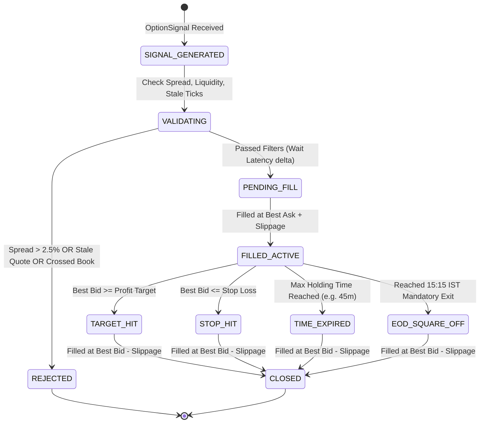

# Nomad Analyst — F&O Paper Trading & Execution Specification (Reconciled)

**Document Reference:** `docs/research/fno/fno_paper_trading_and_validation_spec.md`  
**Revision Date:** 2026-10-17  
**Auditor:** Quantitative Researcher & Systems Architect  
**Status:** RATIFIED EXECUTION SPECIFICATION — RECONCILED WITH CANONICAL SPECIFICATION  

---

## 1. Specification Scope & Phase Boundaries

### Canonical Specification Reference:
The full data contracts, feature schemas, strategy interfaces, execution models, and evaluation matrix are authoritatively specified in:  
👉 [`docs/research/fno/fno_core_engine_and_strategy_lab_spec.md`](file:///Users/shivamsingh/personal/nomad-analyst/docs/research/fno/fno_core_engine_and_strategy_lab_spec.md)

> [!IMPORTANT]
> **Execution is Strictly Out of Scope for Phase 1.**  
> Phase 1 is exclusively restricted to the **NIFTY Options Data-Capture Foundation** (registry, ticker, normalization, and persistence).  
> This document specifies the execution rules, realistic fill models, statutory tax schedules, and validation gates that govern **Phase 4 (Paper Execution Engine)** and **Phase 5 (Prospective One-Month Parallel Paper Experiment)**.

---

## 2. Conservative Fill Engine & Execution Realism

In real market microstructure, retail option buyers act as **liquidity consumers (takers)** crossing the bid-ask spread. Paper trading must simulate this drag conservatively.

### A. Taker Execution Model (Simulated Buys & Sells)
1. **Simulated Buy Entry (Long CE / PE):**
   - Signal generated at timestamp $T_{\text{sig}}$ on bar close.
   - Fill occurs at subsequent tick timestamp $T_{\text{fill}} \ge T_{\text{sig}} + \delta_{\text{latency}}$ (where $\delta_{\text{latency}} \ge 100\text{ms}$).
   - **Execution Price:**
     $$P_{\text{buy}} = \text{Best Ask} + \text{Slippage}$$
     $$\text{Slippage} = \max(\text{TickSize}, 0.005 \times \text{Best Ask})$$
2. **Simulated Sell Exit (Target / Stop Loss / Square-Off):**
   - **Execution Price:**
     $$P_{\text{sell}} = \text{Best Bid} - \text{Slippage}$$
     $$\text{Slippage} = \max(\text{TickSize}, 0.005 \times \text{Best Bid})$$

### B. Defensive Market Microstructure & Data Anomaly Filters
1. **Missing or Stale Quotes:**
   - If the option quote has not updated within 3.0 seconds of $T_{\text{sig}}$, the order is **REJECTED** (`REJECTED_STALE_QUOTE`).
2. **Crossed Book Anomaly (Best Bid >= Best Ask):**
   - If a feed error reports $\text{Bid} \ge \text{Ask}$, reject execution immediately (`REJECTED_CROSSED_BOOK`).
3. **Wide Spread / Illiquidity Filter:**
   - If relative bid-ask spread:
     $$\text{SpreadPct} = \frac{\text{Best Ask} - \text{Best Bid}}{\text{Best Bid}} > 0.025 \quad (2.5\%)$$
     The trade is **BLOCKED** (`REJECTED_EXCESSIVE_SPREAD`).
4. **Sparse Depth Handling & Depth Walking:**
   - Illiquid strikes frequently report sparse books (fewer than 5 bids or 5 offers). If order size exceeds quantity at Best Ask, the fill walks available depth levels; if total depth < order quantity, fill is rejected for insufficient depth.
   - Valid zero values ($OI = 0$, $Volume = 0$) are permitted on out-of-the-money contracts without crashing the parser.

---

## 3. Statutory Transaction Fee & Tax Model (Configurable & Effective-Dated)

Statutory rates change across regulatory cycles. The fee calculation engine is **effective-dated and configurable**, adhering to NSE Circular `NSE/FA/73061` and Finance Act provisions:

```python
from datetime import date
from decimal import Decimal
from typing import Dict, Any

# Effective-dated statutory fee schedules
STATUTORY_FEE_SCHEDULES = {
    "POST_2026_04_01": {
        "effective_from": date(2026, 4, 1),
        # 1. Statutory Taxes (Sovereign Levies - Non-taxable under GST)
        "stt_option_sale_rate": Decimal("0.0015"),       # 0.15% on sell premium turnover
        "stt_option_exercise_rate": Decimal("0.0015"),   # 0.15% on intrinsic value for exercised options
        "stamp_duty_buy_rate": Decimal("0.00003"),       # 0.003% on buy premium turnover
        
        # 2. Service Fees (Taxable under GST)
        "brokerage_per_order": Decimal("20.00"),         # ₹20 flat per executed order
        # Total NSE options transaction outflow per NSE/FA/73061 (effective 1 March 2026):
        # ₹3,553 per crore = ₹3,552.99 exchange charge + ₹0.01 IPFT contribution
        "exchange_turnover_rate": Decimal("0.0003553"),   # 0.03553% on premium turnover
        "sebi_turnover_rate": Decimal("0.000001"),       # ₹10 per crore (0.0001%) on premium turnover
        "gst_rate": Decimal("0.18"),                     # 18% on (Brokerage + Exchange/IPFT + SEBI)
    },
    "HISTORICAL_PRE_2026": {
        "effective_from": date(2024, 10, 1),
        "stt_option_sale_rate": Decimal("0.0010"),       # 0.10% on sell premium turnover
        "stt_option_exercise_rate": Decimal("0.00125"),  # 0.125% on intrinsic value
        "stamp_duty_buy_rate": Decimal("0.00003"),
        "brokerage_per_order": Decimal("20.00"),
        "exchange_turnover_rate": Decimal("0.0003553"),
        "sebi_turnover_rate": Decimal("0.000001"),
        "gst_rate": Decimal("0.18"),
    }
}

def get_fee_schedule(trade_date: date) -> Dict[str, Any]:
    """Resolves the applicable fee schedule based on trade execution date."""
    if trade_date >= date(2026, 4, 1):
        return STATUTORY_FEE_SCHEDULES["POST_2026_04_01"]
    return STATUTORY_FEE_SCHEDULES["HISTORICAL_PRE_2026"]

def calculate_fno_transaction_costs(
    buy_premium: Decimal,
    sell_premium: Decimal,
    quantity: int,
    trade_date: date,
    is_exercised: bool = False,
    intrinsic_value: Decimal = Decimal("0.0")
) -> Dict[str, Decimal]:
    """
    Computes exact statutory taxes, charges, and brokerage for an Indian index option trade.
    GST is strictly applied to (Brokerage + Exchange Charges [including IPFT] + SEBI Fees).
    """
    schedule = get_fee_schedule(trade_date)
    
    buy_turnover = buy_premium * quantity
    sell_turnover = sell_premium * quantity
    total_premium_turnover = buy_turnover + sell_turnover

    # 1. Brokerage (Entry + Exit)
    brokerage = schedule["brokerage_per_order"] * 2

    # 2. Securities Transaction Tax (STT)
    if is_exercised:
        stt = ((intrinsic_value * quantity) * schedule["stt_option_exercise_rate"]).quantize(Decimal("0.01"))
    else:
        stt = (sell_turnover * schedule["stt_option_sale_rate"]).quantize(Decimal("0.01"))

    # 3. Exchange Turnover & IPFT Charges (NSE/FA/73061 effective 1 March 2026: ₹3,553 per crore = 0.03553%, comprising ₹3,552.99 exchange fee + ₹0.01 IPFT)
    exchange_charges = (total_premium_turnover * schedule["exchange_turnover_rate"]).quantize(Decimal("0.01"))

    # 4. SEBI Turnover Charges (₹10 per crore)
    sebi_charges = (total_premium_turnover * schedule["sebi_turnover_rate"]).quantize(Decimal("0.01"))

    # 5. Goods & Services Tax (GST: 18% on Brokerage + Exchange/IPFT + SEBI Charges)
    taxable_service_base = brokerage + exchange_charges + sebi_charges
    gst = (taxable_service_base * schedule["gst_rate"]).quantize(Decimal("0.01"))

    # 6. Stamp Duty (0.003% on buy-side turnover)
    stamp_duty = (buy_turnover * schedule["stamp_duty_buy_rate"]).quantize(Decimal("0.01"))

    total_costs = brokerage + stt + exchange_charges + sebi_charges + gst + stamp_duty

    return {
        "brokerage": brokerage,
        "stt": stt,
        "exchange_charges": exchange_charges,
        "sebi_charges": sebi_charges,
        "gst": gst,
        "stamp_duty": stamp_duty,
        "total_frictions": total_costs,
    }
```

---

## 4. Independent Paper Ledgers & State Machine



Each strategy writes exclusively to its own rows in `fno_paper_trade_ledger`, keyed by `strategy_id`. Positions are never shared or aggregated across strategies.

---

## 5. Prospective One-Month Parallel Evaluation Protocol

### A. Laboratory Design & Evaluation Scope
- **Experimental Window:** 1 full calendar month (approximately 20 to 22 trading sessions).
- **Parallel Multi-Strategy Testing:** Multiple strategy modules run simultaneously against live feature snapshots.
- **Epistemic Tenet:** **One month is an initial evaluation window, NOT proof of long-term alpha.** Its purpose is to verify execution feasibility, measure friction drag in live conditions, and eliminate negative gross expectancy strategies.

### B. Multi-Metric Decision Matrix (Anti-Curve-Fitting Rule)
**A strategy winner must NEVER be selected based on Total Net P&L alone.**

The laboratory evaluates strategies across a 7-dimensional decision matrix:

| Metric | Minimum Passing Standard | Rejection Threshold | Purpose |
| :--- | :--- | :--- | :--- |
| **Trade Sample Count ($N$)** | $N \ge 30$ executed trades across the month | $N < 20$ trades (Inconclusive sample) | Ensures statistical validity; rejects dormant strategies. |
| **Gross Expectancy per Trade** | $> +1.5\%$ of entry premium | $\le 0\%$ of entry premium | Verifies underlying directional edge exists before fees. |
| **Friction Drag Ratio** | $\frac{\text{Total Frictions}}{\text{Gross Profits}} < 35\%$ | $\ge 50\%$ | Rejects strategies where transaction costs devour alpha. |
| **Net Profit Factor** | $\text{PF}_{\text{net}} \ge 1.25$ | $\text{PF}_{\text{net}} < 1.05$ | Measures ratio of gross gains to gross losses post-friction. |
| **Win Rate vs. Payoff Ratio** | Win Rate $\ge 40\%$ with Payoff $\ge 1.5$ | $\text{Win Rate} < 35\%$ with Payoff $< 1.3$ | Validates mathematical expectancy curve. |
| **Maximum Drawdown** | Max Drawdown $< 15\%$ on allocated margin | Max Drawdown $\ge 25\%$ | Measures tail risk and capital preservation. |
| **Statistical Uncertainty** | $t\text{-statistic of Net Mean Return} > 1.8$ | $t\text{-statistic} \le 1.0$ | Confirms edge is distinct from random drift. |

### C. Zero Live Capital Deployment Prior to Phase 6 Certification
No real broker order routing or capital allocation shall be deployed until passing all forward validation gates and obtaining explicit operator approval in Phase 6.
