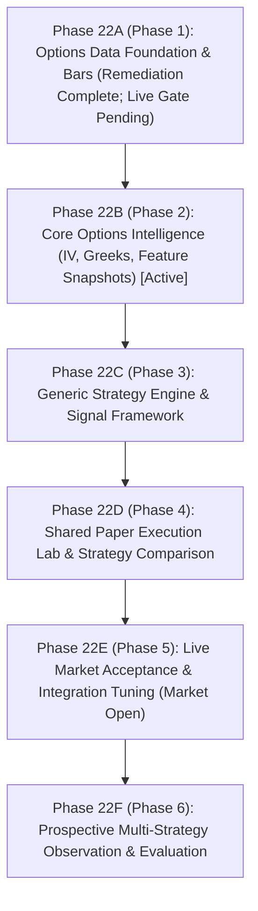

# Nomad Analyst — F&O Implementation Phase Roadmap (Authoritative Phase 22 Execution Plan)

**Document Reference:** `docs/research/fno/fno_phase_roadmap.md`  
**Revision Date:** 2026-10-17  
**Revision Version:** 2.0.0 (Revised Autonomous Execution Plan: Phase 22A–22F)  
**Auditor:** Quantitative Researcher & Systems Architect  
**Status:** RATIFIED AUTHORITATIVE ROADMAP — OFFLINE DEVELOPMENT AUTHORIZED  

---

## 1. Roadmap Architecture & Execution Boundaries

The development of the Nomad Analyst F&O Options Intelligence Pillar is structured into sequential, dependency-ordered phases under the **Phase 22 Program Architecture (Phases 22A through 22F)**.

> [!IMPORTANT]
> **Production Validation vs. Offline Development Rule:**  
> Live market acceptance is a **production-validation gate, not a blocker for offline development**. Offline development of Core Options Intelligence (Phase 22B), Generic Strategy Engine (Phase 22C), and Paper Trading & Strategy Comparison (Phase 22D) proceeds immediately against deterministic test fixtures and verified interfaces. Live acceptance is executed at next market open (Phase 22E).

### Phase Nomenclature & Alias Mapping:
- **Phase 22A** (legacy alias *Phase 1*): Data foundation, 184-byte normalizer, 1-minute OHLCV+OI bars, quote snapshots. (Targeted remediation complete; live acceptance deferred to Phase 22E).
- **Phase 22B** (legacy alias *Phase 2*): Core Options Intelligence — Black-Scholes Greeks, IV inversion with Brent's method, quote quality, feature snapshots (`OptionFeatureSnapshot`).
- **Phase 22C** (legacy alias *Phase 3*): Generic Strategy Engine — `BaseStrategy`, dynamic config, standardized `OptionSignal`, signal validation gates. Initial scope: Long NIFTY index CE/PE only.
- **Phase 22D** (legacy alias *Phase 4*): Shared Paper Execution Lab — Conservative quote-based taker fills, statutory fee engine, zero-bid/settlement separation, PostgreSQL paper ledger, multi-strategy comparison matrix.
- **Phase 22E** (legacy alias *Phase 5 Stage 1*): Live Market Acceptance — 09:08–09:20 IST pre-market and market-hours tick verification, dynamic ATM rebalancing validation, and reconnect tuning.
- **Phase 22F** (legacy alias *Phase 6*): Prospective Parallel Paper Experiment & Review — Multi-strategy observation window and statistical decision matrix.

---

## 2. Phase-by-Phase Scope & Disentangled Acceptance Criteria

### Phase 0: Architecture, Empirical Research & Data-Contract Approval
- **Objective:** Establish quantitative foundations, audit existing codebase for reuse vs. isolation, verify regulatory empirical statistics (SEBI August 2026 reports, NSE Circular `NSE/FA/73061`), map Kite Connect 184-byte binary packets, and ratify canonical data contracts.
- **Execution Status:** **CURRENT PHASE (Documentation-Only)**.
- **In-Scope Components:**
  - Complete factual audit of `nomad-analyst` codebase (`fno_repository_audit.md`).
  - Regulatory loss evidence and microstructure analysis (`fno_research_landscape.md`).
  - Mathematical hypothesis formulations (`fno_strategy_evidence_register.md`).
  - Kite Connect WebSocket and REST capability matrix (`fno_data_feasibility_and_costs.md`).
  - Canonical specification (`fno_core_engine_and_strategy_lab_spec.md`).
- **Measurable Acceptance Criteria:**
  - **AC-0-01** `[Design Requirement]`: 100% agreement across all research documents under `docs/research/fno/`.
  - **AC-0-02** `[Design Requirement]`: Canonical specification establishes explicit, versioned contracts for features, strategies, signals, and ledgers.
  - **AC-0-03** `[Verification Requirement]`: Zero application code, tests, migrations, dependencies, or database records modified.

---

### Phase 1: Isolated Options Data Foundation, Bars & Quote Snapshots
- **Objective:** Establish an isolated data-capture pipeline for NIFTY 50 index options within an independent `fno/` Django application. Captures real-time WebSocket ticks, preserves Open Interest, stores timestamped bid/ask and depth snapshots for Phase 4 realistic fills, and persists 1-minute OHLCV+OI bars with zero interference to the existing equity pipeline.
- **Execution Status:** **PENDING OPERATOR AUTHORIZATION**.
- **In-Scope Components:**
  - Dedicated `fno/` Django application registration.
  - `OptionInstrumentRegistry` parsing daily `kite_instruments_master.csv` with authoritative contract expiry dates and stale master detection.
  - Stateful **Desired-Universe Reconciliation Loop**: calculates $\mathcal{U}_{\text{desired}} \setminus \mathcal{U}_{\text{active}}$ and $\mathcal{U}_{\text{active}} \setminus \mathcal{U}_{\text{desired}}$ based on spot price, resolved ATM strike, active weekly expiry, and configured strike window ($K=5$). Includes periodic 60s reconciliation, reconnect recovery, and configurable next-weekly staging policy.
  - `OptionNormalizer` unpacking 184-byte `MODE_FULL` packets (fixed quote fields in bytes 0–64; market depth in bytes 64–184 comprising 120 bytes across 10 entries of 12 bytes each).
  - Defensive parsing: handles valid zero OI ($OI=0$), unpopulated/missing OI (`None`), sparse depth (0 to 5 levels), locked quotes (`bid == ask`), crossed quotes (`bid > ask`), volume resets, and timestamp anomalies.
  - **Independent Quote Freshness & Timestamp Validation:** Measures quote age strictly from exchange timestamp independently of last trade time. Fallback timestamps do not certify quote freshness and are marked execution-ineligible.
  - Dedicated `OptionOHLCVBar` model and 1-minute candle rollup engine with compound unique constraints.
  - **Quote Snapshot Persistence (`OptionQuoteSnapshot`):** Persists high-frequency bid/ask and depth snapshots with compound indexing (`instrument_token`, `exchange_timestamp_utc DESC`) and rolling 5-day retention policy to support realistic taker fills in Phase 4.
  - Reconnection reconciliation restoring active token subscriptions in `MODE_FULL` after network drops.
  - Dedicated unit-test suite in `fno/tests/`.
- **Explicit Exclusions:** No trading signals, no strategy rules, no paper-trade fills, no live orders, no stock options, no Bank Nifty, and no option selling.
- **Disentangled Acceptance Criteria:**
  - **AC-1-U01** `[Unit-Test Requirement]`: `OptionInstrumentRegistry` parses daily CSV, treats master `expiry` date as authoritative, and detects stale master files.
  - **AC-1-U02** `[Unit-Test Requirement]`: `OptionNormalizer` unpacks 184-byte packets with valid zero OI, unpopulated OI (`None`), sparse depth (120 bytes), and locked/crossed quote classification.
  - **AC-1-U03** `[Unit-Test Requirement]`: Desired-universe reconciliation correctly calculates tokens to subscribe and unsubscribe on spot movements and expiry rolls.
  - **AC-1-U04** `[Unit-Test Requirement]`: 1-minute `OptionOHLCVBar` persistence engine is idempotent and prevents duplicate rows under compound unique constraint.
  - **AC-1-U05** `[Unit-Test Requirement]`: `OptionQuoteSnapshot` persists depth JSONB and bid/ask, rejects timestamps with future skew $>2.0$s, handles fallback timestamps without marking them fresh, and supports fast indexed queries.
  - **AC-1-L01** `[Live Acceptance Test]`: Streaming live NFO option ticks concurrently produces zero errors or state mutations in `IntradayStateManager` and zero rows in `market_ohlcvbar`.
  - **AC-1-L02** `[Live Acceptance Test]`: 1-minute `OptionOHLCVBar` records persist with strictly accurate `open_interest` and volume deltas across continuous trading.
  - **AC-1-L03** `[Live Acceptance Test]`: Reconnection recovery resubscribes all active tokens in `MODE_FULL` within 5 seconds of WebSocket reconnect during market hours.
  - **AC-1-L04** `[Live Acceptance Test]`: `OptionQuoteSnapshot` records persist with valid quote classifications and $\le 3.0$s quote ages during live trading.

---

### Phase 2: Core Intelligence Engine & Validated Feature Snapshots
- **Objective:** Transform raw normalized option ticks and bars into standardized, reproducible feature snapshots (`OptionFeatureSnapshot`) combining contract microstructure, verified underlying index context, market regime, breadth, and Black-Scholes Greeks.
- **Execution Status:** **PLANNED**.
- **In-Scope Components:**
  - `OptionFeatureEngine`: Generates immutable, timestamped feature snapshots on 1-minute candle close with complete provenance metadata (`snapshot_version`, `engine_git_commit`, `calculation_timestamp_utc`).
  - Underlying index volume semantics: Cash index has no native volume; underlying VWAP and RVOL are explicitly sourced from active near-month futures (`NIFTY-FUT`). Set to `None` with `vwap_source = "UNAVAILABLE"` if unpopulated.
  - Real-time Black-Scholes Greeks calculator: Implied Volatility (IV via Brent's method), Delta, Gamma, Theta, Vega, with robust failure handling (`greeks_status = "CALCULATION_FAILED"` on arbitrage violations or convergence failures).
  - Data-quality and quote classification: distinguishing locked quotes (`bid == ask`), crossed quotes (`bid > ask`), stale quotes (>3.0s), empty books, and partial bars across reconnect gaps.
- **Disentangled Acceptance Criteria:**
  - **AC-2-U01** `[Unit-Test Requirement]`: Emits standardized `OptionFeatureSnapshot` schema with 100% compliance across all data types, triple timestamps, independent quote age, and provenance metadata.
  - **AC-2-U02** `[Unit-Test Requirement]`: Greeks calculations match Black-Scholes benchmark within $\pm 0.01\%$ precision; handles inversion failure gracefully.
  - **AC-2-U03** `[Unit-Test Requirement]`: Accurately classifies locked quotes (`bid == ask`), crossed quotes (`bid > ask`), stale quotes, and missing futures volume.
  - **AC-2-L01** `[Live Acceptance Test]`: Feature snapshots generated within 500ms of minute candle close during continuous market hours.

---

### Phase 3: Generic Strategy Interface & Signal Framework
- **Objective:** Establish isolated, versioned strategy module architecture and standardized signal contracts.
- **Execution Status:** **PLANNED**.
- **In-Scope Components:**
  - Abstract `BaseStrategy` class defining pure, deterministic lifecycle: `initialize()`, `on_feature_snapshot()`, and `on_trade_event()`.
  - Dynamic strategy configuration and semantic versioning (`StrategyConfig`).
  - Standardized `OptionSignal` model containing target instrument, action (`BUY_TO_OPEN`, `EXIT_TARGET`, `EXIT_STOP`, `EXIT_TIME`, `EXIT_EOD`), suggested lot count, limit price hint, max acceptable slippage, risk envelope, and audit rationale.
  - Signal validation engine rejecting malformed or out-of-bounds signals, and prohibiting signals referencing partial, locked, crossed, or fallback-timestamp bars.
- **Disentangled Acceptance Criteria:**
  - **AC-3-U01** `[Unit-Test Requirement]`: `BaseStrategy` enforces complete state isolation between multiple strategy instances.
  - **AC-3-U02** `[Unit-Test Requirement]`: Emits standardized `OptionSignal` instances adhering strictly to Pydantic contract.
  - **AC-3-U03** `[Unit-Test Requirement]`: Signal validator rejects any signal referencing stale, locked, crossed, or fallback-timestamp feature snapshots.

---

### Phase 4: Shared Paper Execution Lab & Independent Strategy Evaluation
- **Objective:** Build the realistic simulated order execution engine evaluated against persisted quote snapshots, separating continuous market exits from official expiry settlements, handling unexecutable zero-bid exits without fabrication, verified statutory fee engine, and independent paper trade ledgers.
- **Execution Status:** **PLANNED**.
- **In-Scope Components:**
  - Realistic taker execution engine evaluating entries at `Best Ask + Slippage` and continuous market exits at `Best Bid - Slippage` using `OptionQuoteSnapshot`.
  - Execution microstructure rejection gates: unverified timestamps, stale quotes (>3.0s), locked quotes (`bid == ask`), crossed quotes (`bid > ask`), empty books, and excessive spreads (>2.5%).
  - **Separation of Market Exits from Expiry Settlement:** Continuous market exits cross the order book; official expiry settlement resolves via `SETTLEMENT` fill type with zero slippage.
  - **Zero-Bid Exit & Pending Settlement Handling:** Positions with zero bids are marked unexecutable (`EXIT_UNEXECUTABLE_ZERO_BID`) without fabricating fills. On expiry day post-15:30 IST, positions enter `PENDING_EXPIRY_SETTLEMENT` until official settlement price/fees are verified. Expired contracts are strictly prevented from entering next-session exit retries.
  - Verified statutory fee engine: Pre-implementation verification against actual broker contract notes and circulars required.
  - Independent database ledger table: `fno_paper_trade_ledger` tracking entries, exits, slippage, friction breakdowns, holding durations, and regime tags separately per strategy.
- **Disentangled Acceptance Criteria:**
  - **AC-4-U01** `[Unit-Test Requirement]`: Simulated entry fills execute against persisted quote snapshots at `Best Ask + Slippage`; continuous market exits execute at `Best Bid - Slippage`.
  - **AC-4-U02** `[Unit-Test Requirement]`: Zero-bid exits are marked unexecutable without fabricating fills; official expiry settlements resolve via `SETTLEMENT` fill type with zero slippage or enter `PENDING_EXPIRY_SETTLEMENT`.
  - **AC-4-U03** `[Unit-Test Requirement]`: Expired contracts are strictly prevented from entering next-session exit retries.
  - **AC-4-U04** `[Unit-Test Requirement]`: Statutory fee engine calculations match verified regulatory formulas to the exact paisa (Decimal `0.01`).
  - **AC-4-U05** `[Unit-Test Requirement]`: Multiple strategies executing concurrently write strictly to independent ledger rows with zero cross-contamination.

---

### Phase 5: Prospective One-Month Parallel Paper Experiment
- **Objective:** Execute multiple candidate strategies simultaneously in live market conditions across a prospective one-month evaluation window (~20–22 trading sessions) to gather empirical distribution data.
- **Execution Status:** **PLANNED**.
- **In-Scope Components:**
  - Parallel runtime execution of candidate strategy modules against live incoming feature snapshots.
  - Real-time simulated order processing and position state management.
  - Daily automated reconciliation of executed paper trades, gross vs. net P&L, and friction drag ratios.
  - Regime-decomposed performance categorization (trending vs. sideways, low VIX vs. high VIX).
  - Statistical uncertainty estimation: sample size $N$, standard error of expectancy, and $t$-statistic.
  - Sample size tier resolution: $N < 20$ rejected; $20 \le N \le 29$ conditional with 2-week paper extension; $N \ge 30$ adequate for full evaluation.
- **Epistemic Constraint:** One month is an initial evaluation window to verify execution feasibility and reject unprofitable hypotheses; it is NOT proof of long-term alpha.
- **Disentangled Acceptance Criteria:**
  - **AC-5-L01** `[Live Acceptance Test]`: All candidate strategies run continuously in parallel across 1 full calendar month without crashing or corrupting data.
  - **AC-5-O01** `[Operational Requirement]`: Daily automated ledger reconciliation logs 100% of trades with zero missing friction fields.
  - **AC-5-S01** `[Statistical Requirement]`: Each evaluated strategy records $N \ge 30$ executed trades across the month (or triggers a mandatory 2-week extension if $20 \le N \le 29$).

---

### Phase 6: Evidence-Based Review & Production Gate
- **Objective:** Evaluate prospective paper-trading outcomes against the multi-metric decision matrix, rank strategies, and make formal development decisions.
- **Execution Status:** **PLANNED**.
- **In-Scope Components:**
  - Multi-metric evaluation against falsification gates: Gross Expectancy $> +1.5\%$, Friction Drag Ratio $< 35\%$, Net Profit Factor $\ge 1.25$, Max Drawdown $< 15\%$, $t\text{-statistic} > 1.8$.
  - Anti-Curve-Fitting Gate: No strategy is selected or certified based on Total Net P&L alone.
  - Production readiness audit and operator certification gate.
- **Disentangled Acceptance Criteria:**
  - **AC-6-A01** `[Audit Requirement]`: Formal post-experiment audit report published with complete trade logs, regime breakdowns, and uncertainty bands.
  - **AC-6-D01** `[Decision Gate]`: Operator sign-off approving either (a) advancement to pilot live trading, (b) strategy refinement, or (c) permanent hypothesis rejection.

---

## 3. Summary Comparison of Implementation Phases

| Phase Identifier | Legacy Alias | Title | Primary Focus | App / Layer | Status |
| :---: | :---: | :--- | :--- | :--- | :---: |
| **Phase 22A** | Phase 1 | **Options Data Foundation & Quotes** | 184-byte normalizer, registry, 1m bars, quote snapshots | `fno/` ingestion | **REMEDIATION VERIFIED (Live Gate Pending)** |
| **Phase 22B** | Phase 2 | **Core Options Intelligence** | Standardized `OptionFeatureSnapshot`, Black-Scholes Greeks, Brent IV | `fno/services/` | **ACTIVE IMPLEMENTATION** |
| **Phase 22C** | Phase 3 | **Generic Strategy Engine** | `BaseStrategy`, validation gates, `OptionSignal`, dynamic config | `fno/strategies/` | **ACTIVE IMPLEMENTATION** |
| **Phase 22D** | Phase 4 | **Paper Trading & Strategy Lab** | Taker fills, statutory fee engine, settlement separation, PostgreSQL ledger | `fno/execution/` | **ACTIVE IMPLEMENTATION** |
| **Phase 22E** | Phase 5 | **Live Acceptance & Tuning** | 09:08–09:20 pre-open/live feed acceptance, ATM dynamic rebalance, tuning | Operations / Live Gate | **SCHEDULED (Monday Open)** |
| **Phase 22F** | Phase 6 | **Prospective Multi-Strategy Observation** | Multi-strategy observation window, statistical decision matrix | `fno/lab/` | **PLANNED** |

