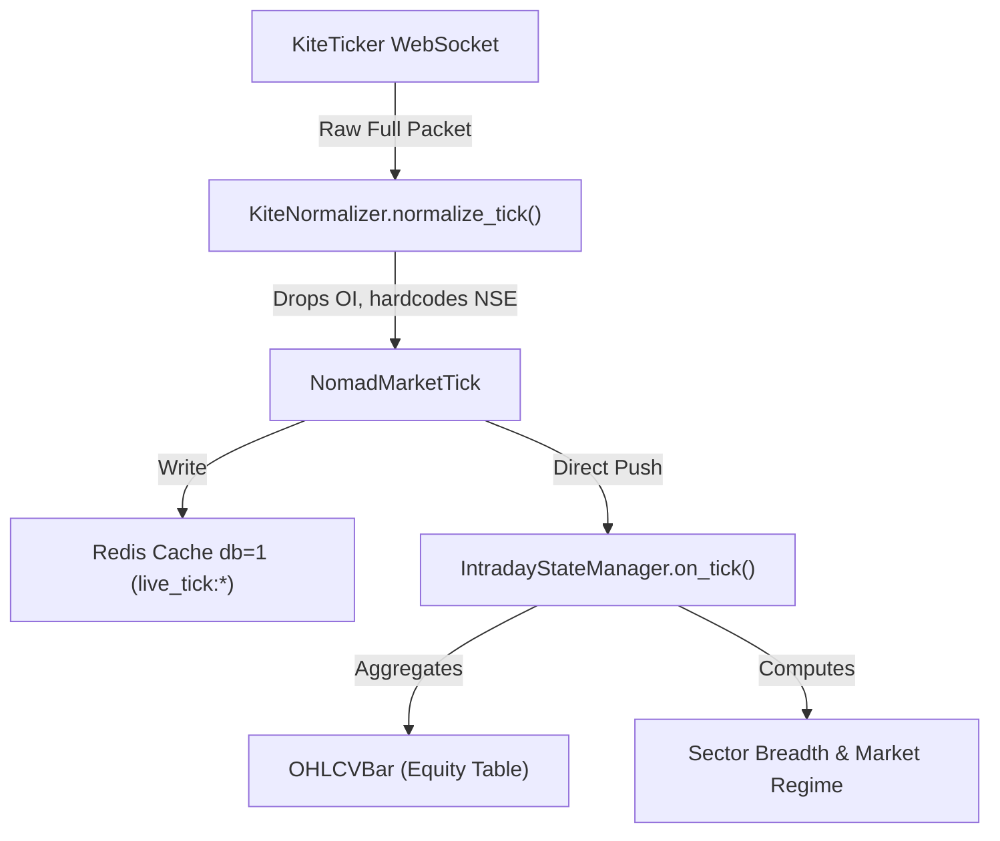
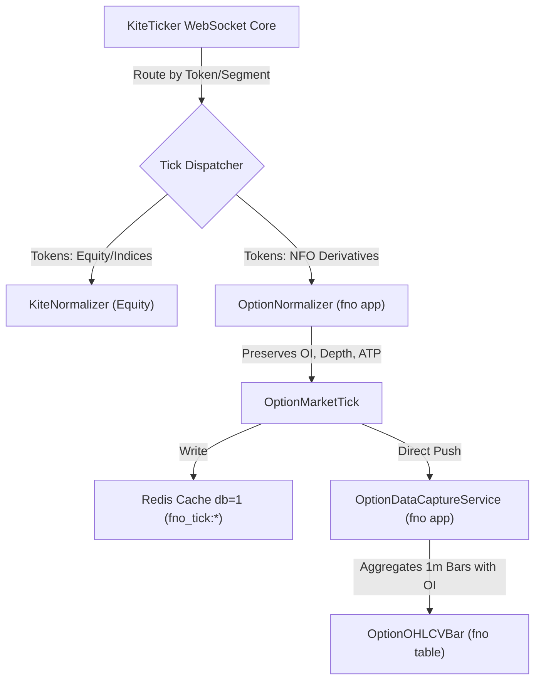

# Nomad Analyst — F&O Research: Codebase & Infrastructure Audit (Reconciled)

**Document Reference:** `docs/research/fno/fno_repository_audit.md`  
**Revision Date:** 2026-10-17  
**Auditor:** Quantitative Researcher & Systems Architect  
**Audit Status:** RATIFIED — RECONCILED WITH CANONICAL ARCHITECTURE SPECIFICATION  

---

## 1. Executive Summary & Audit Purpose

This document provides a factual, line-by-line architectural audit of the Nomad Analyst codebase to determine the reuse potential, limitations, and required isolation boundaries for an upcoming **F&O Options Pillar**.

### Canonical Specification Reference:
The full data contracts, feature schemas, strategy interfaces, execution models, and evaluation matrix are authoritatively specified in:  
👉 [`docs/research/fno/fno_core_engine_and_strategy_lab_spec.md`](file:///Users/shivamsingh/personal/nomad-analyst/docs/research/fno/fno_core_engine_and_strategy_lab_spec.md)

### Integrity & Verification Standards:
- **Verified:** Directly inspected in source files and confirmed by repository inspection.
- **Inferred:** Architecturally derived from structural code patterns.
- **Untested in F&O Context:** Components that function in equity/index streaming but have not been executed or validated with live NFO derivative payloads.
- **Blocked / Incompatible:** Existing components that cannot accept derivative payloads without causing state corruption or data truncation.
- **Security Standard:** No account identifiers, credentials, or session tokens are exposed.

---

## 2. Reusability & Compatibility Matrix

| File Path & Line Numbers | Component / Class | Core Purpose | Existing Consumers | F&O Reusability Classification | Technical Audit Finding |
| :--- | :--- | :--- | :--- | :--- | :--- |
| [`market/services/kite_auth.py:L45-L80`](file:///Users/shivamsingh/personal/nomad-analyst/market/services/kite_auth.py#L45-L80) | `KiteCredentialService` | Manages daily 2FA login, Fernet token encryption, session status, and valid access token retrieval. | `KiteTickerManager`, `KiteHistoricalIngestionService`, API views. | **REUSE UNCHANGED (Verified)** | Authenticated session retrieval is fully operational and shared across all Kite Connect services. Zero modifications needed. |
| [`market/services/kite_registry.py:L100-L140`](file:///Users/shivamsingh/personal/nomad-analyst/market/services/kite_registry.py#L100-L140) | `KiteInstrumentRegistry` | Parses local `kite_instruments_master.csv` into memory for symbol-to-token lookups. | `KiteTickerManager`, `IntradayStateManager`. | **INSUFFICIENT FOR F&O — REQUIRES ISOLATED EXTENSION (Verified)** | In `load_master()`, lines 108–113 explicitly index only `NSE:EQ` and `segment == "INDICES"` into `_symbol_to_token`. All 41,336 NFO derivative instruments are parsed into `_cache_master` but excluded from token lookups. Dynamic weekly expiry and strike resolution logic does not exist. |
| [`market/services/kite_ticker.py:L88-L140`](file:///Users/shivamsingh/personal/nomad-analyst/market/services/kite_ticker.py#L88-L140) | `KiteTickerManager` | Threaded WebSocket client managing connection, heartbeats, callbacks, and Redis caching. | `run_intraday_ticker` management command. | **REUSE WEBSOCKET CORE, ISOLATE TICK DISPATCH (Verified)** | Underlying `kiteconnect.KiteTicker` connection engine is stable. However, `_on_ticks` (lines 128–132) blindly routes all normalized ticks directly to `IntradayStateManager().on_tick()`. Pushing option ticks into this pipeline will corrupt equity market breadth, advance/decline ratios, and sector tracking. Tick dispatch must be isolated. |
| [`market/normalizers/kite.py:L26-L50`](file:///Users/shivamsingh/personal/nomad-analyst/market/normalizers/kite.py#L26-L50) | `NomadMarketTick` | Provider-agnostic tick data structure. | Ticker manager, cache, state manager. | **INCOMPATIBLE WITH F&O — REQUIRES ISOLATED NORMALIZER (Verified)** | Field `exchange` defaults to `"NSE"` (line 282). Crucially, **Open Interest (`oi`, `oi_day_high`, `oi_day_low`) is completely dropped**. In options trading, OI is critical for volume-weighted liquidity and strike participation. |
| [`market/models.py:L220-L260`](file:///Users/shivamsingh/personal/nomad-analyst/market/models.py#L220-L260) | `OHLCVBar` | Model storing historical and intraday candle data. | Historical providers, aggregation engines. | **INSUFFICIENT FOR F&O (Verified)** | Stores `open`, `high`, `low`, `close`, `volume`, `vwap`. Has no column for `open_interest` or derivative metadata (strike, option_type, expiry). Storing option bars requires a dedicated `OptionOHLCVBar` model to prevent bloating the equity table (currently 87,503 bars). |
| [`market/services/intraday_state_manager.py:L60-L110`](file:///Users/shivamsingh/personal/nomad-analyst/market/services/intraday_state_manager.py#L60-L110) | `IntradayStateManager` | Aggregates 1m/5m/15m bars, computes sector momentum, and evaluates market regime. | Celery tasks, REST API, WebSocket consumers. | **DO NOT REUSE — STRICT ISOLATION REQUIRED (Verified)** | Hardcoded for NIFTY 50 equity universe and 14 sectors. Processing derivative ticks here will cause KeyError or corrupt equity breadth metrics. |
| [`market/models.py:L310-L380`](file:///Users/shivamsingh/personal/nomad-analyst/market/models.py#L310-L380) | `StockRecommendation` | Immutable model for equity signals and trade lifecycle. | Signal engines, strategy scanners. | **REFERENCE ONLY — DO NOT INHERIT DIRECTLY (Verified)** | Designed for equities with fields like `sector`, `fundamental_score`, `target_horizon`. F&O options paper trading requires strike, premium, option type, delta, IV, and distinct contract exit states. |

---

## 3. Data Flow & Architectural Boundary Audit

### A. Current Equity Streaming Flow (Verified)


### B. Required Isolated Options Capture Flow (Architecture Specification)
To prevent regression or contamination of the existing equity system, the F&O capture pipeline must run through an isolated path:


---

## 4. Key Limitations & Design Constraints Discovered

1. **Token Indexing Gap in Registry:**  
   `KiteInstrumentRegistry.load_master()` filters by:
   ```python
   if exchange == "NSE" and inst_type == "EQ":
       symbol_to_token[tradingsymbol] = token
   elif segment == "INDICES":
       symbol_to_token[tradingsymbol] = token
   ```
   All 41,336 NFO instruments in `data/universe/kite_instruments_master.csv` are skipped for direct lookup. A dedicated `OptionInstrumentRegistry` in the `fno` app must parse and index `NFO-OPT` instruments by `(underlying, expiry, strike, option_type)`.

2. **Tick Normalization Data Loss:**  
   `NomadMarketTick` lacks fields for:
   - `open_interest` (`oi`)
   - `oi_day_high`, `oi_day_low`
   - `strike_price`
   - `option_type` (`CE` / `PE`)
   - `expiry_date`
   - `exchange` (hardcoded to `"NSE"`)

3. **Database Performance Separation:**  
   The `market_ohlcvbar` table currently holds 87,503 equity bars. Adding 1-minute bars for 20+ option contracts across trading days would add ~7,500 rows per day. Placing derivative bars in the equity table would degrade query performance for equity strategies. An isolated `fno_option_ohlcvbar` table is strictly necessary.

---

## 5. Audit Conclusion

The Nomad Analyst codebase possesses all required foundational components (authentication, WebSocket client, caching, task scheduling) to support F&O data capture. However, **reusing equity pipelines directly is architecturally prohibited** due to data loss (`oi`) and market breadth contamination. 

Phase 1 must implement an isolated `fno/` application with dedicated normalization, registry, and persistence layers, adhering to the canonical specification [`docs/research/fno/fno_core_engine_and_strategy_lab_spec.md`](file:///Users/shivamsingh/personal/nomad-analyst/docs/research/fno/fno_core_engine_and_strategy_lab_spec.md).
